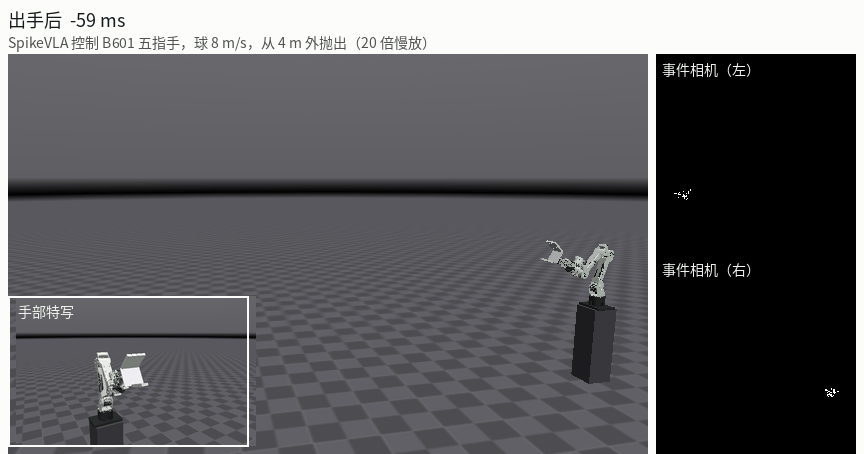
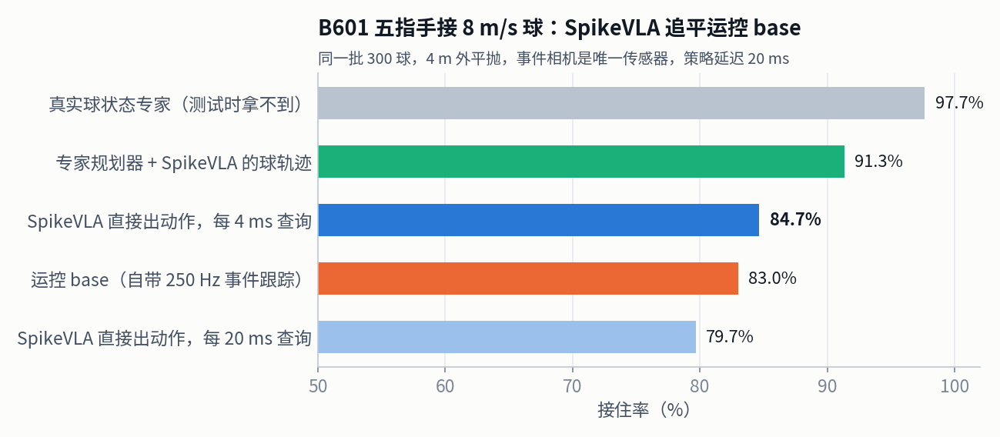
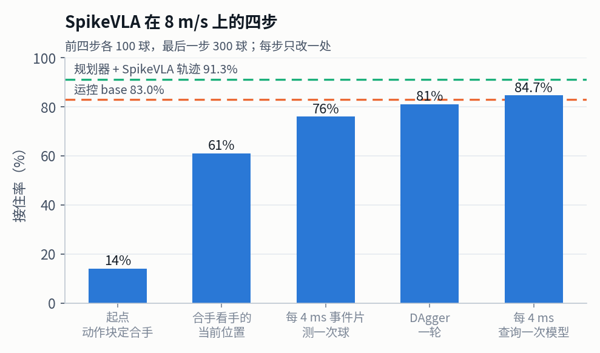
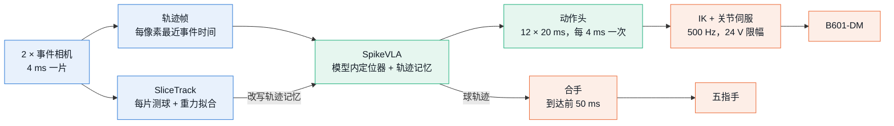
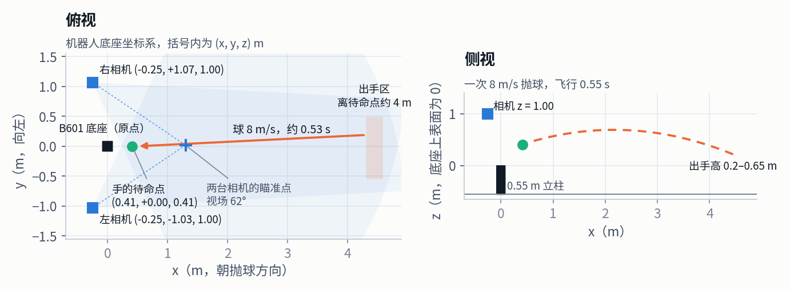
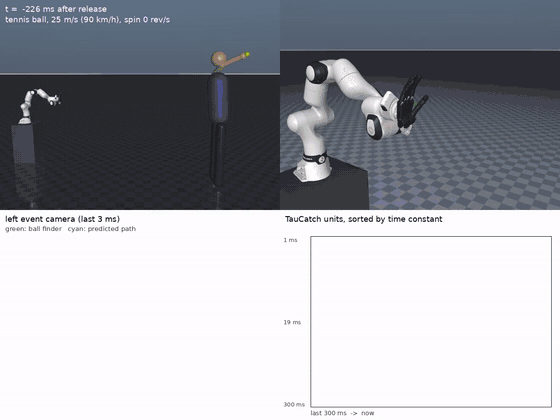
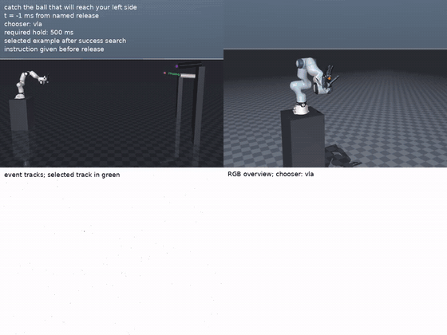

<div align="center">

# TauCatch

**SpikeVLA 只看两路事件相机，控制 B601 机械臂和五指手，接住 4 m 外抛来的 8 m/s 球**


-1baf7a)



<sub>MuJoCo 仿真，20 倍慢放。右侧是两路事件相机的轨迹帧，也是模型唯一的输入；左下是手部特写。球飞行约 0.53 s。</sub>

</div>

球出手后 85 ms 内，SpikeVLA 在模型内找到球、测出轨迹；此后每 4 ms 给出一段 12 × 20 ms 的末端动作，500 Hz 的 IK 和关节伺服执行，手在球到达前 50 ms 合拢。测试时不用任何真值，从拍到事件到动作生效按 20 ms 延迟计，臂按 24 V 电机的力矩–转速线限幅。

## 结果



| 同一批 300 球，8 m/s，4 m 外 | 接住 |
|---|---|
| 真实球状态专家（上限参照） | 97.7% |
| 专家规划器 + SpikeVLA 的球轨迹 | 91.3% |
| **SpikeVLA 直接出动作** | **84.7%** |
| 运控 base（250 Hz 事件跟踪 + 专家规划器） | 83.0% |

SpikeVLA 追平运控 base；它的球轨迹比 base 的好（接同一个规划器多 8 个点）。动作头剩下的差距在手的位置上：位置换成规划器的输出就到 90.0%。



细节、瓶颈分析和低速多球场景见 [SpikeVLA 接球](docs/spikevla_catch.md)。

## 系统



| | |
|---|---|
| 模型 | SpikeVLA（ICML 版 SGSA 视觉 + 动作头），推理 3.08 ms |
| 训练 | 真实球状态专家示教 + DAgger（自身轨迹上重新标注） |
| 运控 base | 不用网络：同一事件流做多球跟踪、双目、重力拟合，接专家规划器和合手规则 |

## 快速开始（仿真）

```bash
git clone https://github.com/wxqnl/taucatch.git && cd taucatch
pip install -r requirements/vla_catch.txt
tools/fetch_b601.sh                      # B601 的 URDF 和网格（上游无许可证，不随仓库分发）

export MUJOCO_GL=osmesa PYOPENGL_PLATFORM=osmesa VLA_AIM_X=1.3   # 有 EGL 时可用 MUJOCO_GL=egl
J="--arm b601 --catcher hand --hand-rate 285 --hand-open .26 --lead .05 --bounce .5 --volts 24 --blend .5 --throw-speed 8 --throw-from 4"

# 运控 base（只用本仓库代码）
python -m taucatch.vla_catch.baseline --select named $J --tosses 100 --out base.json
# SpikeVLA（需要 vendor/spikevla_icml 和权重，见下）
python -m taucatch.vla_catch.evaluate --ckpt runs_v2/saim_r1_b601/ema_3000.pt --latency .02 --fast \
    --close-track --close-hand --slice-track --query-every 0.004 $J --tosses 100 --out ours.json
```

CPU 渲染每球约 40 s，按 `--seed` 拆成多进程并行。训练、DAgger、测量回放和画图命令见 [SpikeVLA 接球 §7](docs/spikevla_catch.md#7-复现)。

## 上真机



| 步 | 做什么 | 通过标准 |
|---|---|---|
| 1 标定 | 相机内外参（掌心 LED + 正运动学）、两相机同步，写回仿真 | 三角化误差 < 1 cm |
| 2 臂空跑 | 回放仿真接球的关节参考 | 手落后参考的距离与仿真相差 < 1 cm |
| 3 手 | 测合手用时 | 写进 `--lead` |
| 4 只看不动 | 人手抛 3–5 m/s，模型在线跑 | 推理 ≤ 4 ms，出手后 100 ms 球速误差 < 10 cm/s |
| 5 影子运行 | 出动作不执行 | 预测接球点误差 < 2 cm |
| 6 闭环 | 3 → 5 → 8 m/s，每档 ≥ 50 球 | 接住率可复现 |
| 7 数据回流 | 整段飞行事后拟合作标签，做 DAgger | 下一档更高 |

硬件清单、布置坐标、标定写回位置、三个硬件接口（`EventSource` / `ArmIO` / `HandIO`）和安全规则见 [在 B601 真机上跑](docs/real_robot.md)。

## 仓库结构

```text
taucatch/
├── taucatch/vla_catch/   当前主线：场景（OpenArm v1/v2、B601）、事件相机、专家、数据采集、
│                         SpikeVLA 策略与定位器、训练、闭环评测、运控 base
├── taucatch/             10 月的融合方案（事件快环 + SpikeVLA 修正）
├── tools/                画图、GIF、逐片测量与回放、B601 资产获取、交接校验
├── docs/                 文档与图（docs/figures/b601 是当前主线的图）
├── requirements/         vla_catch（当前主线）、replay / simulation / visualization（融合方案）
├── third_party/          MuJoCo Menagerie（FR3、Shadow、Allegro）、OpenArm 模型
└── artifacts/            融合方案的证据、权重与校验清单
```

## 文档

| 文档 | 内容 |
|---|---|
| [SpikeVLA 接球](docs/spikevla_catch.md) | 当前主线：结果、系统、每一步的改动、瓶颈、复现命令 |
| [在 B601 真机上跑](docs/real_robot.md) | 硬件、布置、标定、接口、上机顺序、安全 |
| [逐轮记录](docs/spikevla_catch_log.md) | 10-30 以来每一轮的设置、数字和结论 |
| [代码导航](docs/code_map.md) | 每个模块在哪个文件 |

## 早期路线：融合方案（10 月）

事件相机快环负责接住，SpikeVLA 只给 XYZ 位置修正。快环从事件流接住 12–25 m/s 的乒乓球和网球（落点在手附近时 70–94%），但 SpikeVLA 的修正在训练外投球上没有带来增益（4/6 vs 3/6），10-30 起改为 SpikeVLA 主导。

<details>
<summary>融合方案的演示与文档</summary>

| 网球 25 m/s，事件快环 | 按指令选球 |
|:-:|:-:|
|  |  |

[进展与真机计划](docs/roadmap.md) · [算法](docs/algorithm.md) · [结果与证据](docs/results.md) · [复现](docs/reproduction.md) · [硬件选型](docs/hardware.md) · [交接清单](docs/handoff.md)

```bash
python tools/handoff.py verify     # 按 SHA256 核对融合方案的证据、源码、权重和图（仅标准库）
python tools/handoff.py results    # 从原始记录重算 4/6 对 3/6 和飞行时延
```

</details>

## 依赖与许可

- SpikeVLA 代码（ICML 版本）放在 `vendor/spikevla_icml`，不随本仓库分发；当前主线的权重和数据（`runs_v2/`、`data_v2/`）也不在仓库内。
- B601 的 URDF 和网格来自 [reBotArm_control_py](https://github.com/Seeed-Projects/reBotArm_control_py)（提交 `d4f3591`），上游无许可证，由 `tools/fetch_b601.sh` 获取。
- MuJoCo Menagerie（提交 `cda5236`，见 [`third_party/`](third_party/README.md)）与 OpenArm 模型（[`third_party/openarm_mujoco`](third_party/openarm_mujoco/LICENSE)）保留各自的许可证。
- 本仓库的研究代码与权重暂未声明开源许可证。
