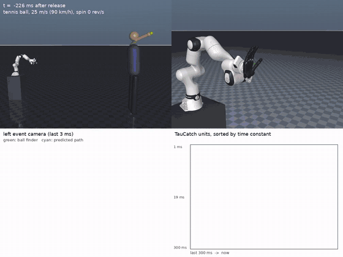
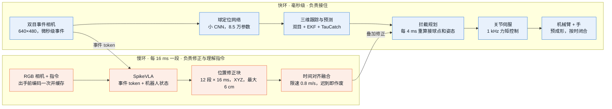
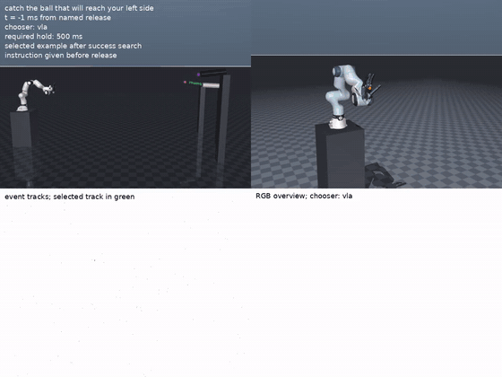
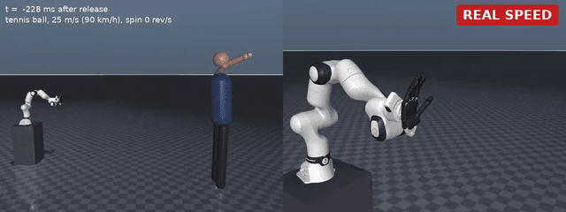
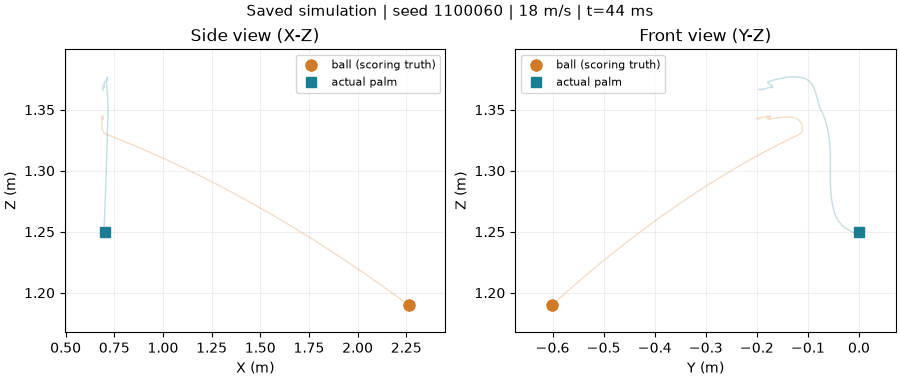
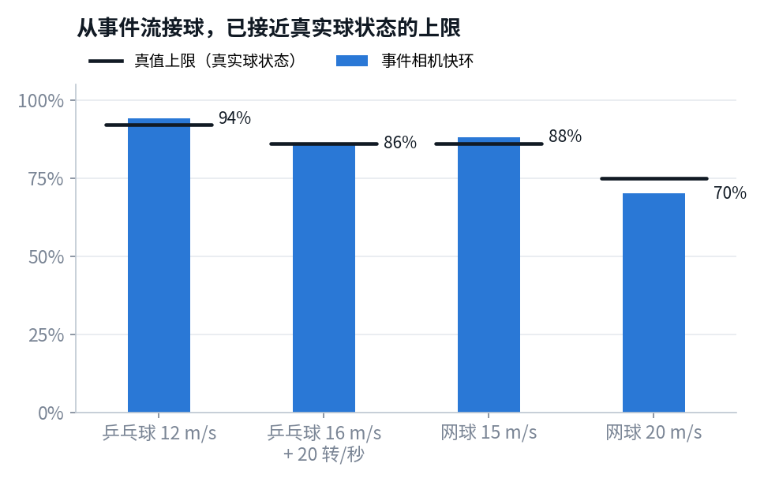
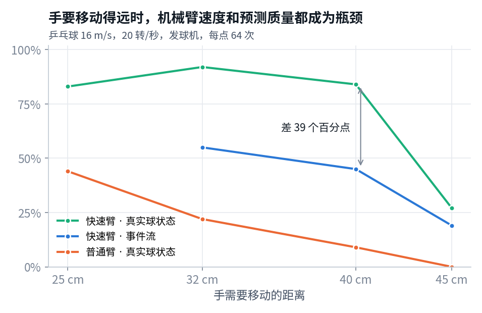
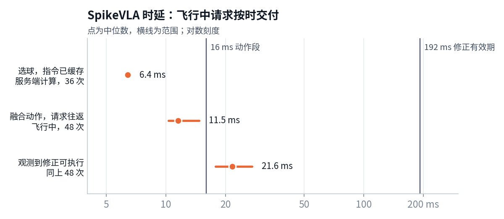

<div align="center">

# TauCatch

**用事件相机和 SpikeVLA 让机械臂在一次飞行内接住高速球**




<sub>网球 25 m/s，20 倍慢放。左下是事件相机看到的画面（绿圈为网络找到的球，青色为预测轨迹），右下是 TauCatch 神经元按时间常数排列的活动。出手后 111 ms 接触。</sub>

</div>

球从 3 m 外以 18 m/s 飞来，留给机械臂的时间不到 0.2 秒，1 ms 的误差等于球多飞 1.8 cm。TauCatch 用双目事件相机做毫秒级跟踪和预测，由快环负责把球接住；SpikeVLA 在慢环里给出位置修正，只在按时到达时才被采用。

## 目录

- [当前进展](#当前进展)
- [系统结构](#系统结构)
- [演示](#演示)
- [主要结果](#主要结果)
- [快速开始](#快速开始)
- [仓库结构](#仓库结构)
- [文档](#文档)
- [上真机](#上真机)
- [依赖与许可](#依赖与许可)

## 当前进展

| 模块 | 状态 | 说明 |
|---|---|---|
| 事件相机快环（仿真） | ✅ 可用 | 从事件流接住 12–25 m/s 的乒乓球和网球；落点在手附近时接住 70–94%，与真实球状态的上限相差不超过 5 个百分点 |
| TauCatch 预测网络 | ✅ 可用 | 多时间常数神经元在每个时刻都比单一时间常数预测得准；出手瞬间误差 20.2 cm，LSTM 为 29.1 cm |
| SpikeVLA 接入闭环 | ✅ 已接通 | 融合方案：飞行中请求往返中位 11.49 ms，修正按真实到达时间执行 |
| SpikeVLA 带来的增益 | ⚠️ 尚未证明 | 6 组训练外投球：快环单独 4/6，加 SpikeVLA 3/6 |
| SpikeVLA 端到端直接出动作 | ❌ 暂不可用 | 闭环 32 次只接住 0–1 次 |
| 真机 | ⚪ 未开始 | 路线、硬件和预算见[部署简报](docs/leader_brief.md) |

## 系统结构

两条回路并行。快环每毫秒控制机械臂，保证来得及接；慢环里的 SpikeVLA 每次给出 12 段、每段 16 ms 的 XYZ 位置修正（最大 6 cm，限速 0.8 m/s）。修正先经过时间对齐、限幅和过期检查，再叠加到快环的拦截目标上；超过 192 ms 有效期的修正直接作废，不会拖累快环。手掌朝向和闭合时机始终由快环控制。



下图是一次记录下来的接球（训练外投球 1100060，18 m/s，SpikeVLA 开启，接住）。四次修正请求都在有效期内到达。


## 演示

| 长距离：手移动 40 cm | 按指令选球 |
|:-:|:-:|
|  |  |
| 乒乓球 16 m/s，带 20 转/秒旋转。半透明的臂是起始位置，橙线是手掌走过的路径。207 ms 接触。 | 指令“接住会到达你左侧的那个球”。SpikeVLA 给每个球编号并选出目标，出手后 33 ms 选定，276 ms 接触。 |
| **真实速度（网球 25 m/s）** | **训练外投球 1100060 复演** |
|  |  |
| 整个过程约 0.11 秒，人眼几乎看不清。 | 18 m/s，SpikeVLA 开启，接住。由保存的球与掌心轨迹重绘。 |

## 主要结果

所有接球都在 MuJoCo 仿真中完成。“接住”指接触后在手里保持住，只碰到不算。

### 1. 从事件流接球，已接近真实球状态的上限

每组 64 次投球，落点在手附近 ±15 cm。真值上限是把真实球状态直接交给同一控制器的结果。



| 投球 | 事件相机快环 | 真值上限 |
|---|---:|---:|
| 乒乓球 12 m/s | 94% | 92% |
| 乒乓球 16 m/s，20 转/秒 | 86% | 86% |
| 网球 15 m/s | 88% | 86% |
| 网球 20 m/s | 70% | 75% |

### 2. 多时间常数的神经元，比任何单一时间常数都预测得准

快神经元一出手就给出初猜，慢神经元积累证据，修正旋转造成的弯曲。乒乓球预测误差（cm）：


| 出手后 | 0 ms | 10 ms | 20 ms | 50 ms | 100 ms | 150 ms |
|---|---:|---:|---:|---:|---:|---:|
| **TauCatch（多时间常数）** | **20.2** | **16.3** | **15.1** | **7.7** | **3.1** | **1.0** |
| 单一时间常数 10 ms | 30.4 | 17.1 | 16.2 | 9.9 | 4.3 | 2.2 |
| LSTM | 29.1 | 18.5 | 14.8 | 8.6 | 4.2 | 2.1 |

### 3. 手要移动得远时，机械臂速度和早期预测决定成败

乒乓球 16 m/s。“快速臂”约相当于手可达 4 m/s、4 g 的高速臂；“普通臂”约为 Panda 的 1.5 倍速度。



| 手移动距离 | 25 cm | 32 cm | 40 cm | 45 cm |
|---|---:|---:|---:|---:|
| 快速臂 · 真实球状态 | 83% | 92% | 84% | 27% |
| 快速臂 · 事件流 | 未测 | 55% | 45% | 19% |
| 普通臂 · 真实球状态 | 44% | 22% | 9% | 0% |

普通臂在手要移动 30 cm 以上时，即使知道真实轨迹也接不住；快速臂能接住，但事件流的早期预测偏差让一半的接球失败。这段差距是 SpikeVLA 最有机会带来增益的地方。

### 4. SpikeVLA 融合方案：训练外 6 组投球开关对比

同一冻结模型 `fusion-617`，同一组投球，各跑一次快环单独、一次快环加 SpikeVLA，共 12 次仿真、60 次真实模型请求。

| 投球 seed | 1100079 | 1100122 | 1100060 | 1100080 | 1100033 | 1100125 | 合计 |
|---|:-:|:-:|:-:|:-:|:-:|:-:|:-:|
| 球速 | 14 m/s | 14 m/s | 18 m/s | 18 m/s | 18 m/s | 18 m/s | |
| 快环单独 | ✅ | ✅ | ✅ | ✅ | ❌ | ❌ | **4/6** |
| + SpikeVLA | ✅ | ✅ | ✅ | ❌ | ❌ | ❌ | **3/6** |

在 3 个训练中失败的投球上，SpikeVLA 全部救回；这一收益还没有推广到训练外的投球。下一步用至少 50 组冻结留出投球做配对验证。详见[结果与证据](docs/results.md)。

### 5. 时延：飞行中的修正按时交付

| 测量（H100） | 次数 | 中位 | 范围 |
|---|---:|---:|---:|
| 飞行中请求往返（RPC） | 48 | 11.49 ms | 10.29–14.67 ms |
| 从观测到修正可执行 | 48 | 21.57 ms | 17.83–27.23 ms |
| 出手前选球（指令已缓存，服务端） | 36 | 6.4 ms | P95 6.5 ms |



最慢的一次修正 27.23 ms 到达，远小于 192 ms 的有效期。真机需要在部署用的 GPU 上对采集、计算、传输分段重测。

## 快速开始

```bash
git clone --recurse-submodules --shallow-submodules https://github.com/wxqnl/taucatch.git
cd taucatch
```

以下三步不需要 GPU，不会启动训练或实验：

```bash
python tools/handoff.py verify          # 按 SHA256 核对证据、源码、权重和图（仅标准库）
python tools/handoff.py results         # 从原始记录重算 4/6 对 3/6 和飞行时延（仅标准库）

python -m pip install -r requirements/replay.txt
CUDA_VISIBLE_DEVICES= python scripts/replay_fusion.py   # CPU 复演融合头，核对保存的 12×3 动作
```

复演只验证融合层计算和动作接口，不运行完整 SpikeVLA、事件感知或物理接球。

<details>
<summary><b>仿真环境、测试与重绘图</b></summary>

```bash
# 仿真依赖：MuJoCo 3.16、Ruckig、SciPy、Numba、PyTorch
python -m pip install -r requirements/simulation.txt
python -m unittest tests.test_action_chunk           # 动作块协议，10 项
python -m pytest tests/test_action_h192_195536.py     # 12×16 ms 时间网格，3 项，需要 pytest

# 重绘图
python -m pip install -r requirements/visualization.txt
python tools/plot_results.py                          # 6 组配对结果图
python tools/render_saved_trajectory.py               # 保存轨迹 GIF
python tools/plot_leader_brief.py docs/figures/leader # 部署简报中的图（需要中文字体）
```

渲染用 CPU 上的 OSMesa（`MUJOCO_GL=osmesa`）。修改代码或图后，先运行 `python tools/handoff.py refresh` 更新校验清单，再运行 `verify`。

</details>

完整闭环还需要两个上游仓库（Spike-driven-VLA 与 CTS 训练框架）、预训练权重和视觉/语言资产，这些不在本仓库内。版本、路径和 SHA 列在 [`artifacts/external_dependencies.json`](artifacts/external_dependencies.json)，步骤见[复现与训练](docs/reproduction.md)。

## 仓库结构

```text
taucatch/
├── taucatch/            算法实现：事件相机、球定位、EKF、TauCatch、拦截规划、IK、伺服、SpikeVLA 接口
├── scripts/             实验入口：数据采集、训练、推理服务、闭环评测、审计
├── tools/               交接与绘图：handoff.py（verify / results / refresh / build）、各类绘图脚本
├── tests/               动作块协议与时间网格测试
├── artifacts/
│   ├── evidence/        原始证据：6 组配对完成报告、逐次请求时间戳、训练记录、传输验收
│   ├── models/          fusion-617 adapter 与融合头权重
│   ├── examples/        CPU 复演样本、1100060 轨迹
│   └── MANIFEST.sha256  全部精选文件的校验清单
├── docs/                算法、结果、复现、代码导航、硬件、部署简报及其图
├── requirements/        replay / simulation / visualization 三组最小依赖
└── third_party/
    └── mujoco_menagerie/  子模块：FR3 机械臂、Shadow Hand、Allegro Hand 模型
```

## 文档

| 文档 | 内容 |
|---|---|
| [部署简报](docs/leader_brief.md) | 进展、上真机的三条路线、分阶段计划、硬件推荐与预算、风险 |
| [算法说明](docs/algorithm.md) | 输入输出、快慢环如何结合、动作块的时间规则 |
| [结果与证据](docs/results.md) | 配对成绩、时延、训练与问题定位，每项附原始记录 |
| [复现与训练](docs/reproduction.md) | 安装、CPU 复演、完整闭环依赖、训练方法 |
| [代码导航](docs/code_map.md) | 每个模块在哪个文件 |
| [硬件选型表](docs/hardware.md) | 机械臂、手、相机的选型依据与验收项 |
| [交接清单](docs/handoff.md) | 交接包内容、权重包、历史归档 |

## 上真机

真机走融合方案：快环负责接住，SpikeVLA 在慢环里做位置修正和指令理解。

| 阶段 | 内容 | 通过标准 |
|---|---|---|
| 0 | 按 FR3 真实限制重做仿真；把快环起步从 44 ms 提前到 0–5 ms；在部署 GPU 上分段计时 | 仿真复现，时延分段可查 |
| 1 | 搭台、标定、相机与机器人时间同步 | 同步误差 0.1–0.2 ms 量级 |
| 2 | 接球杯 + 快环基线，8–12 m/s 网球 | 每档球速至少 50 次 |
| 3 | SpikeVLA 开关配对对比 | 留出集上接住率净提升 |
| 4 | 灵巧手 + 按指令选球 | 选对并接住 |

起步硬件：Franka FR3 + 接球杯、双目 DVXplorer 事件相机、全局快门 RGB 相机、专用推理 GPU，约 4–6 万欧元（以询价为准）。首个真机目标为 8–12 m/s 网球。清单、对比和理由见[部署简报第 6–7 节](docs/leader_brief.md#6-上真机路线与分阶段计划)。

## 依赖与许可

- 仿真模型来自 [MuJoCo Menagerie](https://github.com/google-deepmind/mujoco_menagerie)（子模块，固定在 `cda5236`），各模型保留其原许可证。
- SpikeVLA 架构与训练框架来自配套上游仓库，不随本仓库分发。
- 本仓库的研究代码与权重暂未声明开源许可证。
