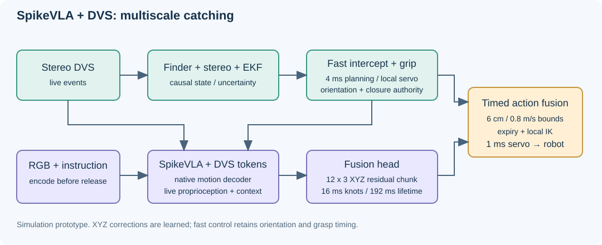

# 算法：DVS 快环＋SpikeVLA 慢环

目标是先接稳一个高速网球；固定指令为 `catch the ball`。当前验证环境是 MuJoCo，球速重点为 14、18 m/s。

| 模块 | 实际输入 | 输出与作用 | 时间尺度 |
|---|---|---|---|
| 事件感知 | 双目 DVS 事件窗口 | 学习型球定位、双目三维测量、EKF 轨迹及不确定性 | 感知按实测耗时交付；保留 8 ms 计算槽 |
| 运动快环 | 已交付轨迹、机器人当前状态 | 预测拦截位置与姿态，安排抓手闭合，局部 IK 与关节伺服 | 规划每 4 ms；仿真伺服每 1 ms |
| SpikeVLA | 释放前双视角 RGB＋指令；飞行中的 DVS、8D 状态、22D 快环/本体上下文 | 原生脉冲动作解码特征，经融合头生成 **12×3 XYZ 残差 action chunk** | 每段 16 ms，共 192 ms；推理异步按真实交付时间计费 |
| 动作融合 | 快环目标＋已送达的 VLA 残差 | 按观测时间插值、限幅、限速，过期后回到零修正 | 位置修正范数上限 6 cm，变化速率上限 0.8 m/s |

## SpikeVLA 具体做什么

1. 释放球之前编码 RGB 与文本，缓存条件，避免飞行时反复做完整外观编码。
2. 事件编码器将双目 DVS `[2,6,60,80]` 转为运动 token，与缓存条件及机器人状态一起送入原生动作头。
3. 读取动作解码器的 `[4,B,12,256]` 特征。对四个脉冲时间步做池化，与 22D 上下文拼接，再经过 `LayerNorm → Linear(278,128) → SiLU → Linear(128,3)`。
4. 将融合项加到原 XYZ 读出与上下文线性项，经过 `tanh` 输出归一化的 12×3 修正。
5. 只有动作实际到达消费者后才能使用；动作时间轴以**观测时刻**为起点。超出 192 ms 的包不能重新计时后执行。

上下文包括：已交付快环动作 7D、关节速度 7D、掌心速度 3D、位置误差 3D、视觉观测年龄及有效标记。在线路径不读取球的仿真真值；真值只用于评分及离线教师。

**当前保留快环对手掌朝向与抓手闭合的控制；VLA 修改 XYZ 连续轨迹。** 这是有学习动作参与的多时间尺度系统，仍有显式感知、规划和伺服模块。原生 7D 动作输出曾训练过，但当前执行路径没有直接执行它，不能表述成完整的图像到关节力矩端到端控制。

## 为什么这样分工

球在 18 m/s 时，20 ms 已移动约 36 cm。快速跟踪和提前拦截负责最紧迫的时间约束；VLA 学习快环没有建模好的动作偏差。是否值得加入 VLA，最终要用同分布、同延迟口径的开/关配对接稳率证明，而不能用动作误差或局部成功片段代替。

当前瓶颈是**动作修正对新几何的泛化不足**。独立几何上的退化发生在约 11 ms 的正常交付条件下，修正都按时到达，因此问题出在修正质量，不在时延。
