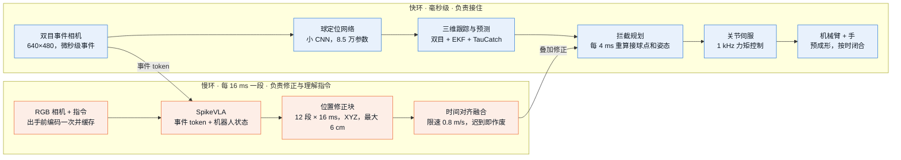
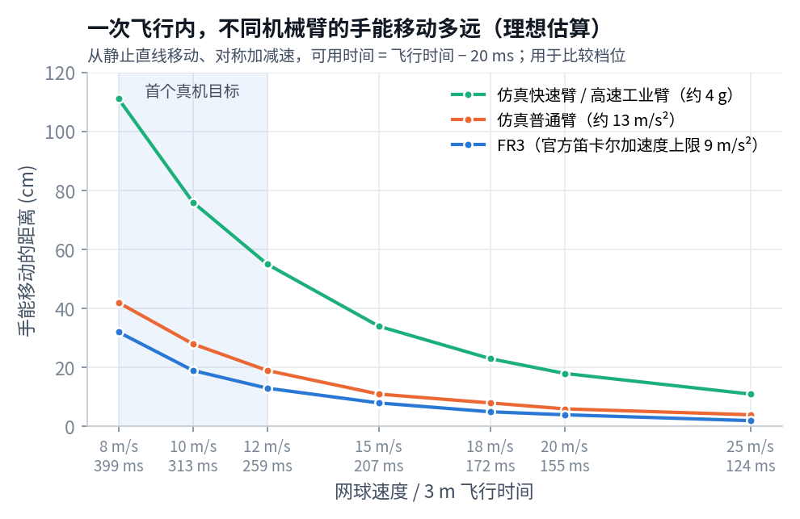
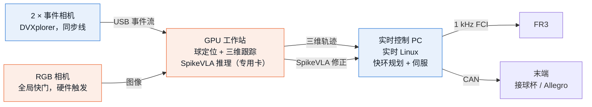

# SpikeVLA 高速接球：进展与真机部署路线

2026-10-30 · 项目进展简报 · 阶段：仿真完成，准备上真机

机械臂用双目事件相机跟踪飞来的球，在一次飞行（约 0.15–0.3 秒）内伸手接住；SpikeVLA 负责学习修正和理解指令。本文是截至 10 月 28 日的仿真结果、上真机的可选路线，以及硬件需求和预算。

| 模块 | 状态 | 说明 |
|---|---|---|
| 事件相机快环（仿真） | ✅ 可用 | 从事件流接住 12–25 m/s 的球；落点在手附近时接住 70–94% |
| SpikeVLA 接入闭环 | ✅ 已接通 | 飞行中请求往返中位 11.5 ms，按真实到达时间执行 |
| SpikeVLA 带来的增益 | ⚠️ 尚未证明 | 6 组训练外投球：快环 4/6，加 SpikeVLA 3/6 |
| SpikeVLA 端到端直接出动作 | ❌ 暂不可用 | 闭环 32 次只接住 0–1 次 |
| 真机 | ⚪ 未开始 | 硬件选型见第 7 节 |

## 1. 结论

1. **感知和快速控制在仿真中已经打通。** 双目事件相机快环能从事件流接住 12–25 m/s 的乒乓球和网球。落点在手附近（±15 cm）时接住率 70–94%，与直接使用真实球状态的上限相差不超过 5 个百分点。
2. **手要移动 30–40 cm 时，预测决定成败。** 同一台快速机械臂，用真实球状态能接住 84%，用事件流只有 45%（乒乓球 16 m/s，手移动 40 cm）。这段差距是 SpikeVLA 这类学习模块最有机会带来增益的地方。
3. **SpikeVLA 已按融合方案接入闭环，但增益还没有出现。** 它每次飞行中请求往返中位 11.5 ms，修正按真实到达时间执行。在 6 组训练外的投球上，快环单独接住 4 组，加上 SpikeVLA 接住 3 组；端到端直接出动作 32 次只接住 0–1 次。
4. **上真机走融合方案。** 快环负责把球接住，SpikeVLA 在慢环里做位置修正和指令理解，迟到的修正自动作废，不会拖累快环。硬件以 FR3 机械臂、双目事件相机、RGB 相机和一张专用 GPU 起步，首个真机目标定在 8–12 m/s 网球。起步配置约 4–6 万欧元，以询价为准。

## 2. 系统怎么工作

两条回路并行。快环每毫秒都在控制机械臂，保证来得及接；慢环里的 SpikeVLA 每 16 ms 给出一段位置修正，只在按时到达时才被采用。SpikeVLA 不在 1 ms 控制环里，它的输出先经过时间对齐、限幅和过期检查，再叠加到快环的拦截目标上。

下图是一次真实记录的接球，取自训练外投球 1100060（18 m/s，SpikeVLA 开启，接住）。18 m/s 时，1 ms 的误差等于球多飞 1.8 cm。

机械臂在 44 ms 才开始动，比早期 TauCatch 快环（出手后 0–5 ms）晚。此前用真实球状态测过：网球 20 m/s 时，起步晚 20 ms 接住率从 77% 降到 65%，晚 50 ms 降到 43%。这一项不需要硬件就能先修。

## 3. 进展时间线

| 日期 | 完成了什么 | 结果 |
|---|---|---|
| 10-20 | 仿真平台：FR3 机械臂 + Shadow 灵巧手、双目事件相机模拟、TauCatch 预测网络；从事件流闭环接单球 | ✅ 接住率接近真值上限 |
| 10-21 | TauCatch 与物理滤波（EKF）融合；长距离接球；多球同时飞来时按指令接指定的球（SpikeVLA 选球） | ✅ 融合后追平上限；⚠️ 选对率 53–56% |
| 10-22 至 10-25 | SpikeVLA 端到端：语言、RGB、事件和本体状态直接输出 12×7 动作 | ❌ 闭环 0–1/32，放弃端到端 |
| 10-26 至 10-27 | 转向融合方案：快环 + SpikeVLA 输出 12×3 位置修正；监督训练 + 1 步强化学习 | ✅ 3 个训练中失败的投球全部救回 |
| 10-28 | 训练外 6 组投球开关对比；时延审计；整理交接包（源码 + 权重 + 证据） | ⚠️ 4/6 对 3/6，增益未证明 |

## 4. 仿真结果

所有接球都在 MuJoCo 仿真中完成。“接住”的标准是接触后在手里保持住，只碰到不算。

### 演示

| 网球 25 m/s，20 倍慢放 | 长距离：手移动 40 cm |
|---|---|
|  |  |
| 左下是事件相机看到的画面（绿圈是网络找到的球，青色是预测轨迹），右下是 TauCatch 神经元按时间常数排列的活动。出手后 111 ms 接触。 | 乒乓球 16 m/s，带 20 转/秒旋转。半透明的臂是起始位置，橙线是手掌走过的路径。207 ms 接触。 |

| 按指令选球（10-21 分支） | 同一网球，真实速度 |
|---|---|
|  |  |
| 指令“接住会到达你左侧的那个球”。SpikeVLA 在 RGB 画面里给每个球编号并选出目标，出手后 33 ms 选定，276 ms 接触。 | 整个过程约 0.11 秒，人眼几乎看不清。这是任务的时间尺度。 |

### 从事件流接球，已接近真实球状态的上限

每组 64 次投球，落点在手附近 ±15 cm，人形投手出手。黑色横线是把真实球状态直接交给同一控制器时的上限。

| 投球 | 事件相机快环 | 真值上限 |
|---|---:|---:|
| 乒乓球 12 m/s | 94% | 92% |
| 乒乓球 16 m/s，20 转/秒 | 86% | 86% |
| 网球 15 m/s | 88% | 86% |
| 网球 20 m/s | 70% | 75% |

16 m/s 乒乓球和 20 m/s 网球使用 TauCatch 与 EKF 融合后的结果。真值上限用另一批随机投球测得，约 ±5 个百分点的差别在噪声范围内。

### 多时间常数的神经元，比任何单一时间常数都预测得准

出手瞬间 TauCatch 误差 20 cm，另两种约 30 cm；150 ms 时降到 1 cm。快神经元负责一出手就给出初猜，慢神经元积累证据，修正旋转造成的弯曲。这是论文的核心结果。其他单一时间常数（2、5、20、50、100、300 ms）在每个时刻也都不如 TauCatch。

### 手要移动得远时，机械臂速度和预测质量都成为瓶颈

“快速臂”约相当于高速工业臂（手可达约 4 m/s、4 g）；“普通臂”约为 Panda 的 1.5 倍速度。

| 手移动距离 | 25 cm | 32 cm | 40 cm | 45 cm |
|---|---:|---:|---:|---:|
| 快速臂 · 真实球状态 | 83% | 92% | 84% | 27% |
| 快速臂 · 事件流 | 未测 | 55% | 45% | 19% |
| 普通臂 · 真实球状态 | 44% | 22% | 9% | 0% |

45 cm 处下降来自工作空间和臂长限制。网球 15 m/s 趋势相同：快速臂 40 cm 时真值 73%，事件流 38%。

> **这张图对硬件选型最重要。** 普通臂在手要移动 30 cm 以上时，即使知道球的真实轨迹也接不住；快速臂能接住，但事件流的早期预测偏差 15–20 cm，让一半的接球失败。前者是买什么臂的问题，后者是 SpikeVLA 要解决的问题。

## 5. SpikeVLA 现在做到哪一步

当前在用的是融合方案：SpikeVLA 读事件 token、机器人状态和快环的计划，每次输出 12 段、每段 16 ms 的 XYZ 位置修正，最大 6 cm。手掌朝向和闭合时机仍由快环控制。

### 训练外 6 组投球的开关对比

同一冻结模型，同一组投球，各跑一次快环单独、一次快环加 SpikeVLA，共 12 次仿真、60 次真实模型请求。

| 投球 | 1100079 | 1100122 | 1100060 | 1100080 | 1100033 | 1100125 | 合计 |
|---|:-:|:-:|:-:|:-:|:-:|:-:|:-:|
| 球速 | 14 m/s | 14 m/s | 18 m/s | 18 m/s | 18 m/s | 18 m/s | |
| 快环单独 | ✅ | ✅ | ✅ | ✅ | ❌ | ❌ | **4/6** |
| + SpikeVLA | ✅ | ✅ | ✅ | ❌ | ❌ | ❌ | **3/6** |

14 m/s 两组都接住，差别全在 18 m/s。在 3 个训练中失败的投球上，SpikeVLA 曾全部救回，但这一收益没有推广到训练外的投球。样本只有 6 组，下一步需要至少 50 组配对才能下结论。

### 时延：飞行中请求按时交付

| 测量 | 中位 | 范围或 P95 | 样本 |
|---|---:|---:|---|
| SpikeVLA 选球，指令已缓存（服务端计算） | 6.4 ms | P95 6.5 ms | 36 次，H100 共享 |
| SpikeVLA 融合动作，飞行中请求往返 | 11.5 ms | 10.3–14.7 ms | 48 次，6 组开关对比 |
| 从观测到修正可以执行 | 21.6 ms | 17.8–27.2 ms | 同上 |

推理本身（6.4 ms、11.5 ms）短于一个 16 ms 动作段；从观测到修正可以执行的 21.6 ms 远小于 192 ms 的修正有效期。以上都在 H100 上测得，真机需要在部署用的 GPU 上重测，并对采集、计算、传输分段计时。

### 三条路线在仿真中的状态

| 路线 | SpikeVLA 的角色 | 仿真结果 | 状态 |
|---|---|---|---|
| 快环单独 | 不使用 | 近距离 70–94%；训练外 6 组 4/6 | ✅ 可用 |
| 融合方案 | 慢环修正位置，理解指令 | 训练外 6 组 3/6；训练中失败 3/3 救回；按指令选球已能演示 | ⚠️ 增益待证 |
| 端到端 | 直接输出全部动作 | 闭环 0–1/32 | ❌ 暂缓 |

## 6. 上真机：路线与分阶段计划

三条路线用同一套硬件，区别只在 SpikeVLA 管多少。融合方案包含快环，所以按融合方案准备硬件，先跑快环建立基线，再逐步交给 SpikeVLA。

| | 路线 A：快环单独 | **路线 B：融合方案（推荐）** | 路线 C：SpikeVLA 端到端 |
|---|---|---|---|
| 定位 | 必做，作为对照和兜底 | 快环 + SpikeVLA 慢环 | 暂缓 |
| 优点 | 上机最快，问题容易定位（感知、到达、闭合、保持） | 快环保证接得住；SpikeVLA 迟到的修正自动作废，安全；可以随时关掉 SpikeVLA 做同条件对比 | 结构最简单 |
| SpikeVLA 的价值 | 不使用，单独不能体现项目特色 | 长距离预测、按指令选球、补偿真机模型误差 | 全部动作由 SpikeVLA 决定 |
| 现状 | 仿真可用 | 增益待证 | 仿真闭环 0–1/32，精度和时延都不满足 |

### 分阶段计划（估计，不含采购周期）

| 阶段 | 时长 | 做什么 | 进入下一阶段的条件 |
|---|---|---|---|
| 0 按真机参数重建仿真 | 到货前，约 2–3 周 | 用 FR3 的真实速度和加速度、所选末端的闭合时间重跑仿真，先预测真机能接多快的球；把机械臂起动从 44 ms 提前到 5 ms 以内；在专用 GPU 上复测 SpikeVLA 时延；按真机相机位置重新生成训练数据 | FR3 约束下的仿真接住率和时延预算明确，确定首个真机球速 |
| 1 搭建、标定、时间同步 | 到货后约 2 周 | 安装完整末端后实测到达时间；标定双目事件相机内外参；相机之间用同步线，电脑之间用 PTP，对齐到 0.1–0.2 ms；用动作捕捉或高速相机测三维跟踪误差 | 真实投球下三维跟踪误差和整条链路时延（P95/P99）实测到位 |
| 2 快环真机基线 | 约 3–4 周 | 先用接球杯或软网做末端，排除手的问题；软网球从 5 m/s 起，逐级升到 8、12 m/s，落点先限制在手附近；用少量真机数据微调球定位网络 | 每档至少 50 次投球，接住率可重复，失败能归到感知、到达、闭合或保持之一 |
| 3 加入 SpikeVLA 慢环 | 约 3–4 周 | 先在真机约束仿真里训练修正，再用少量真机数据适配；同一速度、同一落点范围内交替开关 SpikeVLA 做配对对比 | 开启 SpikeVLA 的接住率在配对对比中稳定更高，且修正过期率不升 |
| 4 灵巧手和按指令选球 | 后续 | 换上灵巧手；多个球同时飞来，按语言指令接指定的球。这一步最能体现 SpikeVLA 理解指令的价值，硬件只需已有的 RGB 相机 | 真机上按指令接住指定的球，作为论文的真机结果 |

## 7. 硬件需求与推荐

球速本身不是硬件指标，关键是球在空中的这段时间里，手能移动多远。下图按网球从 3 m 外飞来估算：从静止出发直线移动、对称加减速，可用时间为飞行时间减 20 ms。实际还要扣除姿态变化和手的闭合时间，所以它适合用来比较档位，不是可达范围的承诺。

| 网球速度 | 飞行时间 | FR3 | 仿真普通臂 | 仿真快速臂 |
|---|---:|---:|---:|---:|
| 8 m/s | 399 ms | 32 cm | 42 cm | 111 cm |
| 10 m/s | 313 ms | 19 cm | 28 cm | 76 cm |
| 12 m/s | 259 ms | 13 cm | 19 cm | 55 cm |
| 15 m/s | 207 ms | 8 cm | 11 cm | 34 cm |
| 18 m/s | 172 ms | 5 cm | 8 cm | 23 cm |
| 20 m/s | 155 ms | 4 cm | 6 cm | 18 cm |
| 25 m/s | 124 ms | 2 cm | 4 cm | 11 cm |

FR3 速度上限 3 m/s、加速度上限 9 m/s²，普通臂 1.7 m/s、13 m/s²，快速臂 4 m/s、约 4 g，均已计入。飞行时间含空气阻力，与仿真一致。

> **结论：FR3 适合 8–12 m/s、落点在手附近的接球，18 m/s 只能接落在手边几厘米内的球。** 手掌本身有约 5 cm 的容差，仿真中普通臂在 ±15 cm 落点下仍能接住 20 m/s 网球的 75%，但长距离接球需要更快的臂。建议先用 FR3 拿到真机结果，同时请厂家评估一台高速臂，作为第二阶段的升级选项。

### 推荐配置

| 部件 | 推荐 | 为什么 | 必须实测确认 | 参考价格 |
|---|---|---|---|---:|
| 机械臂 | **Franka Research 3 + FCI** | 1 kHz 关节力矩控制和状态读取，能运行我们自己的快环；仿真用的就是它的模型 | 装上末端后的实际到达时间和跟踪误差 | 约 €25–30k |
| 末端（第一阶段） | **接球杯或软网，自制** | 排除手的闭合问题，先验证感知和到达 | 球不反弹出杯 | 约 €0.5k |
| 末端（第二阶段） | **Allegro Hand V5 Plus**，四指 16 关节 | 支持预成形和包络抓取；重约 1 kg，在 FR3 负载内 | 实际球径下的闭合时间；官方 500 Hz 是通信频率，不是闭合速度 | 约 $15–27.5k |
| 事件相机 | **iniVation DVXplorer 双目套件**（640×480） | 分辨率与仿真一致；套件带同步线；典型延迟低于 1 ms | 实际照明下的事件质量、标定误差 | €6.8k（学术价） |
| 事件相机（备选） | 2 × Prophesee EVK4 HD（1280×720） | 分辨率更高，可降采样使用 | 两台之间的同步方案 | €4–5k / 台 |
| RGB 相机 | **全局快门工业相机**，如 Basler a2A1920-160ucBAS | SpikeVLA 的视觉输入：出手前编码画面和指令；硬件触发 | 曝光是否看得清球；完整图像的交付延迟 | 约 €1–2k（含镜头，估计） |
| 计算 | **实时控制 PC + 专用 GPU 工作站**（RTX 4090/5090 级单卡，只跑 SpikeVLA 和感知） | 控制和推理分开；推理不与其他任务抢卡 | 在这张卡上重测 SpikeVLA 时延 | 约 €5–8k（估计） |
| 投球与安全 | 可调速、可调旋转的发球机；防护网；急停；软球 | 投球可重复才能做开关对比 | 出球速度和落点的重复性 | 约 €3–8k（估计） |
| 真值测量 | 动作捕捉或高速相机（≥500 fps），已有设备优先 | 测跟踪误差，给真机数据打标签 | 与机器人时钟对齐 | 实验室已有则为 0 |

价格来自官方商店或经销商公开报价，各产品的来源见文末；标“估计”的是量级判断，均以询价为准。

- **起步配置**（接球杯，不含灵巧手和动作捕捉）：约 €40–56k，按 1 欧元约 8 元人民币粗算约 32–45 万元。
- **加灵巧手**：约 €55–81k，约 44–65 万元。

### 真机上的连接方式

控制和推理分在两台电脑上，SpikeVLA 卡顿时快环照常运行。所有时间戳用传感器采样时刻，不用数据到达电脑的时刻。

时间同步：相机之间用硬件同步线，电脑之间用 PTP，全部按传感器采样时刻打时间戳。

## 8. 主要风险与对策

| 风险 | 影响 | 对策 |
|---|---|---|
| FR3 带载加速度不够 | 高速球只能接落在手边的 | 首个目标定在 8–12 m/s；阶段 0 用 FR3 真实限幅预测；评估高速臂作为升级 |
| 真实的手闭合太慢 | 碰到球但接不住（仿真中网球 20 m/s 碰到 95%，接住 69%） | 第一阶段用接球杯；第二阶段先测 Allegro 闭合时间，再定预闭合策略 |
| SpikeVLA 增益未证明 | 融合方案退化成快环 | 上机前在真机约束仿真中做 ≥50 组配对；重点放在长距离和按指令选球这两个快环做不好的场景 |
| 部署 GPU 上的时延还没测 | 修正过期作废，等于没有 SpikeVLA | 专用 GPU、CUDA graph，阶段 0 在部署 GPU 上分段计时；过期作废机制已经实现 |
| 仿真与真机差异 | 事件噪声、照明、背景运动导致找不到球 | 用动作捕捉标注少量真机投球，微调球定位网络 |
| 时间不同步 | 18 m/s 时 1 ms 偏差等于 1.8 cm 位置误差 | 相机硬件同步线，电脑 PTP，采样时刻打时间戳 |
| 安全 | 高速球和快速机械臂 | 防护网、急停、软球，从低速逐级加速 |

## 9. 需要拍板的事项

- [ ] **首个真机目标**：建议 8–12 m/s 网球，落点在手附近，接住后保持 0.5 秒。
- [ ] **机械臂档位**：建议 FR3 起步；实验室若已有 FR3 或 Panda，直接复用。是否同时评估一台高速臂？
- [ ] **末端**：建议第一阶段接球杯，第二阶段再上 Allegro 灵巧手。
- [ ] **预算**：起步约 €40–56k，加灵巧手约 €55–81k，以询价为准。动作捕捉、发球机若已有可省。
- [ ] **专用 GPU 和场地**：SpikeVLA 需要一张不与其他任务共享的 GPU；场地需要约 4 m 投球距离和防护网。

---

**数据来源**：[results.md](results.md)、[algorithm.md](algorithm.md)、[hardware.md](hardware.md)；原始证据 `artifacts/evidence/`；早期结果 `archive/20261028/legacy/docs/research_plan.md` §2、§5.9–5.10。所有接球结果来自 MuJoCo 仿真，尚无真机结果。

**硬件参数与价格**：
[FR3 运动限制](https://frankarobotics.github.io/docs/robot_specifications.html) ·
[libfranka 1 kHz 接口](https://frankarobotics.github.io/docs/doc/libfranka/docs/overview.html) ·
[FR3 价格指南（第三方）](https://grabarobot.com/blog/franka-robotics-price-guide-2026/) ·
[Allegro Hand V5 Plus 参数](https://www.allegrohand.com/sub/product/p.php?idx=4) ·
[Allegro 价格区间](https://www.originofbots.com/humanoid-robot-hand/allegro-hand-v5-plus-by-wonik-robotics-robot-hand-specifications) ·
[DVXplorer 参数](https://docs.inivation.com/hardware/current-products/dvxplorer.html) ·
[DVXplorer 双目套件（学术价）](https://shop.inivation.com/products/stereo-kit-dvxplorer-academic-rate) ·
[Prophesee EVK4 HD 商店](https://www.shop.prophesee.ai/products/metavision%C2%AE-evaluation-kit-4) ·
[Basler a2A1920-160ucBAS](https://docs.baslerweb.com/a2a1920-160ucbas)

图表在 `docs/figures/leader/`，数字与上面各表一致；重绘 PNG：`python tools/plot_leader_brief.py docs/figures/leader`。
