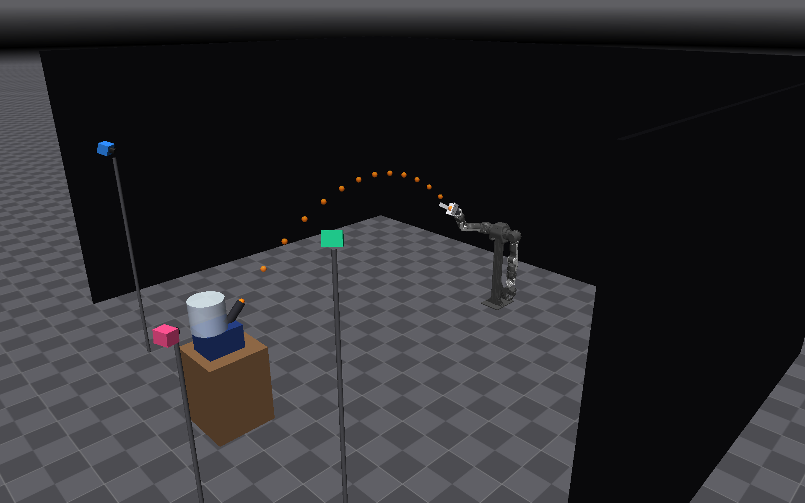
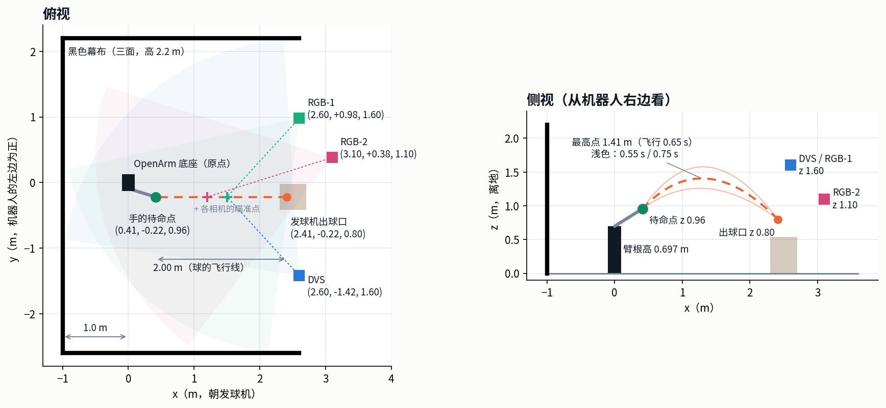
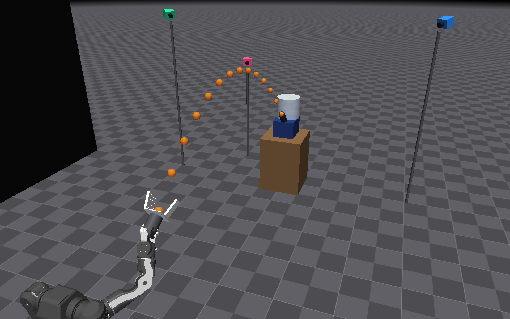
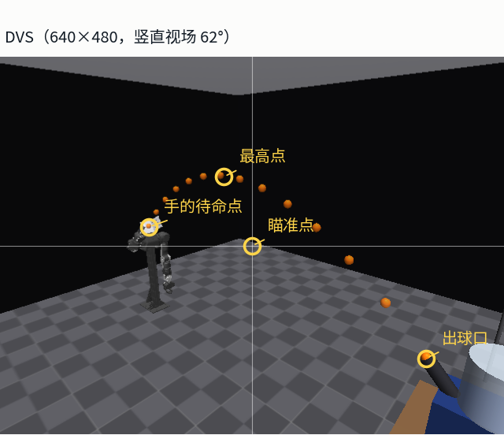
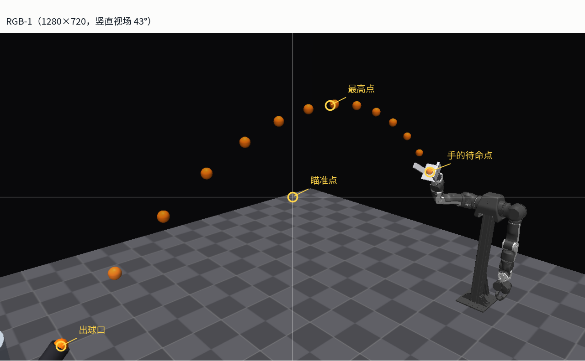
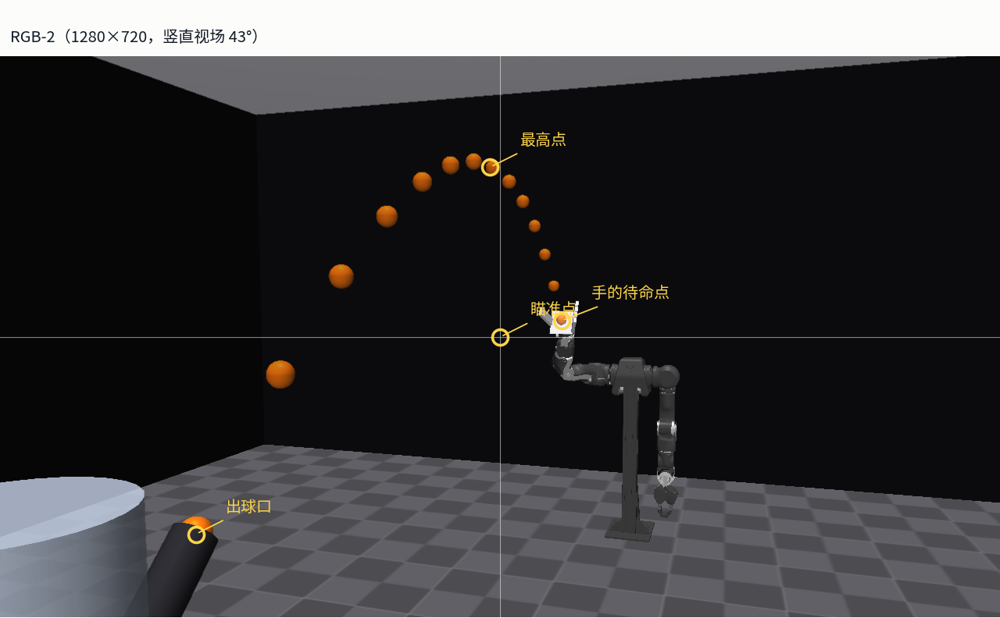
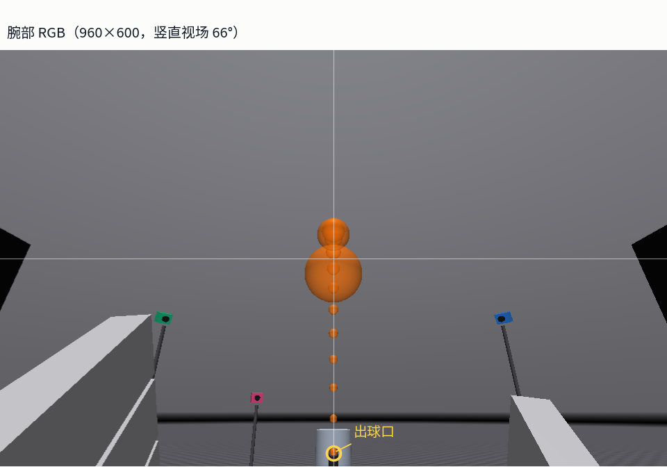
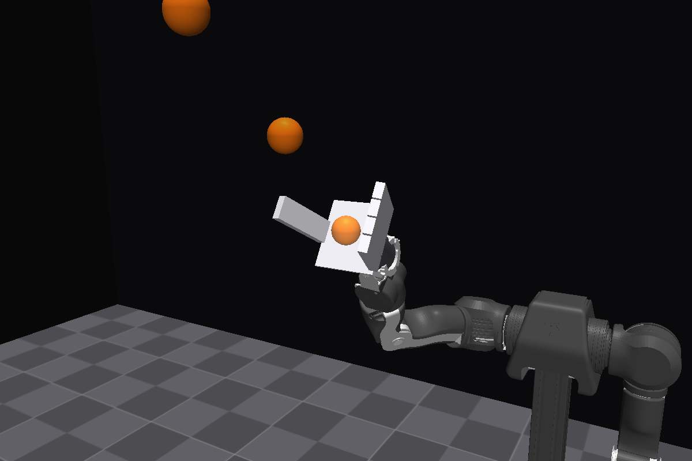

# OpenArm v2 真机场景：发球机发乒乓球，手接

2026-11-18 定稿 · 相机：一台 DVS、两台第三视角 RGB、一台腕部 RGB · 用途：和远端同事对齐场景。按本文搭好以后，每台相机拍一张照片，和下面的截图叠在一起比对，再把第 7 节的测量值发回来。



## 一览

- **器材**：
  - OpenArm v2 双臂，右臂接球，左臂垂下不动；右臂末端换成手；
  - 乒乓球发球机；
  - 相机共四台：一台 DVS，两台第三视角 RGB（RGB-1、RGB-2），一台腕部 RGB。
- **球路**：发球机放在手的待命点正前方 2.0 m，出球口离地 0.80 m，不加旋转。球以 5.2 m/s、仰角 45° 出口，最高 1.41 m，0.65 s 后到手。
- **相机**：
  - **DVS** 放在机器人右侧、发球机旁边，回头看向机器人。
  - **RGB-1** 放在左侧和 DVS 对称的位置。
  - **RGB-2** 放在出球口后方，低位，顺着球路看向手。
  - **腕部 RGB** 装在掌面上沿。
- **背景**：三面黑色幕布，背面在机器人后方 1 m，同时用来挡漏接的球。
- **仿真结果**：
  - 真值专家（直接看到球的真实状态）接住 98.5%（200 球，落点散布 ±10 cm）。换回 v2 原装夹爪只有 46.5%，所以末端用手。
  - 专家改看这套相机估计出的球（带噪声和延迟），接住约 91%（第 5 节）。

## 0. 坐标系

- 原点在 OpenArm 底座正下方的地面上，即两条臂根部连线的中点往下投到地面。
- x 轴指向发球机。y 轴指向机器人的左边：站在机器人身后、面朝发球机时，右手边是 −y。z 轴向上。
- 单位都是米。右臂在 −y 一侧，负责接球。

## 1. 布置



| 物件 | 位置 (x, y, z) | 朝向 | 摆放容差 |
|---|---|---|---|
| OpenArm v2 | 底座在原点，正面朝 +x | 臂根（肩）离地 0.697 m，同 Enactic 立柱 | 臂根高度不同时量出来告诉我们，整体平移即可 |
| 手的待命点（球心应在的位置） | (0.41, −0.22, 0.96) | 掌心朝发球机、上仰 31°，法向 (0.855, 0, 0.519) | ±1 cm |
| 发球机出球口 | (2.41, −0.22, 0.80) | 正对待命点，出球仰角约 45° | ±2 cm；档位按第 3 节实测调 |
| DVS | (2.60, −1.42, 1.60) | 看向 (1.50, −0.22, 1.05) | ±5 cm、±3°，之后做外参标定 |
| RGB-1 | (2.60, +0.98, 1.60) | 看向 (1.50, −0.22, 1.05)，和 DVS 左右对称 | 同上 |
| RGB-2 | (3.10, +0.38, 1.10) | 看向 (1.20, −0.22, 0.95)：在出球口后方 0.7 m、左侧 0.6 m，顺着球路看 | 同上 |
| 腕部 RGB | 掌面上沿，朝掌心方向 | 待命时画面下方正中是出球口 | 装牢，之后标定 |
| 黑色幕布 | 背面 x = −1.0，y 从 −2.6 到 +2.2；两侧 y = −2.6 和 +2.2，x 从 −1.0 到 2.6 | 高 2.2 m，哑光不反光 | 背面必须有；两侧建议有 |

- 三台固定相机（DVS、RGB-1、RGB-2）的画面里都要能看到出球口、整条球路和手。
- 瞄准点都在飞行线上。DVS 和 RGB-1 看同一点 (1.50, −0.22, 1.05)。
- RGB-2 在幕布开口外面（x = 3.1 m），用三脚架。



## 2. 各视角截图

图中橙色点是标准发球每 50 ms 的位置，黄圈是关键点，白线是画面中心。不带标注的原图在 [`figures/openarm_scene/raw/`](figures/openarm_scene/raw)，可以半透明叠在实拍照片上比对：出球口、手的待命点、瞄准点都对上，相机就摆对了。

**DVS**（按竖直视场 62°、4:3 画面渲染）：



- 画面中心（瞄准点）落在飞行线上。机器人在左侧，出球口在右下角。
- DVS 只对变化出事件，静止时拍不到这张图，有两种办法对准：
  - 在瞄准点 (1.50, −0.22, 1.05) 放一个闪烁的 LED（手机闪光灯的频闪模式就行），把它调到画面中心；
  - 发 3–5 个球，把这段时间的事件累积成一张图，球路应该和图中的橙色点重合。
- 带 APS 灰度帧的型号（DAVIS 系列）可以直接用灰度帧比对。

**RGB-1**（两台 RGB 都按 1280×720、竖直视场 43° 渲染，即常见网络摄像头的水平 70°）：



**RGB-2**：



- 左下角大块的是发球机的料斗。出球口要在画面内，离下边缘留出约 10% 的余量。
- 球背着镜头飞向手，手在画面中心偏右。

**腕部 RGB**（手在待命姿态，960×600，竖直视场 66°，同 v2 原装腕部相机）：



- 出球口在画面下方正中，球从下往上朝镜头飞来。左右两边的白块是手指和拇指。
- v2 的腕部相机原本装在夹爪上，换手以后装在掌面上沿。

## 3. 发球机和球

| 项目 | 标准发球 | 散布范围（仿真训练用） |
|---|---|---|
| 出球速度 | 5.2 m/s | 4.9–5.5 m/s |
| 出球仰角 | 45° | 35–54° |
| 飞行时间 | 0.65 s | 0.55–0.75 s |
| 最高点 | 1.41 m，出球后 0.34 s，在 x = 1.29 m | 1.26–1.58 m |
| 到手时 | 3.9 m/s，向下 47° | |
| 过待命点的偏差 | 0 | 前后 ±5 cm，左右、上下 ±10 cm |

- **球**：标准 40 mm、2.7 g 乒乓球，选橙色。橙色在黑幕前对比度高，仿真里也是橙色。
- **空气阻力很大**：同样的出球速度，不计阻力的话，到手处会差 37 cm（水平）和 18 cm（竖直）。所以档位要按实测调，不能按公式算。仿真按阻力系数 0.5 计（0.14 /m）。
- **调档**：
  1. 臂先移开，在待命点挂一个直径 10 cm 的圈。
  2. 调速度和仰角，直到连续 10 球里至少 8 球穿过圈。
  3. 用 RGB-1（或手机 240 fps 慢动作，从侧面拍）录 20 球，量飞行时间和穿过待命点平面的位置。
- **不加旋转**：上旋或下旋会让轨迹偏几十厘米，仿真里没有建模。发球机如果做不到无旋（比如单轮出球），把旋转档位告诉我们，我们再加进仿真。
- **摆头（随机落点）先关**。落点散布 ±10 cm 时，专家接住 98.5%；放宽到左右 ±18 cm、上下 ±14 cm 时，掉到 84.5%。
- **发球间隔**：先手动一球一发，每球之间留出松手放球、回待命位的时间（≥ 5 s）。

## 4. 末端：用手，不用夹爪



仿真里的手是一个通用五指手（和 B601 那套相同）：

- 掌面宽 10 cm、高 9 cm，正对来球；四指在一边，拇指在另一边。
- 每根手指两节，各 45 mm，待命时向外张开。
- 质量 0.54 kg，从发令到合拢约 100 ms。

真手的掌心通常朝侧面，所以待命时的关节角会和仿真不同。要对齐的是任务空间里的位姿：球心落点 (0.41, −0.22, 0.96)，掌心朝向 (0.855, 0, 0.519)。

| 真值专家，200 球（落点散布 ±10 cm） | 接住 |
|---|---|
| 手，掌面带薄衬垫（30 cm 落下回弹 3.6 cm） | **98.5%** |
| 手，掌面完全不弹（回弹 0.7 cm） | 98.0% |
| 手，掌面较硬（回弹 12 cm） | 97.5% |
| 手，掌面是硬塑料（回弹 27 cm，接近乒乓球打在球台上） | 96.5% |
| 手，球到前 30 ms 发令合拢（默认 50 ms） | 98.0% |
| 手，球到前 80 ms 发令合拢 | 0% |
| v2 原装夹爪（球不回弹） | 46.5% |

- **合手时机最关键**：发令太早，手指先合上，球就进不去。真手到了以后，先测"从发令到指尖合拢"的时间，告诉我们。
- **掌面衬垫可选**：手指会把球拢住，所以掌面弹不弹影响不大。
- **夹爪不行**：只有 46.5%，原因没有细查。

## 5. 相机：为什么是这四台、放在这里

### 5.1 手要求跟踪器有多准

先在仿真里给专家喂一个固定偏差的球位置（每球随机一个方向，直到合手为止），看手能容忍多少：

| 真值专家，200 球 | 接住 |
|---|---|
| 无误差 | 98.5% |
| 落点偏 1 cm（1σ，掌面平面内） | 92.0% |
| 落点偏 2 cm | 69.5% |
| 落点偏 3 cm | 44.0% |
| 到达时间偏 10 ms（1σ） | 94.0% |
| 到达时间偏 20 ms | 84.0% |
| 跟踪器出球后 100 ms 才开始报告 | 98.0% |
| 150 ms 才开始报告 | 96.0% |
| 250 ms 才开始报告 | 83.5% |

- 到合手的时候，落点要准到 1 cm 左右、时间准到 10 ms 左右。
- 早期的估计可以粗一些，但不能太晚才有：250 ms 才开始就只剩 83.5%。
- 早期估计偏了，臂还去追，反而更糟（见 5.3）。

### 5.2 线性化误差分析

把跟踪器当成"用所有相机的观测去拟合一条带空气阻力的轨迹"，未知量是出球口位置和出球速度，算它在各个时刻能把落点和到达时间定到多准。假设：

- 每台相机测球的图像位置，噪声按 224 px、62° 画面的 1 px 计（约 0.3°），只在球进画面时才有观测。
- DVS：每 4 ms 一次，时间戳准确，延迟 20 ms。
- RGB：30 Hz，相位随机，帧时间抖动 2 ms，延迟 80 ms（USB 网络摄像头的典型值）。
- 腕部相机按待命姿态固定不动处理。
- 先验：出球口位置 ±1 cm（发球机不动），出球速度 ±0.5 m/s（按档位）。

下表是落点误差（掌面平面内）和到达时间误差，1σ，8 个发球取中位数。"出球后 150 ms"指在这个时刻用已经到手的观测做的估计（RGB 有 80 ms 延迟，所以此时只用到 70 ms 以前的 RGB 帧）。

| 相机组合 | 出球后 150 ms | 出球后 250 ms | 到达前 150 ms |
|---|---|---|---|
| 只有 DVS | 11.4 cm / 18 ms | 4.4 cm / 8.0 ms | 1.8 cm / 4.3 ms |
| DVS + 腕部 | 8.3 cm / 13 ms | 2.4 cm / 4.4 ms | 0.6 cm / 1.3 ms |
| DVS + 腕部 + RGB-1 | 6.9 cm / 11 ms | 2.0 cm / 3.4 ms | 0.5 cm / 1.1 ms |
| **DVS + 腕部 + RGB-1 + RGB-2（选定）** | **5.3 cm / 8.2 ms** | **1.6 cm / 2.7 ms** | **0.4 cm / 1.0 ms** |
| 腕部 + RGB-1 + RGB-2（没有 DVS） | 13.3 cm / 27 ms | 3.9 cm / 8.5 ms | 0.8 cm / 2.6 ms |
| 选定组合，两台 RGB 开 60 Hz（延迟 50 ms） | 2.9 cm / 4.5 ms | 1.1 cm / 1.9 ms | 0.3 cm / 0.8 ms |

### 5.3 端到端：专家按跟踪器的估计去接

让专家不再看真值，而是看上面那个跟踪器的估计：每个球的测量噪声抽一次，每个控制周期只用已经到手的观测。

还加了一条起动规则：预测落点误差（1σ）降到门限以下之前，臂停在待命位不动。如果不加这条规则，臂会去追偏了的早期估计，选定组合只能接住 65.8%（加了是 91%）。

| 相机组合，600 球 | 门限 3 cm | 门限 5 cm |
|---|---|---|
| 真值（上限） | 99.0% | 99.0% |
| 只有 DVS | 64.8% | 70.7% |
| DVS + 腕部 | 85.5% | 88.8% |
| DVS + 腕部 + RGB-1 | 89.5% | 90.5% |
| **DVS + 腕部 + RGB-1 + RGB-2（选定）** | **91.0%** | **90.8%** |
| 腕部 + RGB-1 + RGB-2（没有 DVS） | 73.8% | 78.2% |
| 选定组合，两台 RGB 开 60 Hz（延迟 50 ms） | 92.7% | 93.7% |

600 球时，一个标准误约 ±1.2 个百分点。

### 5.4 结论

- **四台相机各有分工**：
  - DVS 管出球后最早的 150 ms；
  - 腕部相机在接球点上，直接看出球偏了多少；
  - RGB-1 和 DVS 组成约 90° 的基线；
  - RGB-2 顺着球路，补左右、上下的偏差。端到端检查里，它带来的提升在误差范围内（+0.3–1.5 个百分点），作用主要体现在早期估计上：出球后 150 ms 的落点误差从 6.9 cm 降到 5.3 cm。这给真机上的标定误差和遮挡留了余量。
- **DVS 不能少**：RGB 有 80 ms 延迟，出球后头 150 ms 几乎没有可用的观测。没有 DVS 时接住率只有 73.8% / 78.2%，比选定组合低 13–17 个百分点。
- **RGB 开 60 fps**（720p 就够），USB 传输选 MJPEG，并测出实际延迟（见第 7 节）。同样的布置，60 Hz、50 ms 延迟时接住 92.7% / 93.7%，比 30 Hz 高 2–3 个百分点。
- **臂按 5.3 节的规则起动**：预测落点误差降到 3–5 cm 以下再动。
- 离真值的 99% 还差的几个百分点，差在早期估计不准时臂怎么动。这要靠控制策略和 SpikeVLA 解决，和相机布置无关。

### 5.5 每台相机为什么放在那里

- **DVS**：只有一台事件相机时，它要从侧面看球路，不能让球迎着镜头飞，否则沿视线方向的距离测不出来。下表比较了 DVS 的几个位置（出球后 150 ms 的估计）：

| DVS 位置 | 只用 DVS | 加上腕部 + RGB-1 + RGB-2 |
|---|---|---|
| **发球机右侧，回头看（选定）** | **11.4 cm / 18 ms** | **5.3 cm / 8.2 ms** |
| 臂后方右侧（原来两台事件相机中的一台） | 20.8 cm / 43 ms | 10.1 cm / 20 ms |
| 机器人身后高处 | 21.4 cm / 42 ms | 8.9 cm / 17 ms |
| 右侧，正对球路中段 | 18.5 cm / 15 ms | 8.6 cm / 8.1 ms |
| 右侧，球路中段上方 | 20.0 cm / 4.9 ms | 7.8 cm / 4.6 ms |

  两台 RGB 固定后，又搜索了 271 个能看全出球口、球路和手的 DVS 位姿。落点误差最小的是 4.6 cm（发球机右后方高 2.1 m 处），但到达时间误差变大（12 ms）。选定位置已经在最好的一组里。

- **RGB-2**：从出球口后方顺着球路看。球的左右、上下偏差在它的画面里直接表现为偏离画面中心，正好是落点误差的两个方向。在 DVS + 腕部的基础上加一台 RGB，搜索 746 个候选位姿后，第一选择是 (2.9, +0.38, 1.0)。RGB-2 就放在这里，只是往后挪了 0.2 m、抬高了 0.1 m，这样整条球路都在画面里。
- **RGB-1**：和 DVS 左右对称，两者视线夹角约 90°，组成最宽的基线。在 DVS + 腕部 + RGB-2 的基础上，搜索了 382 个灯架能架设的位姿：高度不超过 2 m，都能看到出球口、最高点和手。最好的一个是 5.1 cm，RGB-1 是 5.3 cm，差别在这个分析的误差范围内。

**DVS 镜头**：竖直视场取 60° 左右，焦距 ≈ 0.83 × 传感器高度。

| 型号 | 竖直视场 60° 左右的焦距 |
|---|---|
| DAVIS346（4.8 mm 高） | 约 4 mm |
| 640×480、15 µm 像素（7.2 mm 高） | 约 6 mm |
| DVXplorer（4.3 mm 高） | 约 3.6 mm |
| EVK4（3.5 mm 高） | 约 2.9 mm |

在 640×480 的画面里，乒乓球在出球口附近约 11 px，到手时约 6 px。

## 6. 环境和相机设置

- **灯光**：DVS 对频闪很敏感。不要用普通日光灯或调光 LED，它们 100 Hz 的闪烁会让整幅画面都出事件。用直流驱动的 LED 补光灯（摄影灯），或者白天的自然光。亮度要够 RGB 用 1–2 ms 快门，这样球不拖影（5 m/s 的球，10 ms 快门会拖出 5 cm 长的影子）。
- **RGB 设置**（RGB-1、RGB-2、腕部都一样）：
  - 关掉自动曝光、自动白平衡、自动对焦，手动固定；
  - 开 60 fps，分辨率 720p；
  - 每台相机接在单独的 USB 控制器上，用 MJPEG 传输。
- **背景**：三面哑光黑幕。背面挡球。地面只要不动就行。
- **画面里只能有球和臂在动**：
  - 操作的人站在 RGB-2 后面或 DVS 后面（x > 3.3 m）。这里三台固定相机都看不到。
  - 发球机里搅拌送球的机构会一直出事件，用黑布把发球机主体盖住，只露出出球口。
  - 三脚架压上沙袋，不能晃。
- **左臂**保持垂下（home 姿态），不进球路。

## 7. 对齐步骤和回传清单

1. 在地上贴胶带：标出原点、待命点投影 (0.41, −0.22)、出球口投影 (2.41, −0.22)、三台固定相机的三脚架位置。
2. 右臂摆到待命姿态，用卷尺或激光测距确认球心落点 (0.41, −0.22, 0.96) 和掌心朝向。
3. 摆好发球机，按第 3 节调档。
4. 架相机，按第 2 节的截图对准。
5. 每台相机拍一张，和 `raw/` 里的原图叠在一起；出球口、待命点、画面中心各差多少像素，标出来。
6. **测延迟和时间偏差**：
   1. 在所有相机都看得到的地方（比如瞄准点附近）放一个 LED，用信号发生器或单片机让它每秒闪一次。
   2. 把 LED 的驱动信号接到采集电脑上，记下每次点亮的时间。
   3. 所有相机录 20 s。看每台相机里 LED 亮起的时刻，比电信号晚多少。这就是各相机的延迟和时间偏差，跟踪器要用。

发回来的东西：

| 项目 | 内容 |
|---|---|
| 每台相机（DVS、RGB-1、RGB-2、腕部） | 型号、分辨率、实际帧率、快门时间、镜头焦距或视场、实际位置和朝向、叠图截图、第 6 步测出的延迟 |
| 发球机 | 型号、档位（速度、角度、旋转）、出球口实测位置、20 球的飞行时间和过待命点平面的位置 |
| 手 | 型号、质量、发令到指尖合拢的时间、待命时的掌心位置和朝向 |
| 环境 | 灯的型号（是否直流）、幕布照片、臂根离地高度、采集电脑和各相机怎么连（哪几台共用 USB 控制器） |

我们会把实测值写进代码，重新渲染截图、重跑检查，再发回给你们复核：

- [`pingpong.py`](../taucatch/vla_catch/pingpong.py)：`CAMERAS`、`LAUNCHER`、手的参数；
- [`tools/openarm_scene.py`](../tools/openarm_scene.py)：各相机的延迟、帧率。

## 8. 仿真

- [`taucatch/vla_catch/pingpong.py`](../taucatch/vla_catch/pingpong.py)：本场景。在 Enactic v2 接球场景上，换成乒乓球（含空气阻力），加上发球机、幕布、四台相机和手。`PingPongSim("gripper")` 换回 v2 夹爪。
- [`tools/openarm_scene.py`](../tools/openarm_scene.py)：
  - `render`：本文所有截图和布置图。
  - `check`：第 4 节和 5.1 节的专家接住率和掌面落球测试。结果在 `outputs/checks/openarm_scene/check.{log,json}`。
  - `cameras [--search]`：5.2 节和 5.5 节的线性化误差分析和位置搜索。结果在 `outputs/checks/openarm_scene/cameras.{log,json}`。
  - `tracker`：5.3 节的端到端检查。结果在 `outputs/checks/openarm_scene/tracker.{log,json}`。`--gate 0` 是不加起动规则的对照，结果在 `tracker_nogate.{log,json}`。
- 专家规划时也计入了空气阻力。如果规划时不计阻力，接住率从 98.5% 掉到 75.5%。

```bash
export MUJOCO_GL=osmesa PYOPENGL_PLATFORM=osmesa
python tools/openarm_scene.py render docs/figures/openarm_scene
python tools/openarm_scene.py check --tosses 200 --out outputs/checks/openarm_scene/check.json
python tools/openarm_scene.py cameras --search --out outputs/checks/openarm_scene/cameras.json
python tools/openarm_scene.py tracker --tosses 600 --out outputs/checks/openarm_scene/tracker.json
```

下一步：

1. 按实测值更新场景。
2. 在这个场景里，用 DVS + RGB-1 + RGB-2 + 腕部采数据。
3. 训练 SpikeVLA（F7）：
   - 输入从两路事件相机改成这四台相机；
   - 球改成 40 mm，末端改成手；
   - 然后做 DAgger。
4. 跟踪器和臂的起动规则（5.3 节的门限）按真机测出的延迟重新调。

## 9. 目前的假设（到了真机信息就替换）

- 手的型号未定：仿真用通用五指手。
- DVS 型号未定：按竖直视场 62°、640×480 渲染。
- 两台第三视角 RGB 按 1280×720、水平 70° 的网络摄像头处理。
- 所有 RGB（含腕部）都按 30 Hz、延迟 80 ms、帧时间抖动 2 ms 计；DVS 延迟按 20 ms 计。
- 第 5 节的误差分析和端到端检查：
  - 所有相机的测量噪声都按 224 px、62° 画面的 1 px 计；
  - 没有计入外参标定误差，也没有计入臂挡住视线的情况；
  - 腕部相机按待命姿态固定不动处理。
- 臂根高度按 Enactic 立柱的 0.697 m。
- 发球机无旋，落点散布 ±10 cm。
