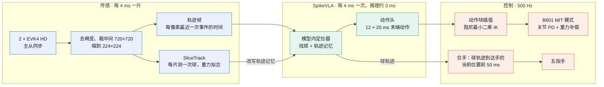
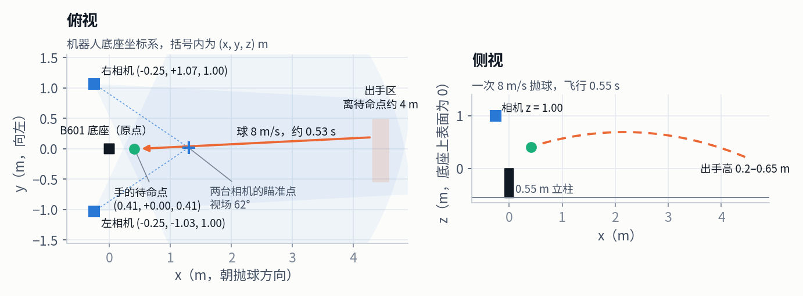

# 在 B601 真机上跑

2026-11-04 · 目标：B601-DM + 五指手，接住 4 m 外抛来的 8 m/s 球

仿真里的每个环节都按真机能拿到的东西设计：两路事件相机是唯一的传感器，测试时不用任何真值，策略延迟按 20 ms 计，臂按 24 V 电机的力矩–转速线限幅。上真机要做的是三件事：按下图搭好台子，把相机和臂标定进仿真，再写三个硬件接口，替换掉仿真里的渲染和物理。



## 1. 硬件

| 部件 | 型号或要求 | 仿真里的设定 |
|---|---|---|
| 机械臂 | Seeed reBot Arm B601-DM：DM4340 × 3（1–3 轴）、DM4310 × 3（4–6 轴），24 V 电源，USB 串口桥 | 力矩上限 27 / 7 Nm，24 V 力矩–转速线；关节 PD kp 190 / kv 6（1–3 轴），30 / 2（4–6 轴） |
| 立柱 | 0.55 m 高，刚性固定，底座 x 轴朝抛球方向 | `b601.BASE = (0, −0.219, 0.55)` |
| 五指手 | 4 指 + 拇指，含法兰 ≤ 0.54 kg；每个指关节 ≥ 285°/s；能停在半张开（后弯 0.26 rad） | `b601.HAND_MASS / HAND_RATE / HAND_OPEN` |
| 事件相机 | 2 × Prophesee EVK4 HD（IMX636，1280 × 720），2.8–3.5 mm C 口镜头，主从同步线 | 224 × 224，竖直视场 62°，4 ms 一片，阈值 0.15 ± 0.02 |
| 球 | 直径 70 mm、50 g 软球 | `sim.py` 的球 |
| 计算机 | Linux + NVIDIA GPU，单步推理 ≤ 4 ms；两个 USB3 口给相机 | H100 上 3.08 ms |
| 抛球 | 投球机或人手，出手点离手的待命点约 4 m | 8 m/s，出手高 0.2–0.65 m（相对底座上表面），飞行约 0.53 s |
| 安全 | 防护网、急停、限位 | 关节限位与力矩上限同仿真 |

## 2. 布置



| 位置（机器人底座坐标系，m） | x | y | z |
|---|---|---|---|
| 左事件相机 | −0.25 | −1.03 | 1.00 |
| 右事件相机 | −0.25 | +1.07 | 1.00 |
| 两台相机的瞄准点 | 1.30 | +0.02 | 0.40 |
| 手的待命点（抓取中心） | 0.41 | 0.00 | 0.41 |
| 出手区 | 4.3–4.5 | −0.53–+0.47 | 0.20–0.65 |

待命姿态的关节角为 (0, −74.1°, −26.2°, −79.1°, 0, 0)，掌心朝抛球方向。两台相机装在臂后方两侧、同一高度，都瞄准待命点前方 0.9 m 处，这样球一出手就在两路视场里。

## 3. 装软件

```bash
conda create -n vlacatch python=3.10 && conda activate vlacatch
pip install -r requirements/vla_catch.txt
tools/fetch_b601.sh                                  # B601 的 URDF 和网格（上游无许可证，不随仓库分发）
# SpikeVLA 代码（ICML 版本）放在 vendor/spikevla_icml，不公开，单独拷贝
# 权重：runs_v2/saim_r1_b601/ema_3000.pt（单独拷贝）

# 真机驱动
git clone https://github.com/Seeed-Projects/reBotArm_control_py && pip install -e reBotArm_control_py
# Prophesee Metavision SDK（或开源的 OpenEB），装完能用 metavision_core.event_io.EventsIterator 读 EVK4
```

先在仿真里确认环境正常（CPU 渲染，单进程 100 球约 1 小时；按 `--seed` 拆成 10 个进程并行约 10 分钟）：

```bash
export MUJOCO_GL=osmesa PYOPENGL_PLATFORM=osmesa VLA_AIM_X=1.3
python -m taucatch.vla_catch.evaluate --ckpt runs_v2/saim_r1_b601/ema_3000.pt --fast --close-track --close-hand \
    --slice-track --query-every 0.004 --catcher hand --hand-rate 285 --hand-open .26 --lead .05 --bounce .5 \
    --volts 24 --blend .5 --arm b601 --latency .02 --throw-speed 8 --throw-from 4 --tosses 100
# 应在 85% 左右（300 球 84.7%）
```

这一行参数就是真机要复现的设置：`--catcher hand …` 是手，`--volts 24` 是电源，`--latency .02` 是从拍到事件到动作生效的时间，`--slice-track --query-every 0.004` 是每 4 ms 测球、每 4 ms 查询模型，`--close-hand` 是按球轨迹合手。

## 4. 标定，并写回仿真

| 项目 | 做法 | 通过标准 | 写到哪里 |
|---|---|---|---|
| 相机内参与畸变 | 每台相机拍闪烁棋盘格（Metavision 标定工具） | 重投影误差 < 0.3 px | 事件预处理的去畸变表 |
| 相机外参（相对底座） | 掌心贴一个闪烁 LED，臂走 20 个已知姿态（B601 正运动学给出 LED 位置），解 PnP | LED 三角化误差 < 1 cm（1–4 m 内） | `sim.EVENT_CAMERAS` 的两台相机位姿 |
| 视场 | 由内参算出 224 px 方向的竖直视场 | — | `sim.EVENT_FOVY` |
| 时间 | 两台 EVK4 用同步线主从对时；相机时钟对齐主机时钟 | 两台时间差 < 0.1 ms | 事件线程的时间戳 |
| 残余偏移 | 手停在待命点看一眼，得到每路的像素偏移 | < 1 px | `ball.set_shift`（`--hand-look` 的同一机制） |

事件预处理：去畸变后取传感器中间 720 × 720，坐标乘 224 / 720 取整，得到 224 × 224 的像素号；每 4 ms 切一片，只保留"这个像素最近一次事件的时间"，不管极性和个数。轨迹帧（`events.trace_frame`）只用这个时间，所以真机相机的分辨率、阈值和仿真不同时，图像形状不变。

标定完、相机位姿或视场和仿真不同时，按新位姿在仿真里重录数据再训练（`collect.py` + 一轮 DAgger），模型看到的轨迹帧才和训练时一致。

## 5. 要写的三个硬件接口

仓库里还没有真机驱动。真机运行就是 `evaluate.rollout` 去掉渲染和物理，换成下面三个接口，其余（轨迹帧、`SliceTrack`、`Policy`、动作块插值、IK、合手规则）原样复用。

| 接口 | 输入 → 输出 | 频率 | 实现 |
|---|---|---|---|
| `EventSource` | EVK4 事件流 → 每 4 ms 一片：每路 (像素号, 正事件数, 负事件数)，带片的结束时间 | 250 Hz | `EventsIterator(delta_t=4000)` + 去畸变 + 裁剪缩放 |
| `ArmIO` | 关节参考 q_ref → MIT 指令；读回 q、q̇ | 500 Hz | `RebotArm.start_control_loop`，`arm.mode_mit(kp, kd)`，`arm.send_mit(q_ref, vel=0, kp, kd, tau=重力补偿)`，`get_positions / get_velocities` |
| `HandIO` | 张开 / 合手指令；读回指关节角 | ≥ 100 Hz | 按所选五指手的 SDK |

IK 用仓库里 B601 的 MuJoCo 模型：每个控制周期把实测 q 写进模型，算阻尼最小二乘的关节参考（与 `sim.track` 相同）。重力补偿用 reBotArm_control_py 的 `controllers/gravity_compensation`，先用它的 `tools/gravity_calibration` 标定。看门狗：60 ms 没有新动作块就回待命姿态。

## 6. 上机顺序

每一步通过了再进下一步。

| 步 | 做什么 | 通过标准 |
|---|---|---|
| 1 标定 | 第 4 节全部 | 三角化误差 < 1 cm，相机时间差 < 0.1 ms |
| 2 臂空跑 | 在真机上回放一次仿真接球的关节参考，先 25% 速度再全速 | 手落后参考的距离与仿真（4–8 cm）相差 < 1 cm；不符就改 `b601.GAINS` 或 `limit_motors` |
| 3 手 | 测从发令到指尖合拢的时间 | 写进 `--lead`（仿真 50 ms） |
| 4 只看不动 | 人手抛 3–5 m/s，事件线程、`SliceTrack`、SpikeVLA 在线跑，臂不动 | 推理 ≤ 4 ms；出手后 100 ms 球速误差 < 10 cm/s（对照整段飞行事后拟合的轨迹） |
| 5 影子运行 | 策略出动作、只记录不执行 | 预测接球点与球实际经过点相差 < 2 cm |
| 6 闭环 | 3 → 5 → 8 m/s，每档 ≥ 50 球 | 每档接住率可复现 |
| 7 数据回流 | 每球全量记录事件和关节；事后用整段飞行拟合出球的轨迹（毫米级），交给专家生成动作标签，做一轮 DAgger | 下一档接住率提高 |

第 4 步的事后拟合同时是真机上的"真值"：它用了整段飞行，在线时拿不到，但足够当标签和评测基准。运控 base（`baseline.py`）用同一个 `EventSource` 和同一套标定，两边在同一批球上比。

## 7. 安全

- 关节限位、力矩上限与仿真一致；IK 目标限制在待命点周围 0.4 m 的盒子内。
- 第一次闭环用 3 m/s 和软球，人站在防护网后，急停在手边。
- 合手后 1 s 内回待命姿态；任何线程超时都停在当前姿态并卸力矩。
