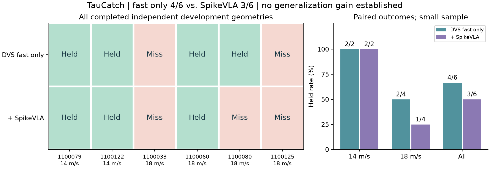

# 当前结果与证据

截至 2026-10-30。所有“接球”均为 MuJoCo 仿真；没有真机结果。成功以实验保存的 `held/caught` 判据为准，要求接触后保持，而非仅碰到球。

## 1. 最新独立开发几何配对

使用同一冻结模型 `fusion-617`；6 个预声明几何、两种模式各运行一次，共 12 次物理仿真、60 个实际模型请求。

| 几何 seed | 球速 m/s | 纯 DVS 快环 | 快环＋SpikeVLA |
|---|---:|---|---|
| 1100033 | 18 | 失败 | 失败 |
| 1100060 | 18 | 成功 | 成功 |
| 1100080 | 18 | 成功 | 失败 |
| 1100125 | 18 | 失败 | 失败 |
| 1100079 | 14 | 成功 | 成功 |
| 1100122 | 14 | 成功 | 成功 |
| **合计** | | **4/6（66.7%）** | **3/6（50.0%）** |

原始记录：[完成报告](../artifacts/evidence/generalization/completion.json)、[逐次结果 CSV](../artifacts/results.csv)。这是独立于该次优化的开发几何，样本小且已用于后续诊断，不能当作永久未见最终测试集。

上图是 seed 1100060 已保存的球与掌心位置可视化，VLA 开启时成功；该 seed 的纯快环也成功，因此这个片段用于展示接球过程，不证明 VLA 增益。[轨迹 CSV 与来源](../artifacts/examples/trajectory_1100060.json)。

训练几何 1100115、1100040、1100035 曾从快环 0/3 改善为 VLA 3/3；这是**训练局部救回**。保留成功案例与这些局部救回不能混算成泛化接稳率。旧 `482` 模型在另一批 12 个几何上双方均 11/12，也未证明 VLA 净收益；不同批次不能直接比较百分比。

## 2. 时延：飞行中的修正按时交付

| 测量 | 次数 | 中位 | 范围 | 说明 |
|---|---:|---:|---:|---|
| 飞行中请求往返（RPC） | 48 | 11.49 ms | 10.29–14.67 ms | 上表 6 组配对中 VLA 开启的全部飞行请求 |
| 从观测到修正可执行 | 48 | 21.57 ms | 17.83–27.23 ms | 观测时刻到动作实际到达控制端 |
| 早先 transport-621 传输验收 | 3 | 11.24 ms | 最大 11.46 ms | 同一融合模型，通过当轮验收 |

一个动作段 16 ms，一条修正的有效期 192 ms；最慢一次也只用了 27.23 ms，VLA 开启的 6 次闭环中所有修正都在有效期内到达。逐次请求的时间戳在[完成报告](../artifacts/evidence/generalization/completion.json)的 `requests_summary` 中，`python tools/handoff.py results` 会从中重算上表；transport-621 的记录见 [RPC 验收](../artifacts/evidence/latency/transport621_rpc_gate.json)。

以上均在 H100 上测得。计时包含搬运、排队、回传，尚未分段；上真机前需要在部署 GPU 上对采集、计算、传输分别计时。

## 3. 训练与问题定位

| 项目 | 已发生的结果 | 含义 |
|---|---|---|
| 原生 action 训练 | 4k / 4k / 8k 步完成；v3 离线位置误差约 3.80 cm | 离线动作误差不等于闭环接稳率 |
| 当前融合模型 | DVS 编码器与原生动作解码器适配，融合头 SFT 选择第 144 步；继承 1 步 raw RL | 已有连续动作学习；不能称 RL 已收敛 |
| 标签修正 | 找出插值真正执行的端点与原监督 mask 的缺口，完成数据修正 | 应按实际可执行区间训练，不能只看完整 chunk 的静态标签 |
| 修正后 CPU 拟合 | 尝试 256 步，候选均未过保持约束，选择 0 步并恢复父模型 | 没有可发布的新优胜模型，也没有新的接球率 |

当前结论：**系统能接到部分高速球，但 VLA 的独立增益尚未成立。** 下一阶段先扩充独立训练几何、使用修正标签训练，以冻结留出集的开/关配对验证收益；之后才评估进一步 RL。此处是接续建议，本次整理没有启动实验。
