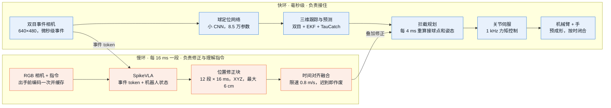
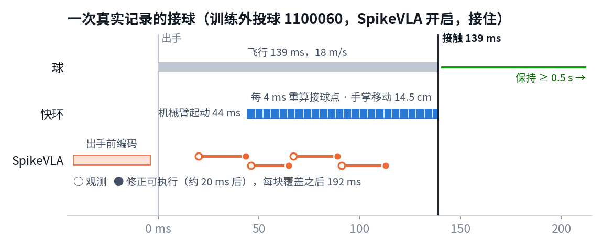
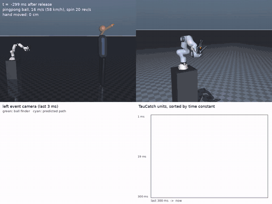
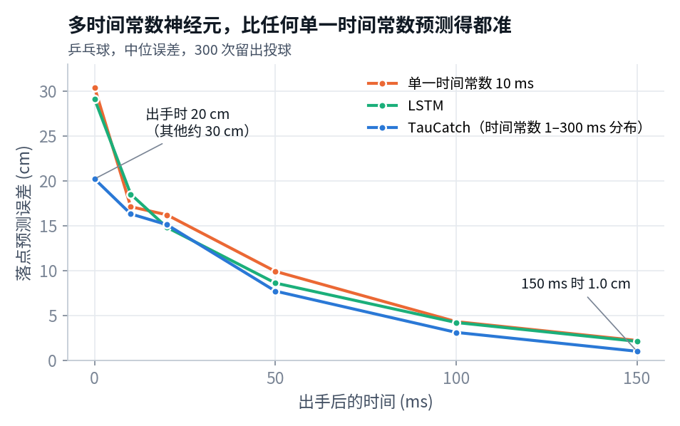
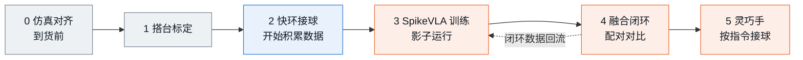
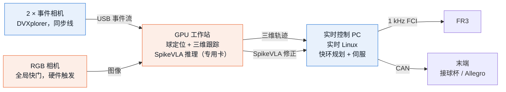

# TauCatch：进展与真机计划

2026-10-30 · 仿真完成，准备上真机

机械臂用双目事件相机跟踪飞来的球，在一次飞行（0.15–0.3 秒）内接住。事件相机快环负责接住，SpikeVLA 在慢环里修正接球位置、理解指令。

| 模块 | 状态 | 结果 |
|---|---|---|
| 事件相机快环 | ✅ 可用 | 12–25 m/s 乒乓球和网球，落点在手附近时接住 70–94%，与真实球状态上限相差 ≤5 个百分点 |
| TauCatch 预测 | ✅ 可用 | 出手瞬间误差 20 cm（LSTM 29 cm），150 ms 时 1 cm |
| SpikeVLA 融合接入 | ✅ 已接通 | 飞行中请求往返中位 11.5 ms，从观测到修正可执行中位 21.6 ms |
| SpikeVLA 增益 | ⚠️ 待验证 | 训练中失败的 3 球全部救回；训练外 6 组：快环 4/6，融合 3/6 |
| SpikeVLA 端到端 | ❌ 暂缓 | 闭环 0–1/32 |
| 真机 | ⚪ 待启动 | 推进顺序见第 5 节 |

## 1. 结论

1. **快环已能从事件流接住 12–25 m/s 的球**，接住率接近真实球状态的上限。
2. **手要移动 30–40 cm 时，早期预测决定成败**：同一快速臂，真实球状态接住 84%，事件流 45%。这是 SpikeVLA 的主要增益空间。
3. **SpikeVLA 已按融合方案接入闭环**，修正全部按时到达；增益要靠更多数据训练和配对验证。
4. **真机按“快环打底、积累数据、再训 SpikeVLA”推进**。起步硬件为 FR3、双目事件相机、RGB 相机和专用 GPU，约 €40–56k；首个目标 8–12 m/s 网球。

## 2. 系统

快环每毫秒控制机械臂；SpikeVLA 每次给出 12 段 × 16 ms 的 XYZ 修正，按时到达才叠加到拦截目标上，超过 192 ms 作废。

一次记录下来的接球（训练外投球 1100060，18 m/s，SpikeVLA 开启，接住）：

机械臂在 44 ms 起动，阶段 0 把它提前到 5 ms 内：网球 20 m/s 时，起动晚 20 ms，接住率从 77% 降到 65%；晚 50 ms 降到 43%。

## 3. 进展

| 日期 | 完成 | 结果 |
|---|---|---|
| 10-20 | 仿真平台（FR3 + Shadow 手、双目事件相机、TauCatch），事件流闭环接单球 | ✅ 接近真值上限 |
| 10-21 | TauCatch + EKF 融合；长距离接球；多球按指令选球 | ✅ 追平上限；⚠️ 选对率 53–56% |
| 10-22 至 10-25 | SpikeVLA 端到端输出 12×7 动作 | ❌ 闭环 0–1/32 |
| 10-26 至 10-27 | 融合方案：快环 + SpikeVLA 12×3 位置修正，监督训练 + 1 步强化学习 | ✅ 训练中失败的 3 球全部救回 |
| 10-28 | 训练外 6 组开关对比；整理交接包 | ⚠️ 4/6 对 3/6 |

## 4. 仿真结果

全部在 MuJoCo 中完成；“接住”指接触后保持在手里。

| 网球 25 m/s，20 倍慢放 | 长距离：手移动 40 cm |
|---|---|
|  |  |
| 左下为事件相机画面（绿圈：找到的球；青色：预测轨迹），右下为 TauCatch 神经元活动。111 ms 接触。 | 乒乓球 16 m/s，20 转/秒。半透明臂为起始位置，橙线为手掌路径。207 ms 接触。 |

| 按指令选球 | 同一网球，真实速度 |
|---|---|
|  |  |
| 指令“接住会到达你左侧的那个球”。SpikeVLA 33 ms 选定目标，276 ms 接触。 | 全程约 0.11 秒。 |

### 事件流接球接近真值上限

每组 64 次投球，落点在手附近 ±15 cm。

| 投球 | 事件相机快环 | 真值上限 |
|---|---:|---:|
| 乒乓球 12 m/s | 94% | 92% |
| 乒乓球 16 m/s，20 转/秒（TauCatch + EKF） | 86% | 86% |
| 网球 15 m/s | 88% | 86% |
| 网球 20 m/s（TauCatch + EKF） | 70% | 75% |

### 多时间常数预测得更准

快神经元出手即给出初猜，慢神经元积累证据、修正旋转造成的弯曲。测试过的 7 个单一时间常数（2–300 ms）在每个时刻都不如 TauCatch。

### 长距离接球取决于臂速和早期预测

“快速臂”手速约 4 m/s、4 g；“普通臂”约为 Panda 的 1.5 倍速度。乒乓球 16 m/s：

| 手移动距离 | 25 cm | 32 cm | 40 cm | 45 cm |
|---|---:|---:|---:|---:|
| 快速臂 · 真实球状态 | 83% | 92% | 84% | 27% |
| 快速臂 · 事件流 | — | 55% | 45% | 19% |
| 普通臂 · 真实球状态 | 44% | 22% | 9% | 0% |

普通臂移动 30 cm 以上就接不住，这决定买什么臂；快速臂上事件流比真值低一半，这是 SpikeVLA 要补的差距。

### SpikeVLA 融合方案：训练外 6 组开关对比

同一冻结模型、同一组投球，开关各一次，共 12 次仿真、60 次模型请求。

| 投球 | 1100079 | 1100122 | 1100060 | 1100080 | 1100033 | 1100125 | 合计 |
|---|:-:|:-:|:-:|:-:|:-:|:-:|:-:|
| 球速 | 14 m/s | 14 m/s | 18 m/s | 18 m/s | 18 m/s | 18 m/s | |
| 快环单独 | ✅ | ✅ | ✅ | ✅ | ❌ | ❌ | **4/6** |
| + SpikeVLA | ✅ | ✅ | ✅ | ❌ | ❌ | ❌ | **3/6** |

14 m/s 全部接住，差别在 18 m/s。真机阶段 3–4 用真机数据扩大训练，并做 ≥50 组配对。

### 时延

| 测量（H100） | 中位 | 范围 | 次数 |
|---|---:|---:|---:|
| 选球，指令已缓存（服务端） | 6.4 ms | P95 6.5 ms | 36 |
| 融合修正，飞行中请求往返 | 11.5 ms | 10.3–14.7 ms | 48 |
| 从观测到修正可执行 | 21.6 ms | 17.8–27.2 ms | 48 |

修正一段 16 ms、有效期 192 ms，最慢一次 27 ms 到达。

## 5. 真机计划

快环先在真机上接住球并积累数据，SpikeVLA 再用这些数据训练，逐步接管更多控制。三条路线因此串成一条：快环单独 → 融合 → SpikeVLA 接管更多动作维度。任何阶段关掉 SpikeVLA 都能回到快环。

### 推进顺序

| 阶段 | 目标 | 控制方案 | 做法 | 进入下一阶段 | 时长 |
|---|---|---|---|---|---|
| **0 仿真对齐** | 预测真机能接多快的球 | 仿真 | 按 FR3 速度、加速度和末端闭合时间重跑仿真；起动提前到 5 ms 内；在部署 GPU 上分段测 SpikeVLA 时延 | 首个真机球速和时延预算确定 | 到货前 2–3 周 |
| **1 搭台标定** | 看得准、时间对得齐 | — | 双目事件相机标定；相机同步线 + 电脑 PTP，对齐到 0.1–0.2 ms；动作捕捉测三维跟踪误差 | 跟踪误差和整链路时延实测完成 | 2 周 |
| **2 快环接球** | 真机接住球，开始积累数据 | 快环单独 + 接球杯 | 软网球 5 → 8 → 12 m/s，落点由近到远；少量标注微调球定位网络；每次投球全量记录 | 每档 ≥50 次，接住率可重复 | 3–4 周 |
| **3 SpikeVLA 训练** | 用真机数据学会修正 | 快环控制，SpikeVLA 影子运行 | 用事后标签训练（见下表）；SpikeVLA 在线推理但不执行，与事后标签比对 | 留出投球上，修正后的接球点误差低于快环 | 2–3 周 |
| **4 融合闭环** | SpikeVLA 提升接住率 | 快环 + SpikeVLA 位置修正 | 同速度、同落点范围交替开关；落点再放宽到 30–40 cm | ≥50 组配对，开启后接住率更高 | 3–4 周 |
| **5 最终形态** | 灵巧手按指令接指定的球 | 快环兜底，SpikeVLA 选球、修正，并接管手掌朝向和闭合时机 | 换 Allegro 手；多球同时投出，RGB + 语言指令选目标 | 真机按指令接住指定的球 | 后续 |

时长不含采购。每次投球记录：双目事件流、RGB、1 kHz 机器人状态与指令、动作捕捉球轨迹、快环预测与计划、SpikeVLA 请求与输出、结果（碰到/接住），全部按传感器采样时刻打时间戳。

### SpikeVLA 的训练步骤

| 步骤 | 数据 | 方法 | 检验 |
|---|---|---|---|
| 1 仿真预训练 | FR3 约束仿真，加入真机标定得到的噪声和时延 | 沿用 fusion-617 流程：监督训练融合头 + 强化学习微调 | 仿真留出集开关配对 |
| 2 事后标签 | 阶段 2 的真机投球 | 动作捕捉给出真实轨迹和真实接球点；标签 = 真实接球点 − 快环计划点，按 12 × 16 ms 网格，上限 6 cm | — |
| 3 真机微调 | 仿真 + 真机混合 | 监督微调融合头 | 影子运行：留出真机投球上的修正误差 |
| 4 闭环迭代 | 阶段 4 开启 SpikeVLA 后的投球 | 新投球重新打事后标签继续训练；数据足够后以接住与否为奖励做强化学习 | 配对接住率 |
| 5 扩展输出 | 多球、指令、灵巧手投球 | 加入选球（RGB + 指令）和手掌朝向、闭合时机输出（12×7） | 按指令接住率 |

## 6. 硬件

决定硬件的是球在空中时手能移动多远。网球从 3 m 外飞来，按直线移动、对称加减速估算，可用时间为飞行时间减 20 ms：

| 网球速度 | 飞行时间 | FR3（3 m/s，9 m/s²） | 普通臂（1.7 m/s，13 m/s²） | 快速臂（4 m/s，约 4 g） |
|---|---:|---:|---:|---:|
| 8 m/s | 399 ms | 32 cm | 42 cm | 111 cm |
| 10 m/s | 313 ms | 19 cm | 28 cm | 76 cm |
| 12 m/s | 259 ms | 13 cm | 19 cm | 55 cm |
| 15 m/s | 207 ms | 8 cm | 11 cm | 34 cm |
| 18 m/s | 172 ms | 5 cm | 8 cm | 23 cm |
| 20 m/s | 155 ms | 4 cm | 6 cm | 18 cm |
| 25 m/s | 124 ms | 2 cm | 4 cm | 11 cm |

> **FR3 适合 8–12 m/s、落点在手附近的接球。** 长距离接球需要更快的臂：先用 FR3 拿到真机结果，同时请厂家评估一台高速臂作为升级。

### 推荐配置

| 部件 | 推荐 | 理由 | 参考价 |
|---|---|---|---:|
| 机械臂 | **Franka Research 3 + FCI** | 1 kHz 力矩控制，能跑我们的快环；仿真用的就是它 | €25–30k |
| 末端（阶段 2–4） | **接球杯或软网**，自制 | 先验证感知和到达 | €0.5k |
| 末端（阶段 5） | **Allegro Hand V5 Plus**，16 关节 | 预成形和包络抓取；约 1 kg，在 FR3 负载内 | $15–27.5k |
| 事件相机 | **iniVation DVXplorer 双目套件**，640×480 | 与仿真分辨率一致；套件带同步线；延迟 <1 ms | €6.8k（学术价） |
| 事件相机（备选） | 2 × Prophesee EVK4 HD，1280×720 | 分辨率更高 | €4–5k / 台 |
| RGB 相机 | **全局快门工业相机**，如 Basler a2A1920-160ucBAS | SpikeVLA 视觉输入；硬件触发 | €1–2k* |
| 计算 | **实时控制 PC + GPU 工作站**（RTX 4090/5090 级，专跑感知和 SpikeVLA） | 控制与推理分开，互不干扰 | €5–8k* |
| 投球与安全 | 可调速、可调旋转的发球机；防护网；急停；软球 | 投球可重复，开关对比才成立 | €3–8k* |
| 真值测量 | 动作捕捉或 ≥500 fps 高速相机，优先用已有设备 | 测跟踪误差，给真机数据打事后标签 | 已有则为 0 |

\* 为估计价，其余为官方或经销商公开报价。

- **起步**（接球杯，不含灵巧手和动作捕捉）：€40–56k，约 32–45 万元。
- **加灵巧手**：€55–81k，约 44–65 万元。

### 连接方式

控制和推理分在两台电脑上；相机之间用同步线，电脑之间用 PTP，全部按传感器采样时刻打时间戳。

## 7. 风险与对策

| 风险 | 对策 |
|---|---|
| FR3 带载加速度有限，高速球只能接手边的 | 首个目标 8–12 m/s；阶段 0 按真实限幅预测；评估高速臂 |
| 手闭合慢（仿真网球 20 m/s：碰到 95%，接住 69%） | 阶段 2–4 用接球杯；上 Allegro 前先测闭合时间 |
| SpikeVLA 增益不足 | 真机事后标签数据 + 闭环迭代；重点放在长距离和按指令选球 |
| 仿真与真机差异（事件噪声、照明、背景运动） | 动作捕捉标注真机投球，微调球定位网络 |
| 时间不同步（18 m/s 时 1 ms = 1.8 cm） | 相机同步线 + PTP，采样时刻打时间戳 |
| 安全 | 防护网、急停、软球、逐级加速 |

## 8. 待决定

- [ ] **首个真机目标**：8–12 m/s 网球，落点在手附近，接住后保持 0.5 秒。
- [ ] **机械臂**：FR3 起步（已有 FR3 或 Panda 可直接用）；是否同时评估高速臂。
- [ ] **末端**：先接球杯，阶段 5 上 Allegro。
- [ ] **预算**：起步 €40–56k，加灵巧手 €55–81k；已有动作捕捉、发球机可省。
- [ ] **GPU 与场地**：一张专用 GPU；约 4 m 投球距离和防护网。

---

**数据来源**：[results.md](results.md)、[algorithm.md](algorithm.md)、[hardware.md](hardware.md)、`artifacts/evidence/`、`archive/20261028/legacy/docs/research_plan.md` §2、§5.9–5.10。

**硬件参数与价格**：
[FR3 运动限制](https://frankarobotics.github.io/docs/robot_specifications.html) ·
[libfranka 1 kHz 接口](https://frankarobotics.github.io/docs/doc/libfranka/docs/overview.html) ·
[FR3 价格指南](https://grabarobot.com/blog/franka-robotics-price-guide-2026/) ·
[Allegro Hand V5 Plus](https://www.allegrohand.com/sub/product/p.php?idx=4) ·
[Allegro 价格](https://www.originofbots.com/humanoid-robot-hand/allegro-hand-v5-plus-by-wonik-robotics-robot-hand-specifications) ·
[DVXplorer](https://docs.inivation.com/hardware/current-products/dvxplorer.html) ·
[DVXplorer 双目套件](https://shop.inivation.com/products/stereo-kit-dvxplorer-academic-rate) ·
[Prophesee EVK4 HD](https://www.shop.prophesee.ai/products/metavision%C2%AE-evaluation-kit-4) ·
[Basler a2A1920-160ucBAS](https://docs.baslerweb.com/a2a1920-160ucbas)

重绘图：`python tools/plot_roadmap.py docs/figures/roadmap`
