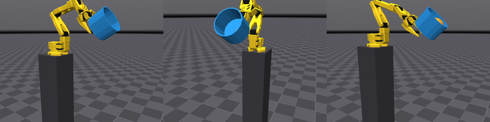

# SO-101 接球：仿真可行性与舵机实测

2026-11-13 · 目标：LeRobot SO-101（STS3215，7.4 V 版舵机）接 3 m/s 左右的球

## 结论

- **臂够用。** 用真值专家（所有臂共用的规划器，看到的是球的真实状态）在 SO-101 仿真里做低速抛球（2–4 m/s，飞行 0.45–0.75 s），200 次接住 99.5%。从 2–3 m 外平抛，3–6 m/s 都在 99.5% 以上，6–8 m/s 掉到 84.5%。
- **杯子要装在夹爪侧面。** SO-101 有 5 个关节，其中 3 根俯仰轴互相平行。杯子装在腕部转轴上（轴向）时，杯轴始终落在 shoulder_pan 的竖直面里，杯口没法朝向偏在一侧的球，最好也只有 85–87%。把杯子装在夹爪尖端的侧面，让杯轴垂直于腕部转轴，wrist_flex 和 wrist_roll 就能把杯口指向任意方向。侧装只能朝活动夹爪那一侧：装在固定夹爪外侧时，准备姿态需要 wrist_flex 超过 −95° 的限位，换任何底座位置都解不出来。实物做法是拆掉活动夹爪，把杯子支架固定在夹爪本体上。
- **杯子不能把球弹出来。** 杯–球接触改用 MuJoCo 默认的软接触后，接球率掉到 73.5%：球会陷进 4 mm 厚的杯底，顶到后面的夹爪，然后被弹出去或卡住。所以真杯子要做硬背板，内衬一层吸能材料（泡棉或毛毡）。验收方法：球从 30 cm 高丢进杯里，不能弹出来。
- **舵机参数基本不敏感。** 下面这些变化接球率都在 97–100%：5 V 或 7.4 V 供电、P 环刚度（1–8° 饱和）、阻尼减半、转子惯量加倍、舵机自带的加速度斜坡、50 Hz 总线、不做垂坠补偿。跟踪器晚 105 ms 才开始给出球的位置，仍是 100%。真正敏感的只有两项：杯子的弹性，以及杯口是否转向来球（只转 15% 时是 82.5%）。
- 以上都是真值专家的上限，不包括事件相机感知的误差，也不包括 SpikeVLA 策略本身。下一步是在 SO-101 上采数据，训练 SpikeVLA（F7）并做 DAgger，然后用事件相机闭环评估。

## 仿真模型：`taucatch/vla_catch/so101.py`

- **模型来源**：TheRobotStudio/SO-ARM100 的 `Simulation/SO101`（Apache-2.0）。`tools/fetch_so101.sh` 把它下载到 `vendor/so101`，不进仓库。默认用带腕部相机支架的版本。
- **摆放**：用一个台子把杯子的准备点放到 OpenArm 手等待的位置，这样抛球、相机和策略的任务空间动作都和其他臂共用。侧装时台面在准备点后方 30 cm、下方 16 cm。前后 ±4 cm 以内、台面最多高出 6 cm 的范围里，接球率都在 95.5% 以上，所以台子不需要摆得很准；但台面不能再低，否则摆不出准备姿态。
- **杯子**：口径 110 mm，深 80 mm，重 60 g，和 B601 的杯子相同。杯轴垂直于腕部转轴，朝活动夹爪那一侧，杯底贴着夹爪的外轮廓（`MOUNTS`、`JAW_BOX`）。杯–球接触用 `CUP_SOLREF = (0.004, 1)`，即硬接触、临界阻尼、不回弹。
- **舵机模型（STS3215）**：
  - 驱动力矩 = clamp(kp·(goal−q) − kv·q̇, ±stall)；反电动势按关节阻尼处理（空载转速 = stall/back_emf）；转子惯量 0.028 kg·m²，摩擦 0.052 N·m。
  - stall 随供电电压线性变化。标准套件用 5 V 驱动 7.4 V 版舵机，默认按 5 V 算。
  - 关节目标以 100 Hz 下发（总线同步写），下发前按重力力矩/kp 预先补偿垂坠。
  - kp、kv、舵机自带斜坡和总线延迟目前是猜的，等真机阶跃测量拟合出来后，用 `SO101_SERVO=拟合结果.json` 替换。
- **用法**：`collect.py`、`evaluate.py`、`baseline.py` 加 `--arm so101`。环境变量 `SO101_CUP_MOUNT=axial` 换成轴向装法，`SO101_SUPPLY=7.4` 换成 7.4 V 供电。

## 可行性：`tools/so101_feasibility.py`

每个变体都在独立进程里跑，种子相同，各 200 次抛球。完整结果在 `outputs/checks/so101/feasibility.{log,json}`。

| 变体 | 接住 |
|---|---|
| 默认：侧装杯，5 V，低速抛球 2–4 m/s | 99.5% |
| 跟踪器晚 105 ms 起步 / 再加横向 ±12 cm | 100% / 100% |
| 平抛 3 m/s，从 1.5 m 或 2 m 外 | 99.5% |
| 平抛 4–5 m/s，从 2.5 m 外（再加跟踪器延迟） | 100%（99.5%） |
| 平抛 5–6 m/s，从 3 m 外 | 100% |
| 平抛 6–8 m/s，从 3 m 外 | 84.5% |
| 轴向装杯（加跟踪器延迟） | 87.0%（85.0%） |
| 杯–球软接触（MuJoCo 默认） | 73.5% |
| 杯口只转 15% 向来球（blend 0.15） | 82.5% |
| 7.4 V / P 环 1° 饱和 / ζ 0.3 / 转子惯量 0.05 | 100% / 97.5% / 97.0% / 98.0% |
| 舵机斜坡 40 rad/s² / 50 Hz 总线 / 不补偿垂坠 | 100% / 99.5% / 99.0% |
| 不带腕部相机 / 杯子 120 g | 100% / 99.5% |

底座位置扫描：`--scan-base [--variant 名称] --behind ... --below ...`。

## 真机舵机阶跃测量：`tools/so101_step.py`（发给合作者）

这一步测出舵机的真实响应，用来替换仿真里猜的那几个舵机参数。全程大约 5 分钟，不需要这个仓库。

1. **准备**：
   - 只需要 numpy 和 `feetech-servo-sdk`（装了 LeRobot 就有），把 `tools/so101_step.py` 单独拷过去即可。
   - 停掉 LeRobot、遥操作和录制程序，确保没有别的程序占着串口。
   - 臂周围清空 0.5 m，手放在电源开关旁边。
2. **摆到 LeRobot 的 0 位**：大臂竖直向上，小臂和夹爪水平朝前，每个关节离量程中点不超过 15°。
3. `python so101_step.py check --port /dev/ttyACM0`
   - 只读寄存器，臂不会动。把输出发回来，内容包括模式、P/D/I、加速度、电压、温度和各关节离中点的角度。
4. `python so101_step.py run --port /dev/ttyACM0 --out so101_step.json`
   - 测 4 个关节，每个关节分别走 10°、20°、30°，正反两个方向都测，约 1 分钟。开始前会要求输入 yes 确认。
   - 安全措施：任何一个不在测试中的关节偏离超过 10° 就立即停止；舵机温度到 60 °C 也停止；结束时恢复原来的寄存器。
5. **可选**：加 `--accel 0 --speed 0`，用另一个文件名再跑一次。这会关掉舵机自带的加速度斜坡和限速，用来测极限能力。
6. **装上杯子以后**，加 `--cup` 再跑一次。
7. 把生成的 json 发回来。这边执行 `python tools/so101_step.py fit so101_step.json --out so101_servo.json`，再用 `SO101_SERVO=so101_servo.json` 重跑可行性检查和数据采集。

辅助命令：

- `python tools/so101_step.py sim --out sim.json`：在仿真里跑同一套协议。
- `python tools/so101_step.py report so101_step.json sim.json`：并排列出两份数据的死区时间、上升时间、峰值速度、加速度、超调、稳定时间和垂坠。

**拟合自检**：用一组已知参数在仿真里生成一份"实测"数据。参数为 sat 6°、ζ 0.3、stall 1.4 N·m、空载 4.5 rad/s、转子惯量 0.02、斜坡 40 rad/s²。数据里加了 7 ms 总线延迟，把两个关节的方向反过来，按约 150 Hz 不均匀采样，并量化到 4096 刻度/圈。`fit` 的任务是把这些参数找回来。

结果：sat 5.94°、ζ 0.32、stall 1.39、空载 4.64、转子惯量 0.0199、斜坡 47 rad/s²、延迟 13 ms，残差 0.09°（用真实参数算是 0.025°，也就是量化误差）。关节方向全部判对。延迟和斜坡互相能抵消一部分，所以延迟多估了 6 ms。fit 用 8 个起点并行做 Nelder-Mead，约 8 分钟。

## 下一步

1. **合作者**：跑舵机阶跃测量；按上图做侧装杯支架（拆掉活动夹爪，杯子固定在夹爪本体上，加吸能内衬）；搭台子。
2. **这边**：拟合舵机参数，重跑可行性检查；用 SO-101 采专家数据，在 SO-101 上微调 SpikeVLA（F7）并做 DAgger；在仿真里用事件相机闭环评估。
3. **真机接口**：Feetech 总线以 100 Hz 同步写关节目标、同步读位置，替换仿真里的 `step_physics`。
