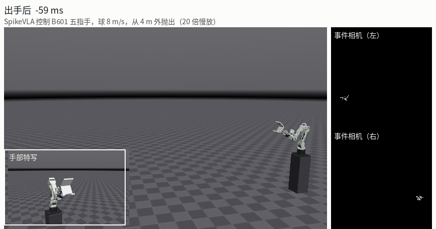
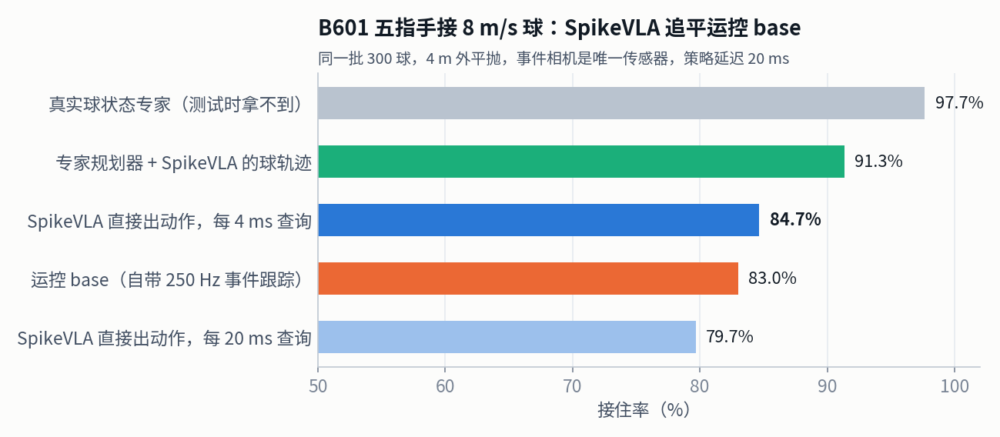
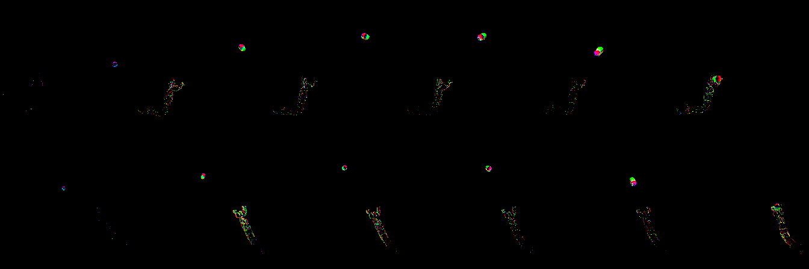
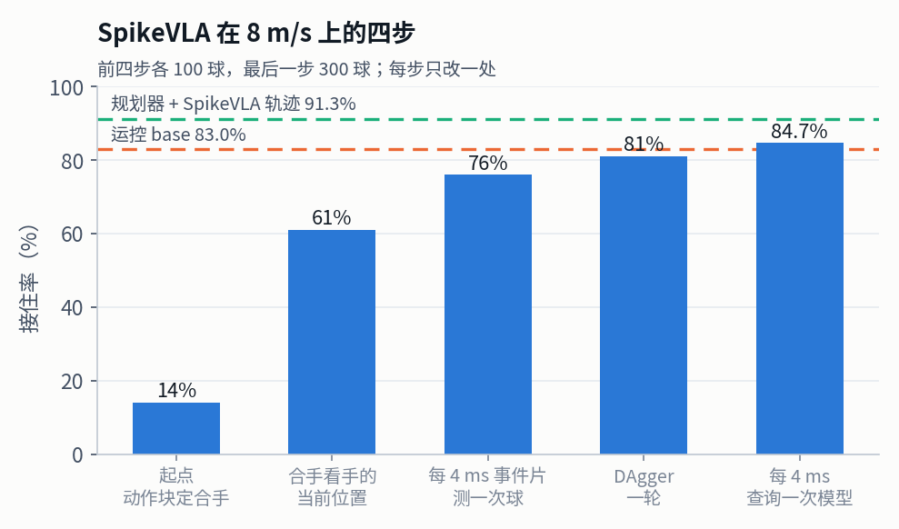
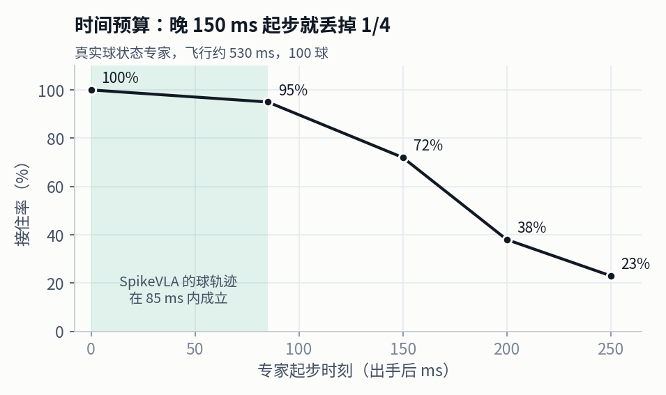
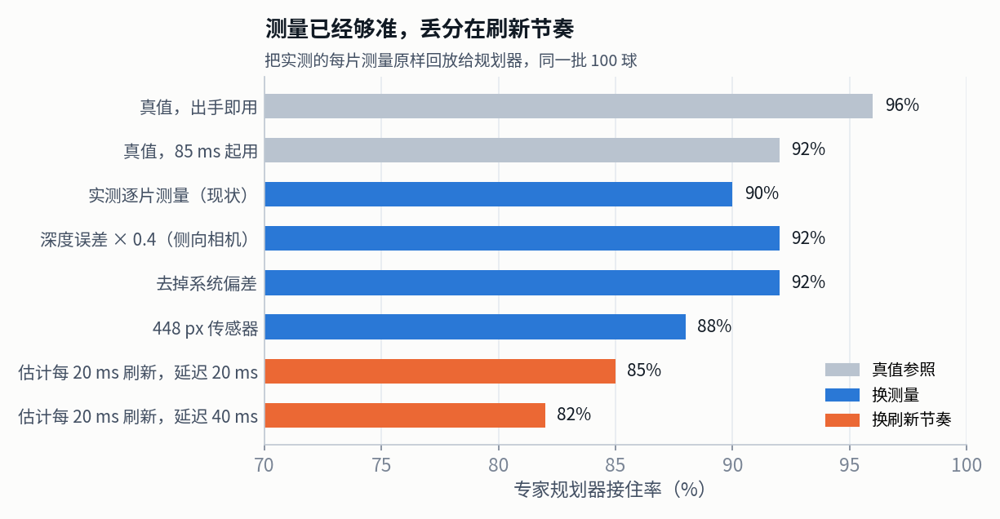

# SpikeVLA 接球

2026-11-04 · MuJoCo 仿真，按真机条件设计 · 逐轮记录见 [spikevla_catch_log.md](spikevla_catch_log.md)，上真机见 [real_robot.md](real_robot.md)

SpikeVLA 只看两路事件相机，在模型内找球、测球、记住球的轨迹，每 4 ms 输出一段 12 × 20 ms 的末端动作；500 Hz 的逆运动学和关节伺服执行，手按模型内的球轨迹合拢。真机平台是 Seeed reBot Arm B601-DM 加五指手，24 V 供电。



## 1. 结果：8 m/s，4 m 外



| 同一批 300 球（种子 1000000–1000299） | 接住 |
|---|---|
| 真实球状态专家（测试时拿不到，上限参照） | 97.7% |
| 专家规划器 + SpikeVLA 的球轨迹 | 91.3% |
| **SpikeVLA 直接出动作，每 4 ms 查询** | **84.7%** |
| 运控 base（自带 250 Hz 事件跟踪 + 专家规划器） | 83.0% |
| SpikeVLA 直接出动作，每 20 ms 查询 | 79.7% |

- SpikeVLA 追平运控 base（只有 SpikeVLA 接住的 40 球，只有 base 接住的 35 球）。
- SpikeVLA 的球轨迹比 base 的好：同一个规划器，接 SpikeVLA 的轨迹比接 base 的多接 45 球、少接 20 球。
- 动作头还差规划器 6.6 个点，丢在手的位置上：位置换成规划器的输出、朝向仍用动作头，接住 90.0%。

低速场景（球 2–4 m/s，1.2–1.7 m 外，100 球，细节见逐轮记录 §5.12–5.15）：

| 场景 | SpikeVLA | 专家 |
|---|---|---|
| OpenArm v2 单球 | 83% | 92% |
| OpenArm v1 单球 | 64% | 91% |
| B601 接球杯单球 | 77%（另 200 球 83%） | 100% |
| 三球，按颜色点名 | 62% | 92% |
| 三球，按左右高低点名 | 66% | 96% |

## 2. 系统

| 环节 | 设置 |
|---|---|
| 传感器 | 2 × 事件相机（仿真 224 × 224，竖直视场 62°，4 ms 一片），装在臂后两侧；测试时不用任何真值 |
| 图像 | 轨迹帧：每像素最近一次事件的时间，三个时间常数（10 / 50 / 250 ms）放进 RGB 三个通道 |
| 模型 | SpikeVLA（ICML 版 SGSA 视觉 + 动作头）+ 模型内定位器：打分器找球 → 均值漂移测球 → 三角化 → 20 格轨迹记忆 → 重力拟合 |
| 逐片测量 | `SliceTrack`：轨迹成立后每个 4 ms 事件片都测一次球，改写模型的轨迹记忆（只用几何） |
| 输出 | 12 × 7 动作块，间隔 20 ms：抓取目标偏移（3）、姿态旋转（3）、手指 |
| 执行 | 阻尼最小二乘 IK，关节 PD + 重力补偿，24 V 力矩–转速线；手在球轨迹到达手的当前位置前 50 ms 合拢 |
| 延迟 | 从拍到事件到动作生效按 20 ms 计；推理 3.08 ms |



## 3. 8 m/s 是怎么做上去的



| 改动 | 接住 | 原因 |
|---|---|---|
| 起点：动作块里的手指通道决定合手 | 14% | 手落后 IK 参考 4–8 cm（24 V 力矩上限），按计划位置算的合手时刻不对 |
| 合手看手的当前位置（`--close-hand`） | 61% | 合手时刻按球轨迹到达手实际所在处来定 |
| 每 4 ms 事件片测一次球（`--slice-track`） | 76% | 原来每 20 ms 测一次，出手后 100 ms 球速误差 18 cm/s |
| 在新设置下做一轮 DAgger（自身 300 球） | 81% | 动作头见到自己造成的状态 |
| 每 4 ms 查询一次模型（`--query-every 0.004`） | 84.7% | 估计刷新慢是剩下的主要丢分（见下节） |

前四步各 100 球，最后一步 300 球。

## 4. 瓶颈在哪



8 m/s 由球速估计多早可用决定：真实球状态专家晚 150 ms 起步，接住率就从 100% 掉到 72%。SpikeVLA 的轨迹在 85 ms 内成立。



把实测的每片测量原样回放给专家规划器：测量换成真值只多 2 个点，换侧向相机、448 px 传感器、去掉偏差都在 ±3 个点内；估计改成每 20 ms 刷新一次就掉到 82–85%，正是当时的闭环成绩。按事件数加权的测量窗口比二值窗口差（沿投掷方向 1.34 vs 1.02 cm）。所以改的是查询节奏，不是相机。

## 5. 正在做

| 项目 | 状态 |
|---|---|
| 动作头的位置输出 | 位置换成规划器的输出能到 90%，下一步针对位置做 DAgger 标签和损失 |
| DAgger 第二轮 | 同一设置再录 300 球后反而 86% → 71%（204 球），在查原因（中间检查点评测中），第三轮暂停 |
| 上真机 | 步骤、标定和接口见 [real_robot.md](real_robot.md) |

## 6. 一路上解决的问题

| 问题 | 发现 | 解决 | 结果 |
|---|---|---|---|
| 20 ms 事件窗定不出球速 | 一帧里只有球的一小段 | 轨迹帧（每像素最近事件时间） | 球速可读 |
| 视觉特征丢球位置 | 事件直接定位 0.6 cm，视觉特征只到 5.3 cm | 定位器做进模型 | 0.46 cm |
| 动作超出可输出范围 | 动作头输出在 (−1, 1)，z 分数下 1/3 目标出界 | 按范围缩放 | +220 ms 误差 4.75 → 2.60 cm |
| 策略延续手的运动，不看球 | 专家驱动时首项误差 1.4 cm，自己驱动时 11.5 cm | DAgger + 隐去手速度 | 7% → 68% |
| 合手时机不准 | 动作头给的手指通道不准 | 模型内球轨迹定时 | 52% → 73% → 83% |
| 三球时定位被别的球拉偏 | 20 px 测量窗里别的球把质心拉偏约 10 cm | 窗口收到球自身大小 | 三球 46% → 62% |
| 推理太慢 | 单步 132 ms | 编译、双视角合批、FP16 脉冲卷积、时间步折叠 | 3.08 ms，成绩不变 |

## 7. 复现

GPU 渲染（EGL）11-03 起在这台机器上不可用（GPU 7 不可纠正 ECC 错误），全部改用 CPU 渲染（OSMesa）。同一批 100 球，SpikeVLA 75% vs 76%、运控 base 85% vs 83%、专家都是 98%，结果一致。

```bash
export MUJOCO_GL=osmesa PYOPENGL_PLATFORM=osmesa VLA_AIM_X=1.3
J="--catcher hand --hand-rate 285 --hand-open .26 --lead .05 --bounce .5 --volts 24 --blend .5 --throw-speed 8 --throw-from 4"
# SpikeVLA（加 --plan-track 换成专家规划器，加 --mix pos 只换位置）
python -m taucatch.vla_catch.evaluate --ckpt runs_v2/saim_r1_b601/ema_3000.pt --arm b601 --latency .02 --fast \
    --close-track --close-hand --slice-track --query-every 0.004 $J --tosses 300 --out ours.json
# 运控 base
python -m taucatch.vla_catch.baseline --select named --arm b601 $J --tosses 300 --out base.json
# DAgger 一轮：录自身轨迹，再训练
python -m taucatch.vla_catch.evaluate --ckpt runs_v2/aim_r5_b601/ema_3000.pt --arm b601 --latency .02 --fast --close-track \
    --close-hand --slice-track $J --throw-speed 7 10 --throw-from 4 5 --tosses 300 --record data_v2/dagger_x
python -m taucatch.vla_catch.train --arm f7 --data data_v2/aim_b601 data_v2/dagger_x --frames trace --locator --no-velocity \
    --init runs_v2/aim_r5_b601/ema_3000.pt --steps 3000 --out runs_v2/x
# 逐片测量与回放
python tools/slice_measure.py measure 224 1000000 100 res_r224_0.pkl
python tools/replay_measurements.py now 'res_r224_*.pkl' 0.084 0.02 1 1 1 0 0.02
# 图
python tools/plot_b601.py docs/figures/b601
python tools/render_b601_catch.py record 1000086 runs_v2/saim_r1_b601/ema_3000.pt catch.npz
python tools/render_b601_catch.py render catch.npz docs/figures/b601/catch_8ms.gif
```

CPU 渲染每球约 40 s，评测按 `--seed` 拆成多个进程并行（`outputs/logs/vla_catch/osm_common.sh` 的 `osm_job`）；每个进程约占 7 GB 显存。SpikeVLA 代码（ICML 版本）在不公开的 `vendor/spikevla_icml`，从头训练用的预训练起点在 `vendor/checkpoints/spikevla_{v1,f7}.pth`，权重和数据在 `runs_v2/`、`data_v2/`，都不进仓库。
