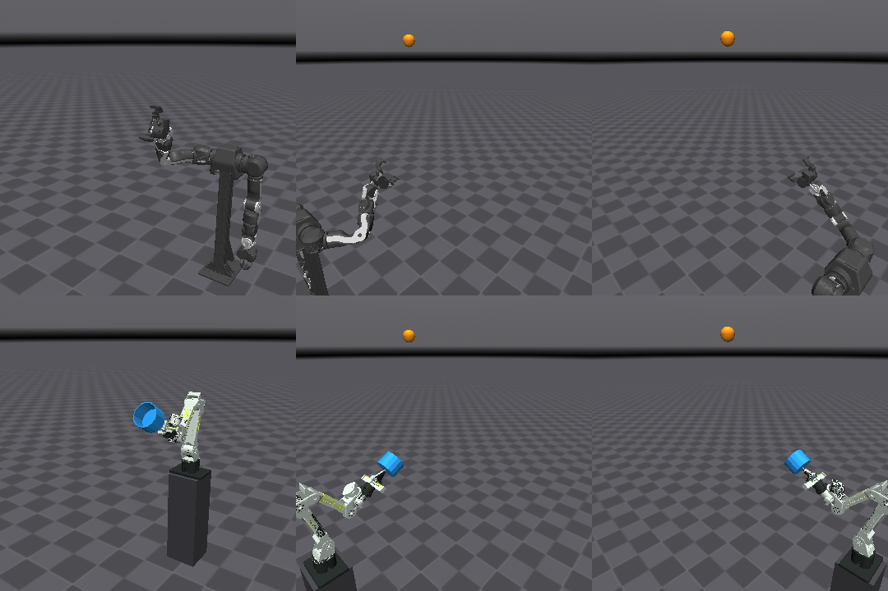
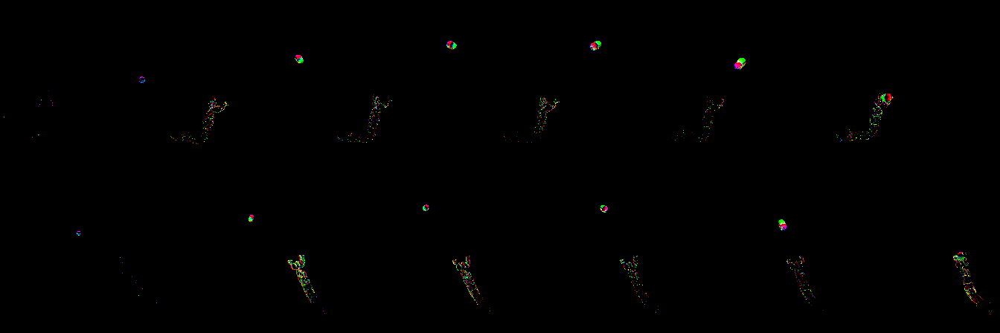
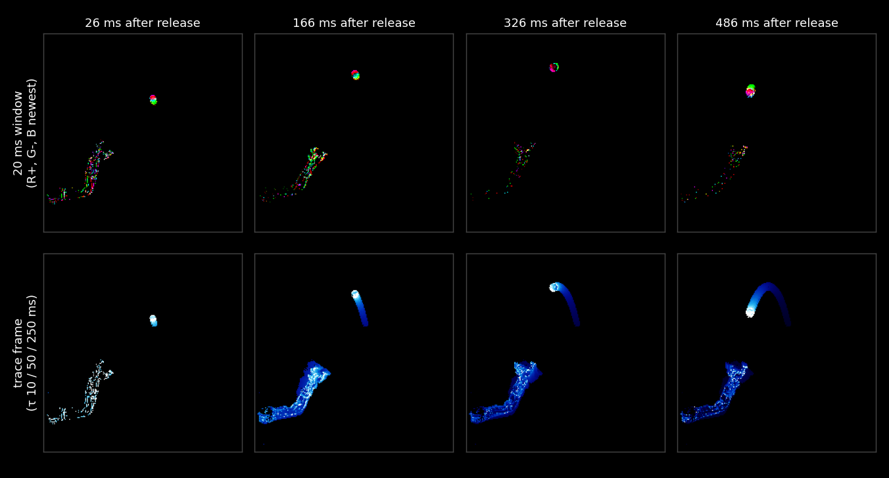
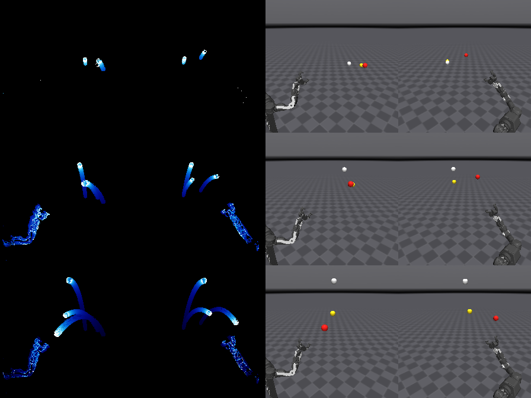

# SpikeVLA 接球：逐轮记录

完整的实验过程，按时间顺序。结论和当前结果见 [spikevla_catch.md](spikevla_catch.md)。


2026-11-04 · 仿真对齐真机，SpikeVLA 直接出动作

SpikeVLA 看两路事件相机画面和手的状态，每 20 ms 输出一段 12 × 20 ms 的末端动作；500 Hz 的跟踪层只做逆运动学和伺服。两台真机（OpenArm v1、Seeed reBot B601-DM）和 OpenArm v2 在同一个场景里，抛球、相机和动作格式相同，同一个 SpikeVLA 可以驱动各台臂。方法对比（第一、二轮）在 OpenArm v2 数据上做，上真机的策略用 OpenArm v1 和 B601 的数据训练。

| 模块 | 状态 | 结果 |
|---|---|---|
| OpenArm v2 仿真 + 专家 | ✅ | 真实球状态专家接住 90.3%（300 球） |
| OpenArm v1 仿真 + 专家（真机型号） | ✅ | 专家接住 91.3%（300 球），70 mm 球 |
| B601 仿真 + 专家 | ✅ | 110 mm 接球杯，专家接住 99.9%（3000 球） |
| 事件相机选型 | ✅ | 2 × Prophesee EVK4 HD（§3.2） |
| 事件相机数据 | ✅ / ⏳ | OpenArm v2 12000 球（专家接住 10880），B601 3000 球；OpenArm v1 12000 球采集中 |
| 第一轮：20 ms 事件窗，三组对照 | ✅ | 闭环 0–7%（专家 92%）：手离球最近处中位 13 cm |
| 诊断 | ✅ | 20 ms 事件窗定不出球速；三组模型误差相同 |
| 第二轮：轨迹帧（时间面） | ✅ | 8000 步闭环 F7 5.5%、v1 4%；+220 ms 误差 5.6 / 5.7 cm |
| 第三轮：轨迹帧 + 球位置预测 | ✅（4000 步） | +220 ms 误差 5.9 cm，不优于第二轮 |
| 诊断：精度丢在哪 | ✅ | 事件相机本身定位球 0.6 cm；SpikeVLA 视觉特征只到 5.3 cm（§5.4） |
| 第四轮：球测量进 state | ✅（2000 步） | 球位置 0.44 cm、速度 3 cm/s，闭环仍 5%：手离球最近处中位 15 cm |
| 诊断：动作目标超出 tanh 范围 | ✅ | 动作头输出在 (−1, 1)，动作按 z 分数归一化：+220 ms 的目标 1/3 超出可输出范围，第一至五轮都受影响；修正后只训动作头，+220 ms 误差 4.75 → 2.60 cm，与看真实球状态的 MLP 相当（§5.6） |
| 事件接入模型内部 | ✅ | SpikeVLA 自己的 token 找球、事件测球、轨迹记忆：0.46 cm、3.3 cm/s，40 球无丢失（§5.7） |
| 第五轮：state 进动作查询 + 模型内定位 | ✅ | 2000 步 5%、4000 步 8%（原归一化，§5.8） |
| 第六轮：修正动作缩放 | ✅ | 离线 +220 ms 误差 2.8 cm，闭环仍 4.5–7%（§5.10） |
| 诊断：闭环模仿惯性 | ✅ | 专家驱动时策略首项误差 1.4 cm，策略自己驱动时 11.5 cm：策略延续手当前的运动，不读球（§5.11） |
| 第七轮：DAgger | ✅ | 模型内定位 + 隐去手速度 + DAgger：4000 步闭环 **41%**（第六轮 7%），手离球最近处中位 2.9 cm（§5.12） |
| 第八轮：DAgger 第二轮 | ✅ | OpenArm v2 闭环 2000 步 65%、4000 步 **68%**，手离球最近处中位 1.5 cm，超过同样输入的 MLP（58%）；只多训不加新轨迹 56%（§5.13） |
| 第九至十二轮：DAgger + 模型内合手 | ✅ / ⏳ | 旧轨迹降权 50%，保持原权重 63%；动作块时间集成 49–57%；夹爪改由模型内轨迹决定后第十一轮 73%，第十二轮 **83%**（专家 92%），手离球中位 1.24 cm（§5.14–5.15） |
| 真机臂 OpenArm v1：DAgger | ⏳ | 自身轨迹 200 → 600 → 1000 → 1400 球：4% → 31% → 50% → **64%**（夹爪由模型内轨迹决定，专家 91%）（§5.14） |
| 真机臂 B601 | ⏳ | 执行器检查 100%；专家数据 8–12%；DAgger 自身 200 → 400 球后闭环 75% → **77%**（专家 100%），手离球中位 1.25 cm |
| B601 五指手，8 m/s、4 m 外抛 | ⏳ | 同一批 300 球：SpikeVLA 动作头 **84.7%**，运控 base 83.0%，专家规划器接 SpikeVLA 的轨迹 **91.3%**，真实球状态专家 97.7%（§5.16） |
| 推理加速 | ✅ | 编译 + 双视角合批 + FP16 脉冲卷积 + TF32 + 时间步折叠：**3.08 ms**（CUDA Graph 41 ms），闭环 67%（CUDA Graph 68%）（§5.9） |
| 多球语义选球 | ⏳ | 同一模型：语言头选球，事件轨迹锁定，门控后的事件帧进单球控制头。三球 100 次接住 **62%**（专家 92%，单球 83%），轨迹跟对 98%（§5.15） |



上：OpenArm v2（Enactic 官方模型）。下：B601-DM 手持接球杯。左为总览，中、右为两路事件相机的 RGB 视角。

## 1. 系统

| 环节 | 设置 |
|---|---|
| 抛球 | 出手点 x 1.15–1.65 m，飞行 0.45–0.75 s，速度约 2–4 m/s，70 mm / 50 g 球；瞄准手的待命点 ±10–18 cm |
| 事件相机 | 两台，装在臂后方两侧，视线夹角约 90°，224 × 224，每 4 ms 渲染一帧，按对数亮度变化生成事件（每像素阈值 0.15 ± 0.02） |
| SpikeVLA 输入 | 两路事件图 + state8（抓取中心位置、速度、手指角度、手指指令）。事件图第一轮为 20 ms 事件窗，第二轮为轨迹帧（§5.3） |
| SpikeVLA 输出 | 12 × 7 动作块，间隔 20 ms：抓取目标相对当前抓取中心的偏移（3）、相对当前姿态的旋转向量（3）、手指斜坡（越过 0.5 即闭合） |
| 执行 | 动作块在时间上插值，500 Hz 阻尼最小二乘逆运动学，关节 PD 伺服（带重力补偿） |



一次抛球的两路事件图（上、下各一台相机），从出手到接住约 0.64 s。手臂静止时不产生事件，球和运动中的手臂清晰可见。

## 2. 专家：从 71% 到 90%

SpikeVLA 的上限是它模仿的专家。OpenArm 场景的第一版专家只接住约 71%：失败的球在第一次接触时，手还以 1.2 m/s 运动、离目标 5.5 cm，球偏到手掌一侧 2.6 cm，撞在一根手指上。原因是关节 PD 没有重力补偿，手整体下垂 2–3 cm；抓取中心也设浅了 3 cm。

| 设置（300 球） | 接住 |
|---|---|
| 原设置：无重力补偿，抓取中心 12 cm，提前 50 ms 闭合 | 73.0% |
| 只加重力补偿 | 50.7% |
| 重力补偿 + 抓取中心 15 cm | 89.0% |
| 重力补偿 + 抓取中心 15 cm + 提前 40 ms 闭合 | **90.3%** |

真实 OpenArm 的控制栈自带重力补偿，仿真与真机一致。

## 3. 真机与传感器

### 3.1 机械臂

| | OpenArm v1（真机） | B601-DM（真机） | OpenArm v2（方法对比） |
|---|---|---|---|
| 模型来源 | Enactic openarm_mujoco v1（Apache-2.0，随仓库） | Seeed reBotArm_control_py 的 URDF（无许可证，`tools/fetch_b601.sh` 下载） | Enactic openarm_mujoco v2 |
| 自由度 | 7 + 平行滑动夹爪 | 6 + 平行夹爪 | 7 + 转动夹爪 |
| 电机 | DM8009 / DM4340 / DM4310，增益与 v2 相同 | DM4340（1–3 轴）/ DM4310（4–6 轴） | DM8009 / DM4340 / DM4310 |
| 接球方式 | 夹爪内侧最大张开 78 mm，70 mm 球单侧余量 4 mm；手指几毫秒内合拢，球到抓取中心前 12.5 ms 闭合 | 夹爪最大开口 57 mm，小于 70 mm 球，改用 110 mm 接球杯 | 夹爪抓握，闭合到接触约 90 ms，提前 40 ms 闭合 |
| 专家接住（300 球） | 91.3% | 100% | 90.3% |

三台臂的待命点（抓取中心和手的朝向）重合，抛球分布和相机位置相同。OpenArm v1 的底座位置与 v2 相同（肩高 0.697 m），B601 底座放在 0.55 m 的立柱上。

OpenArm v1 照搬 v2 的闭合时机（提前 40 ms）只接住 1%：滑动手指合拢快，球离抓取中心还有 6 cm 时手指已经夹到球，球被夹在指尖。专家的截球时间搜索原来从 20 ms 起，提前量小于 20 ms 时永远不闭合；改为从 0 起之后，v2 专家不变（300 球 90.7%），v1 的闭合提前量在 5–20 ms 之间都能接住 82–90%：

| OpenArm v1 闭合提前量（抓取中心 15 cm，150 球） | 接住 |
|---|---|
| 40 ms（v2 的设置，抓取中心 15.5 cm，100 球） | 1% |
| 20 ms | 82.7% |
| 15 ms | 89.3% |
| 10 ms | 90.0% |

### 3.2 事件相机：2 × Prophesee EVK4 HD

| 候选 | 传感器 | 分辨率 | 延迟 | 多相机同步 | 价格 |
|---|---|---|---|---|---|
| **Prophesee EVK4 HD** | Sony IMX636 | 1280 × 720 | < 100 µs（1000 lux） | 同步接口（主从） | 5,450 美元 / 台 |
| iniVation DVXplorer | — | 640 × 480 | < 1 ms | 隔离的同步输入 / 输出口 | 3,500 欧元 / 台（学术价） |
| Prophesee EVK3 GenX320 | GenX320 | 320 × 320 | < 150 µs | 同步接口 | 未公开 |

选 EVK4 HD 的理由：IMX636 是事件相机研究中最常用的传感器，传感器上自带抗频闪和事件率控制，室内 50 Hz 照明的 100 Hz 闪烁不会淹没球的事件；正方形中心区 720 × 720 合并到 224 × 224，每个输入像素约 3 × 3 个传感器像素，70 mm 球在 1.5 m 处约 30 个传感器像素宽；C 口镜头可换，两台用同步线主从对时。配 2.8–3.5 mm 的 C 口镜头（720 像素方向视场 53–64°），仿真的视场按买到的镜头设定。

轨迹帧对每个像素只记最近一次事件的时间，不依赖事件个数，相机分辨率、合并方式和阈值不同时，图像形状不变，适合仿真到真机。相机到货后实测并写入仿真的量：视场与安装位姿（标定）、对比度阈值、背景噪声事件率、抗频闪后的残余事件。

## 4. SpikeVLA 对照

三组从同一份数据全量微调（视觉编码器 lr 2e-5，其余 1e-4，batch 64，8000 步，全 fp32）：

| 组 | 起点 | 检验的问题 |
|---|---|---|
| v1 | v1 预训练权重 + v1 动作头 | 原 SpikeVLA |
| v1+SGSA | v1 预训练权重 + SGSA 读出（F7 的 ifr 设置） | 读出改进本身带来多少 |
| F7 | ICML 最终模型（SGSA） | 改进后的 SpikeVLA 整体 |

## 5. 结果

### 5.1 第一轮：20 ms 事件窗

闭环评测用训练时没见过的抛球（种子 1,000,000 起），专家在同一批球上对照。

| 组（8000 步） | 闭环接住 | 手离球最近处（中位） |
|---|---|---|
| F7 | 5%（100 球） | 12.6 cm |
| v1+SGSA | 7%（100 球） | 13.0 cm |
| v1 | 0/20 | — |
| 专家（真实球状态） | 92% | — |
| 专家动作块经同一执行器（oracle） | 83% | 1.1 cm |

oracle 把专家在当前状态下的 12 × 7 动作块直接交给策略的执行器，接住 83%，说明动作格式、插值执行和 DAgger 重标注都是对的，问题在策略本身。策略的闭合时机正确（中位在球到达前 35 ms，与 oracle 相同），但手没有移到球的位置：离球最近处中位 13 cm，相当于瞄准点在待命点周围的分布范围，即手基本停在待命点附近。

### 5.2 原因：20 ms 事件窗定不出球速

在专家轨迹的验证集上看动作块各项的位置误差（F7，768 步）：

| 位置误差（cm） | 当前项 | +60 ms | +120 ms | +220 ms |
|---|---|---|---|---|
| 恒预测零偏移 | 4.0 | 5.4 | 6.5 | 9.8 |
| 真实事件图 | 1.7 | 2.5 | 3.2 | **5.7** |
| 事件图置零 | 3.3 | 4.5 | 5.3 | 8.2 |
| 换成别的球的事件图 | 3.7 | 4.8 | 5.7 | 8.6 |

训练日志里的验证误差 1.5 cm 只算了当前项。决定接球的是 +220 ms 项，即手要去的位置，误差 5.7 cm，而接住需要 1–2 cm。v1+SGSA 与 F7 的各项误差相同（+220 ms 都是 5.7 cm），所以瓶颈在输入，不在视觉模型。

20 ms 的事件窗里球只走 4–8 cm，策略没有记忆。单视角下球的位置精度约 0.26 cm（0.3 像素），由 20 ms 估计的球速误差约 18 cm/s，外推到 0.4 s 后的截球点就是约 7 cm，与实测的 5.7 cm 相符。用 200 ms 的历史，同样的位置精度给出的截球点误差约 0.7 cm。

### 5.3 第二轮：轨迹帧



同一次抛球、同一台相机。上：20 ms 事件窗，每一刻只有一个点。下：轨迹帧，每个像素按最近一次事件的时间衰减，R/G/B 三个时间常数为 10 / 50 / 250 ms，一帧里能看到球过去几百毫秒的弧线和方向。

轨迹帧仍是 3 通道 224 × 224 图像，SpikeVLA 结构不变。事件按原始格式存储，12000 球数据直接复用；数据、配方、步数与第一轮相同，只换输入。

| F7，轨迹帧，2000 步 | 当前项 | +60 ms | +120 ms | +220 ms（出手后 < 150 ms / 之后） |
|---|---|---|---|---|
| 真实事件图 | 2.3 | 3.1 | 3.8 | 6.3（6.4 / 6.3） |
| 事件图置零 | 3.6 | 4.7 | 5.7 | 8.8 |

到 8000 步：

| 轨迹帧 | 闭环接住 | 手离球最近处（中位） | +220 ms 误差（前段 / 后段） |
|---|---|---|---|
| F7，8000 步 | 5.5%（200 球） | 11.4 cm | 5.6 cm（5.5 / 5.6） |
| v1，8000 步 | 4%（100 球） | — | 5.7 cm（5.8 / 5.6） |
| F7 + 球位置预测（第三轮），4000 步 | — | — | 5.9 cm（6.0 / 5.9） |

轨迹帧和球位置预测都没有改变结果：+220 ms 误差停在 5.6–5.9 cm，飞行后段不比前段好，闭环仍为 4–6%。第三轮的球位置预测项（+220 ms 球相对抓取中心的位置）到 6000 步仍有 8.2 cm 误差。这三轮的动作和预测项都受 §5.6 的输出范围限制。

### 5.4 精度丢在哪

三个不训练模型（或只训练小探针）的检查，验证集上的球位置误差：

| 从什么读球的位置 | 球当前位置（世界坐标） | +220 ms 手的目标 |
|---|---|---|
| 两路事件的质心三角化（门限内事件，按最新两片的中间时刻） | **0.64 cm**（中位 0.50） | — |
| 同上，门限中心偏 12 px（模拟粗定位） | 1.14 cm | — |
| F7 视觉主干特征 + 训练的热图探针（含 state） | 5.3 cm | 2.7 cm |
| F7 视觉主干特征的线性探针（2 × 2 池化） | 5.6 cm | 4.7 cm |
| SpikeVLA 自身的动作头 | — | 5.6 cm |
| 恒预测均值 | 40.9 cm | 9.1 cm |

224 × 224 的两路事件相机足以把球定到 0.6 cm；SpikeVLA 的视觉主干（SDT-V3，16 像素一个 token）只保留了约 5 cm 的位置，动作头的 5.6 cm 是在 tanh 输出范围限制下测得的（§5.6），修正后动作头对 +220 ms 手目标的误差为 2.60 cm，与热图探针相当。视觉主干的 5 cm 球位置精度由模型内定位补上（§5.7）。

### 5.5 第四轮：球测量进 state

`ball.py` 在每个策略步取两路最新两片（8 ms）事件，在门限（20 px）内做加权均值漂移得到质心，三角化，再对出手以来 0.4 s 内的测量做已知重力的最小二乘，得到球相对抓取中心的位置、球速和是否看到（7 维）。验证集上位置误差 0.44 cm，速度误差 3.0 cm/s（出手 100 ms 后）。这 7 维作为 7 个新的 state token 接入 SpikeVLA（state 8 → 15），SpikeVLA 仍看两路轨迹帧、输出全部动作。门限中心取真实球投影加最大 12 px 的随机偏移，代表粗定位；§5.7 换成 SpikeVLA 自己找球。

| 组 | 起点 | 数据 |
|---|---|---|
| F7 + 球测量 | 第二轮 F7 8000 步 | OpenArm v2 |
| v1 + 球测量 | 第二轮 v1 8000 步 | OpenArm v2 |
| F7 + 球测量（真机臂） | 第二轮 F7 8000 步 | OpenArm v1 12000 球（专家接住 92.5%） |

F7 + 球测量 2000 步：闭环 5%（100 球，专家 92%），手离球最近处中位 15 cm；+220 ms 误差 4.7 cm。球的状态已经精确到 0.5 cm，策略仍和看不到球时一样。

### 5.6 诊断：动作目标超出 tanh 范围

同样的输入换成普通 MLP（3 层 512，同一数据、同一执行器、同一批 100 球）：

| 策略 | 输入 | 闭环接住 | 手离球最近处（中位） |
|---|---|---|---|
| MLP | state8 + 球测量 | **58%** | 1.1 cm |
| MLP | state8 | 2% | 18 cm |
| SpikeVLA F7（第四轮 2000 步） | 两路轨迹帧 + state8 + 球测量 | 5% | 15 cm |

球测量足够接住，SpikeVLA 却与只看 state8 的 MLP 一样：手总差十几厘米。原因在动作的归一化。ICML 的动作头以 tanh 输出，取值在 (−1, 1)，LIBERO 的动作本身就在这个范围；接球数据按 z 分数归一化（位置标准差 3.5 / 6.6 / 3.6 cm），远端条目大量超出：

| 动作块条目 | 首项 | +100 ms | +220 ms |
|---|---|---|---|
| \|z\| > 1 的比例（x / y / z） | 16 / 9 / 17% | 24 / 20 / 22% | 35 / 34 / 33% |

每段动作块里手相对当前位置在 y 上最多偏 +4.9 / −8.2 cm，目标却到 −22.7 cm；把标签本身截到 (−1, 1)，+220 ms 误差就有 3.63 cm。截断区 tanh 的导数接近 0，这些样本几乎不再提供梯度。第一至五轮都在这个归一化下训练。

修正（`data.label_stats`）：每个手臂通道按 |a − 均值| 的 99.5% 分位数缩放到 ±0.9（原标准差的 3.2–4.3 倍）。在缓存的视觉输出上（第四轮 F7 2000 步，16000 个训练样本）只训练动作头 6000 步，验证集误差：

| 动作头 | +220 ms | 首项 |
|---|---|---|
| 原归一化，state 同时进动作查询（学习率 3e-4） | 4.75 cm | 1.45 cm |
| 修正缩放（学习率 3e-4） | **2.60 cm** | **0.95 cm** |
| 修正缩放，球 token 置为"未锁定" | 2.83 cm | 1.07 cm |
| MLP，state8 | 4.14 cm | 1.64 cm |
| MLP，state8 + 球测量 | 2.69 cm | 0.96 cm |

修正后动作头达到看真实球测量的 MLP 的精度。球 token 置空只差 0.23 cm，沿球 token 的跟随增益为 0.01：动作头主要从轨迹帧读球，球 token 是补充。原归一化下另外试过的读出改动（state 进动作查询、state token 单独归一化、上下文神经元整数脉冲、只读 state token）都没有让误差离开 4.7–5.0 cm。

### 5.7 事件接入模型内部

`locator.py` 把球测量放进 SpikeVLA 的前向，门限不再取真实投影：

1. 找球：轨迹记忆里少于两个测量时，一个 token 打分器（LayerNorm + 两层 MLP，每路 196 个 token 加一个"无球"）在 SpikeVLA 视觉主干的 token 上选出球所在的块；有了两个测量后，门限中心取轨迹自己的预测。
2. 测球：在轨迹帧的新鲜像素（最近两片 8 ms 内有事件，红通道 ≥ 143）上，从门限中心做半径 20、10、10 px 的均值漂移，两路三角化。
3. 记忆与拟合：每次调用一个槽，共 20 槽（0.4 s），已知重力的最小二乘给出球相对抓取中心的位置、速度和"已锁定"，即 7 个球 token。

打分器在冻结的主干 token 上训练（24000 个样本，交叉熵）：有球的视图中 84.3% 选中正确的块，97.4% 在相邻一块以内，漏选 2.6%；无球的视图误选 4.8%。在 40 个留出抛球上逐步运行（门限全部来自模型自己）：

| 球状态来源 | 飞行中已锁定 | 位置误差（均值 / p90） | 速度误差（均值 / p90） |
|---|---|---|---|
| 模型内定位（打分器找球 + 轨迹自门限） | 94% | 0.46 / 0.67 cm | 3.3 / 5.7 cm/s |
| `ball.py`（真实投影 + 12 px 门限） | 96% | 0.45 / 0.69 cm | 5.7 / 10.4 cm/s |

出手后 43 ms（中位）首次锁定，40 球无一丢失。训练时轨迹记忆由录制的事件按同一规则重放（`ball.track_memory`，与模块逐步运行比对：154 步有效标志无差异，记忆差 0.0000 cm），找球阶段用真实投影加 20 px 噪声作教师门限，打分器以 0.1 权重的交叉熵与动作 L1 一起训练。

### 5.8 第五轮：state 进动作查询 + 模型内定位

| 组 | 起点 | 数据 |
|---|---|---|
| F7 | 第四轮 F7 2000 步 + 拟合好的打分器 | OpenArm v2 |
| v1 | 第二轮 v1 8000 步 | OpenArm v2 |
| F7 只用 state token（对照） | 第四轮 F7 继续训练到 6000 步 | OpenArm v2 |

每 1000 步测一次跟随增益，2000、4000、6000 步做闭环。F7 组 2000 步接住 5%（手离球最近处中位 13.5 cm），4000 步 8%（11.9 cm），跟随增益一直在 0.01 以下；v1 组所在的 GPU 被占满，停在 50 步以内。这一轮仍是原归一化（§5.6）。

### 5.9 推理速度

仿真评测时物理在推理期间暂停，所以第一至三轮的失败与推理速度无关；oracle 在同一执行器上接住 83%。真机上推理延迟要由动作块吸收：

| oracle，观测到动作块生效的延迟 | 0 ms | 10 ms | 20 ms | 40 ms | 80 ms |
|---|---|---|---|---|---|
| 接住（200 球） | 83% | 81.5% | 84.5% | 84% | 约 78% |

动作块按观测时刻对齐、跳过过期的前段，40 ms 以内的延迟不损失成功率。

加速沿用 SDVLA v1 的推理路线（`fast.py`）。eager 前向每次观测有 213 次 GPU 同步，其中 212 次来自 MaskedTemporalBatchNorm 每次调用对统计量的检查；检查一次后去掉，整段前向（含像素归一化）可以捕获为一个 CUDA Graph。

| F7，batch 1，H100 | 单次调用（中位） | 与 eager 的差异 |
|---|---|---|
| eager | 133 ms | — |
| CUDA Graph | 40.6 ms | 逐位一致 |
| torch.compile（max-autotune）+ CUDA Graph | 9.3 ms | 位置最大 2.9 cm，夹爪无翻转 |

CUDA Graph 已接入评测（`--fast`），带定位器的策略同样整段捕获（定位器无主机同步）。

在此之上接入 v1 推理路线的各项（ICML 代码里没有）：两路视角一次过骨干网；SDT-V3 中输入为 MultiSpike（k/4）的 60 个卷积改用 FP16（激活在 FP16 下精确，仅权重舍入，FP32 累加），每次构建时用钩子核对输入确为脉冲；剩余的 FP32 矩阵乘走 TF32。带定位器的第八轮策略，batch 1，H100，32 个观测各 200 次调用：

| 配置 | 单次调用（中位） | 与 eager 的动作差（位置中位 / 最大） | 夹爪翻转 / 32 | 闭环接住（同一批 100 球） |
|---|---|---|---|---|
| CUDA Graph | 41.3 ms | 0 / 0 | 0 | 68% |
| + 编译 | 11.5 ms | 0 / 6.1 cm | 1 | — |
| + 双视角合批 | 9.4 ms | 0 / 6.1 cm | 1 | 68% |
| + FP16 脉冲卷积 | 7.5 ms | 0.26 / 5.7 cm | 3 | 65% |
| + 自动调优 | 6.1 ms | 0.26 / 6.8 cm | 4 | 62% |
| + TF32（不调优） | 5.1 ms | 0.26 / 3.9 cm | 2 | 65% |
| + 时间步折叠进批 | **3.1 ms** | 0.25 / 3.9 cm | 5 / 64（TF32 版同批 6 / 64） | 67% |

编译版的动作差来自个别样本在脉冲阈值附近的翻转（中位差为 0）；各档闭环接住率在 62–69% 之间（TF32 + 自动调优 69%），与 CUDA Graph 精确版的 68% 相当。

时间步折叠（`fast.fold_time`，`--fold`）：TF32 版剩下的 638 次矩阵乘中 568 次来自融合层、投影和动作头按 T = 4 的逐步循环，每次只有几十到几百行，受启动延迟限制。时间步之间，一层只经由自己神经元的膜电位（逐元素）和动作头里累积的 QK 匹配（按步的滑动平均）相互依赖，因此把 T 个时间步叠进 batch 维，每层的 Linear 和 QK 乘积对全部 T 只算一次，神经元在内部按 T 逐步更新，各步的 BN 读各自的统计量。逐元素运算与原循环相同；矩阵乘按时间步分开算时折叠版与原循环逐位一致（32 个观测），合在一起算只改变舍入。矩阵乘降到 212 次（2.96 → 1.30 ms），单次调用 5.07 → **3.08 ms**（空闲 H100，batch 1）。torch inductor 自带的横向 GEMM 合批（`batch_linear_post_grad`）只合并了约 100 次，且引入的拼接使调用变慢到 9.0 ms。


### 5.10 第六轮：修正动作缩放

| 组 | 起点 | 数据 | 验证 +220 ms 误差（6000 步） | 闭环 6000 步 | 手离球最近处（中位） |
|---|---|---|---|---|---|
| F7 + 模型内定位 | 第四轮 F7 2000 步 + 拟合好的打分器 | OpenArm v2 | 2.82 cm | 7%（100 球） | 15.3 cm |
| F7 只看轨迹帧 | 第二轮 F7 8000 步 | OpenArm v2 | 2.80 cm | 6%（100 球） | 11.2 cm |
| v1 + 模型内定位 | 第二轮 v1 8000 步 | OpenArm v2 | 2.85 cm | 4.5%（200 球） | 11.9 cm |
| F7 + 模型内定位（真机臂） | 第四轮 F7 2000 步 + 拟合好的打分器 | OpenArm v1 | 2.47 cm | 5%（100 球） | 11.1 cm |

离线误差降到看真实球测量的 MLP 的水平（2.69 cm），闭环没有变化。

### 5.11 诊断：闭环模仿惯性

同一个策略（F7 只看轨迹帧，6000 步）在两种驱动下的首项误差（相对专家在当前状态下给出的标签）：

| 驱动 | 出手前 20 ms | 出手 | +20 ms | +40 ms | +60–460 ms |
|---|---|---|---|---|---|
| 专家执行，策略旁听（40 球） | 0.2 cm | 5.1 cm | 3.0 cm | 2.2 cm | 0.8–1.4 cm |
| 策略执行（100 球） | 1.6 cm | 11.4 cm | 11.7 cm | 11.6 cm | 11.4–11.6 cm |

策略执行时手并不停：出手前 20 ms 手已有 5 cm/s（专家 0），出手时 25 cm/s（专家 4.5），出手后 40 ms 达到 103 cm/s，方向与专家标签的夹角余弦只有 0.01。策略在出手前凭场景猜测出手、提前起动，之后延续手当前的运动。专家数据里手的速度和位置始终指向截球点，"延续当前运动"在离线验证上几乎是最优预测，所以策略不需要读球：沿球 token 的跟随增益始终在 0.01 以下。

把 state 里的手速度置零后，只训动作头的验证 +220 ms 误差为 3.11 cm（2000 步，保留速度时 2.79 cm），跟随增益仍为 0.00：事件相机拍得到手臂，轨迹帧里同样有手的运动。

第七轮用 DAgger：在策略自己走出的状态上取专家标签（`evaluate --record`，第六轮两个 F7 策略各 400 球），与原数据合并训练；一组同时隐去手速度（`train --no-velocity`）。

### 5.12 第七轮：DAgger

数据：专家数据（10331 球）+ 第六轮两个 F7 策略各 400 球的自身轨迹（专家重新标注，权重 4 倍，占 23%）。归一化统计只取专家数据，越界标签截到 ±1。从第六轮 6000 步继续训练。

| 组 | 闭环 2000 步 | 闭环 4000 步 | 手离球最近处（中位，4000 步） |
|---|---|---|---|
| F7 + 模型内定位 + 隐去手速度 | 21% | **41%** | 2.9 cm |
| F7 + 模型内定位，保留手速度 | 9% | 38% | 3.6 cm |
| F7 只看轨迹帧 + 隐去手速度 | 12% | 33% | 4.7 cm |
| 第六轮 F7 + 模型内定位（对照，6000 步） | — | 7% | 15.3 cm |

每格 100 球，专家同批 92%，同样输入的 MLP 58%。最好的一组在另外 600 球（另取随机种子，DAgger 第二轮的采集）上接住 41.8%，策略自身轨迹上的首项误差从第六轮的 13–16 cm 降到 6.4 cm。模型内定位领先只看轨迹帧的一组（41% 对 33%，手离球 2.9 对 4.7 cm）；隐去手速度在 2000 步差别最大（21% 对 9%），4000 步时为 41% 对 38%。只训动作头、只给 state token 且隐去手速度时，动作头沿球 token 的跟随增益从 0.01 升到 0.27（2000 步），把球的预测位置（+0.1 … +0.5 s）也作为 token 时为 0.39：脉冲动作头能读球 token，前提是没有更容易的捷径。

第八轮继续 DAgger：用第七轮最好的一组（4000 步）再走 600 球，与前两轮的轨迹合并训练；真机臂 OpenArm v1 用同样的配方（隐去手速度 + 自身 200 球轨迹）。

### 5.13 第八轮：DAgger 第二轮

第七轮最好的一组（4000 步）再走 600 球，专家重新标注后与前两轮的轨迹合并（第六轮轨迹 2 倍、第七轮 4 倍），从第七轮 4000 步继续训练。对照组用同样的起点和第七轮的数据再训 4000 步。

| 组 | 闭环 2000 步 | 闭环 4000 步 | 手离球最近处（中位） |
|---|---|---|---|
| 第八轮：DAgger 第二轮 | 65% | **68%** | 1.5 cm |
| 对照：只多训，不加新轨迹 | 50% | 56% | 1.6 cm |
| 第七轮 4000 步（起点） | — | 41% | 2.9 cm |
| MLP，state8 + 球测量（参照） | — | 58% | 1.1 cm |
| 专家 | — | 92% | — |

新采的轨迹比单纯多训多 12–15 个百分点。真机臂 OpenArm v1 用同样的配方从第六轮出发，自身轨迹只有 200 球（占训练抛球 7%，OpenArm v2 第七轮为 23%），2000、4000 步闭环都是 4%（手离球 9.2 cm）；第九轮给它再采 400 球。

### 5.14 第九、十轮：DAgger 的数据配比，OpenArm v1

第八轮 4000 步在 200 个新球上接住 73.5%（专家 92%），这批轨迹经专家重标注后加入训练；另一批 200 球（另一随机种子，接住 52.5%）不参与训练，作为离线测试集。两种配比都从第八轮 4000 步继续训 4000 步：

| 组 | 第六 / 七 / 八轮轨迹的倍数 | 闭环 2000 步 | 闭环 4000 步 |
|---|---|---|---|
| 第八轮（起点） | 2 / 4 / — | 65% | **68%** |
| 第九轮：旧轨迹降权 | 1 / 2 / 4 | 58% | 50% |
| 第十轮：旧轨迹保持原权重 | 2 / 4 / 4 | 47% | 63% |

每格为同一批 100 球。2000 步时学习率仍在高位，第十轮从 47% 回到 63%，此后各轮只看 4000 步。旧轨迹降权使闭环下降 13 个百分点：早期轮次的轨迹偏离专家最远，提供纠偏样本，后续轮次保持全部历史轨迹的权重。第八轮的成功率随抛球批次变化较大（三批 68% / 73.5% / 52.5%，合计 500 球 64%），各轮之间只在同一批 100 球上比较。

离线测试集（第八轮自身轨迹，专家重标注）上的 +220 ms 误差：第七轮 9.14、第八轮 8.66、第九轮 8.04 cm。第九轮离线拟合最好、闭环最差，离线误差不能用于在轮次之间做选择。预测偏差（预测 − 专家标签）向第八轮实际走出的轨迹回归的斜率，在 +220 ms 处第七、八、九、十轮为 0.32、0.34、0.29、0.31：后续轮次没有更多地照搬第八轮的动作，第九轮的下降不是模仿惯性。

动作块时间集成（覆盖当前时刻的各块按 exp(−Δt/τ) 加权平均目标和夹爪）降低成功率：τ = 20 / 40 / 80 ms 时第八轮接住 55% / 57% / 49%，只执行最新块 68%。最新块包含最新的球观测，平均会推迟手对球的修正。

第十一轮用第十轮 4000 步走 200 球，以 4 倍加入，其余轨迹保持原权重，闭环 52%。手离球更近（中位 1.45 cm），接住却更少，问题在合手：

| 第十一轮 4000 步（同一批 100 球，专家接住的 92 球内统计） | 接住 | 手离球 < 2 cm 时接住 |
|---|---|---|
| 夹爪由动作块的手指通道决定 | 57% | 63%（76 球） |
| 夹爪由模型内轨迹决定 | **78%**（100 球中 **73%**，专家 92%） | **98%**（61 球） |

新规则在模型内定位器的小球轨迹与动作块计划的手路径最近的时刻之前，提前专家的合手量（OpenArm v2 40 ms）合手，不需要训练（`evaluate --close-track`）。第八轮用这条规则 67%（手指通道 68%），第十一轮的手更准，受益最大。

| 第十一轮，夹爪来自模型内轨迹 | 手离球 < 2 cm | 2–3 cm | ≥ 3 cm |
|---|---|---|---|
| 球数 | 61 | 12 | 19 |
| 接住 | 98% | 75% | 16% |

剩余失败集中在手的位置：手到位的球基本都能接住。后续 DAgger 轮次在这条规则下采集，训练只需要继续压低手的位置误差。第一版规则照搬了专家"手到位 4 cm 内才合手"的条件，策略的手到得比专家晚，20% 的球没有合手，第八轮降到 54%，去掉后恢复。

OpenArm v1 的专家驱动检查（40 球，策略只旁听）：策略首项误差 1.43 cm，与 OpenArm v2 的 1.44 cm 相同；策略自己驱动时 11.4 cm。数据、评测链路和动作接口与 v2 一致，第一轮 DAgger 后的 4% 来自自身轨迹太少。逐轮加入自身轨迹（各 4 倍）后：

| OpenArm v1 | 自身轨迹（累计） | 闭环 2000 步 | 闭环 4000 步 |
|---|---|---|---|
| 第七轮 | 200 球 | 4% | 4% |
| 第八轮 | 600 球 | 12% | 31% |
| 第九轮 | 1000 球 | 38% | **50%** |
| 只多训，不加新轨迹（对照） | 1000 球 | — | 47% |

B601 手持接球杯：专家数据训练后闭环 8–12%，策略在两批 200 球上接住 13%、16%。第一批 200 球以 4 倍加入，从 6000 步继续训 4000 步后闭环 **75%**（100 球，专家 100%，手离球中位 1.59 cm）。一轮 DAgger 的提升远大于 OpenArm（第七轮 7% → 41%）：接球杯开口大，没有合手时机的问题，手离球 3 cm 内的 84 球接住 90%，失败集中在手差 5 cm 以上的 16 球。

### 5.15 多球语义选球

单球接住证明了快速闭环控制；VLA 相对传统运控的优势在于按语言从多个目标中选出一个。任务 S1：每次抛出三个颜色不同的球，出手时间相差最多 ±0.12 s，经过区域内的不同点（彼此至少 15 cm）；指令点名其中一个（"catch the red ball" 等 4 种说法，另留 1 种训练中不出现的说法测泛化），七种颜色随机组合。

| 部分 | 做法 |
|---|---|
| 传感器 | 每台事件相机旁 3 cm 加一台 30 Hz RGB 相机（事件相机不分颜色）；RGB 帧延迟 10 ms 后可用 |
| 模型输入 | 4 个视角：2 路事件轨迹帧 + 2 路 RGB；同一 patch 编号在事件和 RGB 视角中看同一处 |
| 选球 | 模型内定位器的打分头读事件 token 与同位置 RGB token，按指令的 SpikeBERT 句向量调制增益；捕获目标后由事件轨迹记忆跟踪 |
| 起点 | 第八轮 4000 步（4 视角模型直接载入，新增视角参数从初始值开始；打分头新增部分零初始化，起点等于原打分头） |
| 对照 | 单球第八轮策略放进三球场景（不读指令）；专家 |
| 指标 | 接住点名的球；接错球率（合手时离手更近的是其他球） |



专家在三球场景中接住 91.7%（1600 球）。

| 组 | 接住点名的球 | 接错球 | 每个视角选中点名的球 / 其他球（三球都在飞） |
|---|---|---|---|
| 单球第八轮策略（不读指令） | 0% | 65% | — |
| S1：选球头读同位置 RGB token，2500 步 | 1% | 56% | 66% / 32% |
| 专家 | 91.7% | — | — |

S1 选中点名的球只比其他球多一倍，接住几乎为零。用线性探针（7 色，按抛球划分训练 / 测试）检查颜色信息在哪里：

| 特征 | 测试准确率 |
|---|---|
| RGB 视角最终 14 × 14 token，取事件时刻的球位置 | 68.6% |
| 同上，取 RGB 曝光时刻的球位置 | 79.4% |
| SDT-V3 第二级 28 × 28 特征（8 px 格），曝光时刻的球位置 | **97.0%** |
| 事件视角 token | 17% |
| 原始像素均值（参照） | 96% |

两处丢了颜色：RGB 帧比事件晚（球在两帧之间移动中位 4.6 px，常跨 16 px 的 patch 边界），以及最终 token 把小球的颜色和背景混在一起。第二级特征保留颜色。指令句向量里，同一颜色的不同说法之间的距离（1.22）大于颜色之间的距离（0.99），但训练中没见过的说法仍全部映射到正确颜色（7 / 7）。

S2 让选球头在第二级特征上做指令匹配（每格特征与句向量的点积，最大池化到 14 × 14 后加到打分），1000 步每视角选中 61% / 31%，点名的球得分高于其他球的样本对只有 43%：最大池化把梯度送到随机的背景格，打分监督（权重 0.1）不足以训练匹配。

S3：匹配图直接监督。每个 RGB 视角给出点名的球在曝光时刻所在的第二级格（784 类 + 不在视野），对匹配图做交叉熵（权重 0.1）；池化改为 log-sum-exp，梯度分到所有高分格。标签中 93.6% 的格确实是点名的颜色。从 S1 5000 步出发训 3000 步，验证集上匹配图的最大值落在标注格的比例从 27% 升到 75%。

匹配图峰值落在点名的球上（12 px 内，每视角，3000 步，留出的 40 球）：

| 距点名球出手 | 出手前 | 0–50 ms | 50–100 ms | 100–200 ms | 200–300 ms | 300–500 ms | > 500 ms |
|---|---|---|---|---|---|---|---|
| 点名的球 | 87% | 94% | 88% | 87% | 90% | 90% | 81% |
| 其他球 | 13% | 3% | 9% | 11% | 10% | 8% | 3% |
| 两个视角都对 | 78% | 87% | 79% | 79% | 84% | 86% | 75% |

选球本身已经够用，损失在锁定：定位器两路视角各取打分最大的 patch，事件打分和匹配分相加，一次选错就锁定不再改。新的获取方式直接以匹配图峰值为搜索中心，第一次测量要求两路视角的射线相距 3 cm 以内，单视角选错不会形成轨迹。

| S3 3000 步，三球 100 次 | 轨迹跟点名的球 | 跟其他球 | 无轨迹 | 接错球 | 接住 |
|---|---|---|---|---|---|
| 原获取方式（S3 自身 200 球） | 50% | 25% | 25% | 8.5% | 2.5% |
| 匹配峰值 + 射线相交 | **75%** | 17% | 8% | 8% | 2% |
| 同上，训练中没出现的说法 | 66% | 24% | 10% | 9% | 4% |

接住率没有变：轨迹全程跟对的 34 球里手离球中位 15.8 cm。S3 的动作头只见过专家数据，状况与单球第六轮（7%，15.3 cm）相同；S4 用 S3 自身的 400 球三球轨迹做 DAgger。

事件门控（`evaluate --event-gate`）：丢弃点名的球附近 30 px 和手臂带状区域以外的事件，单球策略看到的接近单球场景。第十一轮，夹爪来自模型内轨迹，同一批 100 球：

| 场景 | 手臂带宽 | 接住 | 轨迹跟点名的球 / 其他球 / 无 | 接错球 | 手离球中位 |
|---|---|---|---|---|---|
| 单球，不门控 | — | 73% | — | — | 1.45 cm |
| 单球，七色随机 | — | 70% | — | — | 1.44 cm |
| 单球，门控 | 35 px | 73% | — | — | — |
| 单球，门控 | 15 px | 75% | — | — | 1.44 cm |
| 三球，门控 | 35 px | 8% | 60 / 27 / 13 | 40% | — |
| 三球，门控 | 15 px | 16% | 65 / 22 / 13 | 32% | 9.0 cm |
| 三球，门控，定位器用真实起始点 | 15 px | 25% | 74 / 18 / 8 | 28% | 8.6 cm |

球的颜色对单球策略没有影响。三球里失败的主因是轨迹：给定真实起始点后仍有 18% 跟到其他球上，这些球一个也接不住（跟点名的球不足一半的 28 球，轨迹中位偏 30.6 cm）。其他球在图像上擦过跟踪窗口时，它的事件拉走均值漂移，错误测量进入 0.4 s 长的轨迹记忆，把后续预测带走。于是加入三维校验：轨迹已有 3 个点后，三角化结果离轨迹预测超过 4 cm 的测量不进记忆。这一步不改权重，所有模型直接生效。

| 三球，门控 15 px，定位器用真实起始点 | 接住 | 轨迹跟点名的球 / 其他球 / 无 | 接错球 | 手离球中位 |
|---|---|---|---|---|
| 无校验 | 25% | 74 / 18 / 8 | 28% | 8.6 cm |
| 三维校验 | **34%** | 76 / 1 / 23 | 13% | 6.4 cm |

跟错球从 18% 降到 1%，接错球减半。无轨迹升到 23%：这些球起步的两三个点就错了，错误的预测把之后的正确测量全部拒掉，轨迹要等 0.4 s 的记忆过期才重新开始（首个可用轨迹中位在出手后 0.66 s）。修正：轨迹 80 ms 没有接受任何测量就丢弃，回到捕获；前 3 个点都要求两路射线相距 3 cm 内。

| 三球，门控 15 px | 接住 | 轨迹跟点名的球 / 其他球 / 无 | 接错球 | 手离球中位 |
|---|---|---|---|---|
| 真实起始点 + 校验 + 丢弃重捕 | 30% | **95** / 3 / 2 | 9% | 4.3 cm |
| 语言选球（S3 匹配峰值）+ 校验 + 丢弃重捕 | 26% | 76 / 2 / 22 | 14% | 6.0 cm |

轨迹问题在真实起始点下解决。两个差距留下来：单球 70–75% 的手离球 1.44 cm，这里轨迹对了手仍差 4.3 cm，跟对的 87 球里有 28 球手差 5–10 cm，全部失败；语言选球时 22% 的轨迹离三个球都超过 10 cm。这类轨迹不在任何球上，只可能来自手臂或两路各看一个球配成的假点，两者都不走抛物线，于是再加一条物理校验：轨迹点数 ≥ 5 时，点到重力拟合的均方根超过 2 cm 就丢弃。单球场景下这组校验不损失成功率（72%）。

手差 4.3 cm 的原因用上界对照确定：三球场景里直接抹掉其他球的事件（真实投影 14 px 内），第十一轮不改权重：

| 三球，真实起始点，全部校验 | 接住 | 轨迹跟点名的球 | 接错球 | 手离球中位 |
|---|---|---|---|---|
| 门控 15 px | 30% | 95% | 9% | 4.3 cm |
| 门控 15 px + 抹掉其他球的事件 | **65%** | 100% | 9% | 1.35 cm |

单球控制头在三球场景里不需要重训：只要帧上没有其他球，成功率回到单球水平。门控后留下的其他球事件（手臂带内、球盘内）足以把手带偏 3 cm，任务变成把事件滤干净。

对比端到端路线，S4（S3 + 自身 400 球三球 DAgger，匹配准确率 0.79）闭环 8%，手离球 9.6 cm；校验之后它的轨迹已有 93% 跟对点名的球，问题全在动作头。单球控制头积累了六轮 DAgger，S4 只有一轮。主线改为：语言 + RGB 选球，事件轨迹锁定，门控后的事件帧进单球控制头。

门控收紧到手臂带 8 px、球盘 15 px，第十一轮，同一批 100 球：

| 场景 | 手臂带宽 | 接住 | 轨迹跟点名的球 / 其他球 / 无 | 接错球 | 手离球中位 |
|---|---|---|---|---|---|
| 单球 | 8 px | 78% | — | — | — |
| 三球，真实起始点 | 8 px | 52% | 98 / 1 / 1 | 17% | 1.9 cm |
| 三球，真实起始点 | 1 px | 51% | — | — | — |

门控对单球也有好处（73% → 78%），手臂带收到 1 px 不再变化，留下的差距不在手臂带内。第十二轮（第十一轮自身 400 球，4 倍）单球 **82%**，另 200 球上 78%（专家 93.5%），手离球中位 1.27 cm。

选球和接球可以用同一个模型。第十二轮全部权重冻结，只在 SDT-V3 第二级特征上加一个词–格匹配头（5.8 万参数），两路 RGB 走策略自己的主干。一个场景里三个球都可以被点名，训练帧按点名的球重新生成标签，不需要新数据，6000 步 20 分钟。

| 匹配峰值离点名的球 16 px 内（留出的抛球，出手前后 −0.1 到 +0.25 s） | 颜色 | 方位 |
|---|---|---|
| 训练过的说法 | 98.6% | 93.2% |
| 没见过的说法 | 96.1% | 81.5% |

方位词（左、右、最高、最低）比较的是球与球，匹配头加一项格的图像位置；要求两路视角都认同且领先 12 px。匹配准确率（精确到格）0.79，与联合训练的 S4（0.79–0.81）相同：主干不需要为选球重训。

第十二轮的完整管线卡在 46–49%，逐球对比单球和三球（点名的球轨迹相同）：单球接住的 79 球里丢了 41 球，这些球与其他球在两路图像里都重叠的时间占 21%，保住的球是 0。三球录像逐帧回放定位器（不渲染、不过主干）：

| 测量窗口（px，有轨迹时；三球 120 球） | 落点预测误差中位 | p90 | 两路都重叠时 | 有步超过 5 cm 的球 |
|---|---|---|---|---|
| 20 / 10 / 10（原设置） | 2.16 cm | 25.9 cm | 12.5 cm | 65% |
| 8 / 6 / 6 | **1.76 cm** | 16.3 cm | **3.9 cm** | 42% |
| 6 / 5 / 5 | 3.02 cm | 17.1 cm | 4.2 cm | 62% |

20 px 窗口里，另一个球把质心拉偏 10 px，约等于 10 cm。收紧到球自身大小，重叠时的误差降到三分之一；再窄会截掉球自身。单球回放误差 1.14 → 1.26 cm。闭环，同一批 100 球：

| 第十二轮，门控 8 / 15 px | 接住 | 轨迹跟点名的球 / 其他球 / 无 | 接错球 | 手离球中位 |
|---|---|---|---|---|
| 单球，原窗口 | 82% | — | — | 1.27 cm |
| 单球，8 / 6 / 6 | **83%** | — | — | 1.24 cm |
| 三球，S4 选球，原窗口 | 49% | 92 / 8 / 0 | 17% | 2.6 cm |
| 三球，同一模型选球，原窗口 | 46% | 93 / 6 / 1 | 16% | 3.3 cm |
| 三球，同一模型选球，8 / 6 / 6 | **62%** | 98 / 2 / 0 | 13% | 1.63 cm |

三球 8%（端到端）到 62% 没有重训控制头，改的是选球方式、事件门控和定位器的物理校验与测量窗口。选球峰值在轨迹锁定前就开始门控（`--look-disk`），其他球的事件从第一帧起不进时间面。

指令不止颜色。同一模型、同一设置，每组 100 球：

| 指令 | 接住 | 轨迹跟点名的球 / 其他球 / 无 | 接错球 | 手离球中位 |
|---|---|---|---|---|
| 颜色（"catch the red ball"） | **62%** | 98 / 2 / 0 | 13% | 1.63 cm |
| 颜色，训练中没出现的说法（"take the red ball"） | **60%** | 96 / 4 / 0 | 13% | 1.84 cm |
| 方位（"catch the ball on the left"，"get the top ball"），专家 96% | **66%** | 92 / 6 / 2 | 18% | 1.61 cm |

方位场景要求点名的球在出手前后 0.35 s 内始终是两路视角都认同的最左（右、高、低），球在图像上分得更开，接住率略高于颜色。控制头对指令不敏感：换一种说法只需要重训 20 分钟的匹配头，接球路径不变。

之后的指令类型：顺序（"第一个扔出来的"，事件相机的毫秒分辨率有优势）、组合属性（"左边的红球"），以及接住后放入指定容器。

### 5.16 B601 五指手接 8 m/s

B601 只用 24 V 电源（力矩–转速线按 24 V 截断），末端换五指手（每指 285°/s，等待时后弯 0.26 rad，到达前 50 ms 开始合手）。球 8 m/s 从 4 m 外平抛，飞行约 0.53 s。两路事件相机是唯一的传感器，测试时不用任何真值，策略延迟按 20 ms 计。

真实球状态专家接住 98%。把专家的起步推迟，可以看出时间有多紧：

| 专家起步（出手后） | 0 ms | 85 ms | 150 ms | 200 ms | 250 ms |
|---|---|---|---|---|---|
| 接住（100 球） | 100% | 95% | 72% | 38% | 23% |

8 m/s 由球速估计多早可用决定。臂本身不是瓶颈：逆运动学参考点贴着目标（0.1–0.5 cm），手落后参考点 4–8 cm 来自 24 V 力矩上限，伺服加上速度前馈也不缩小这个滞后。

**逐片测量。** 模型内定位器每 20 ms 测一次球（最新两片事件），出手后 100 ms 速度误差 18 cm/s。轨迹一旦成立，`SliceTrack` 在每个 4 ms 事件片上沿预测路径测球（同一个均值漂移、同一组三角化），回填之前缓存的 0.4 s 事件片，拟合重力轨迹后改写模型的轨迹记忆。它只用几何，真机可以直接跑。nimg_r0 61% → 76%。之后在这个设置下做 DAgger 一轮（自身 300 球，7–10 m/s、4–5 m 混合），带图像 token 的 saim_r1 到 81%。

**测量精度已经够了。** 同样的抛球，把离线记录的真实逐片测量原样回放给专家规划器（`noise_replay.py`），100 球：

| 规划器用的轨迹 | 接住 |
|---|---|
| 真值，出手即用 | 96% |
| 真值，85 ms 起用 | 92% |
| 真实逐片测量，85 ms 起用 | 90% |
| 同上，沿投掷方向误差 × 0.4（侧向相机） / 去掉系统偏差 / 448 px 传感器 | 86–92% |
| 同上，估计每 20 ms 刷新一次，延迟 20 ms | 85% |
| 同上，估计每 20 ms 刷新一次，延迟 40 ms | 82% |

换相机位置、提高分辨率都买不到成功率；按事件数加权的测量窗口比二值窗口更差（沿投掷方向 1.34 vs 1.02 cm）。闭环丢分来自估计刷新太慢：策略每 20 ms 才查询一次。

**每 4 ms 查询一次。** 逐片轨迹改写记忆后，查询不必再对齐 20 ms 网格（`--query-every 0.004`，在此之前仍按 20 ms，模型自己的轨迹需要）。延迟仍按 20 ms，推理 3.08 ms 跟得上。同一批 300 球（种子 1000000–1000299），全部用 CPU 渲染：

| 方法 | 接住 | 相对 SpikeVLA 动作头：多接 / 少接 |
|---|---|---|
| SpikeVLA 动作头，每 20 ms 查询 | 79.7% | 11 / 26 |
| **SpikeVLA 动作头，每 4 ms 查询** | **84.7%** | — |
| 运控 base（自己的 250 Hz 事件跟踪 + 专家规划器） | 83.0% | 35 / 40 |
| **专家规划器接 SpikeVLA 的轨迹，每 4 ms** | **91.3%** | 31 / 11 |
| 真实球状态专家 | 97.7% | — |

SpikeVLA 的轨迹比运控 base 的轨迹好：同一个规划器，接 SpikeVLA 的轨迹比 base 多接 45 球、少接 20 球。动作头与规划器还差 6.6 个点，DAgger 第二、三轮在训。

渲染：11-03 起所有 GPU 的 EGL 都初始化失败（GPU 7 出现 151 个不可纠正 ECC 错误，nvidia-modeset 返回 EPERM），改用 OSMesa CPU 渲染，按种子拆成多个进程并行（每球约 40 s）。同一批 100 球，SpikeVLA 75% vs EGL 76%，运控 base 85% vs 83%，专家都是 98%。

## 6. 复现

```bash
conda activate vlacatch
MUJOCO_EGL_DEVICE_ID=0 python -m taucatch.vla_catch.collect --out data_v2/bc_v1 --seed 0 --tosses 3000
MUJOCO_EGL_DEVICE_ID=7 python -m taucatch.vla_catch.collect --arm openarm_v1 --out data_v2/v1arm_bc_v1 --tosses 12000
CUDA_VISIBLE_DEVICES=0 python -m taucatch.vla_catch.train --arm f7 --data data_v2/bc_v1 --out runs_v2/trace_v1_f7 --frames trace
MUJOCO_EGL_DEVICE_ID=7 CUDA_VISIBLE_DEVICES=0 python -m taucatch.vla_catch.evaluate --ckpt runs_v2/trace_v1_f7/ema_8000.pt
MUJOCO_EGL_DEVICE_ID=7 python -m taucatch.vla_catch.evaluate --ckpt runs_v2/diag/oracle.pt --oracle   # 执行器检查
CUDA_VISIBLE_DEVICES=0 python -m taucatch.vla_catch.train --arm f7 --data data_v2/bc_v1 --out runs_v2/ball_v1_f7 --frames trace \
    --ball --init runs_v2/trace_v1_f7/ema_8000.pt --steps 6000                                       # 第四轮
CUDA_VISIBLE_DEVICES=7 python -m taucatch.vla_catch.locator runs_v2/ball_v1_f7/ema_2000.pt \
    --out runs_v2/ball_v1_f7/located_2000.pt                                                         # 打分器
CUDA_VISIBLE_DEVICES=6 python -m taucatch.vla_catch.train --arm f7 --data data_v2/bc_v1 --out runs_v2/cond_loc_f7 --frames trace \
    --locator --condition --init runs_v2/ball_v1_f7/located_2000.pt --steps 6000                     # 第五轮
MUJOCO_EGL_DEVICE_ID=5 CUDA_VISIBLE_DEVICES=7 python -m taucatch.vla_catch.evaluate --ckpt runs_v2/cond_loc_f7/ema_6000.pt --fast
CUDA_VISIBLE_DEVICES=6 python -m taucatch.vla_catch.train --arm f7 --data data_v2/bc_v1 --out runs_v2/r6_loc_f7 --frames trace \
    --locator --init runs_v2/ball_v1_f7/located_2000.pt --steps 6000                                 # 第六轮
CUDA_VISIBLE_DEVICES=0 python -m taucatch.vla_catch.train --arm f7 --data data_v2/v1arm_bc_v1 --out runs_v2/r6_loc_v1arm_f7 \
    --frames trace --locator --init runs_v2/ball_v1_f7/located_2000.pt --steps 6000                 # 真机臂
MUJOCO_EGL_DEVICE_ID=5 CUDA_VISIBLE_DEVICES=0 python -m taucatch.vla_catch.evaluate --ckpt runs_v2/r6_loc_v1arm_f7/ema_6000.pt \
    --fast --arm openarm_v1
CUDA_VISIBLE_DEVICES=0 python -m taucatch.vla_catch.fast runs_v2/trace_v1_f7/ema_8000.pt --compile  # 推理计时
```

```bash
# §5.16：B601 五指手 8 m/s，CPU 渲染
export MUJOCO_GL=osmesa PYOPENGL_PLATFORM=osmesa VLA_AIM_X=1.3
CUDA_VISIBLE_DEVICES=5 python -m taucatch.vla_catch.evaluate --ckpt runs_v2/saim_r1_b601/ema_3000.pt --fast --close-track \
    --close-hand --slice-track --query-every 0.004 --catcher hand --hand-rate 285 --hand-open .26 --lead .05 --bounce .5 \
    --volts 24 --blend .5 --arm b601 --latency .02 --throw-speed 8 --throw-from 4 --tosses 300
python -m taucatch.vla_catch.baseline --select named --arm b601 --volts 24 --catcher hand --hand-rate 285 --hand-open .26 \
    --lead .05 --bounce .5 --blend .5 --throw-speed 8 --throw-from 4 --tosses 300 --out runs_v2/fast/base300_8_4.json
python outputs/checks/vla_catch/res_check.py measure 224 1000000 100 res_r224.pkl                 # 逐片测量
python outputs/checks/vla_catch/noise_replay.py now res_r224.pkl 0.084 0.02 1 1 1 0 0.02            # 回放给规划器
```

渲染（EGL）和推理（CUDA）放在不同 GPU 上：同一 GPU 上每次 CUDA 调用之后的第一帧渲染会卡 0.1–19 s。渲染用的 GPU 上不能有其他进程，推理用的 GPU 可以共享。评测按 `--batch`（默认 20）个抛球同步推进，共用一次推理。SpikeVLA 代码（ICML 版本）放在不公开的 `vendor/spikevla_icml`。
